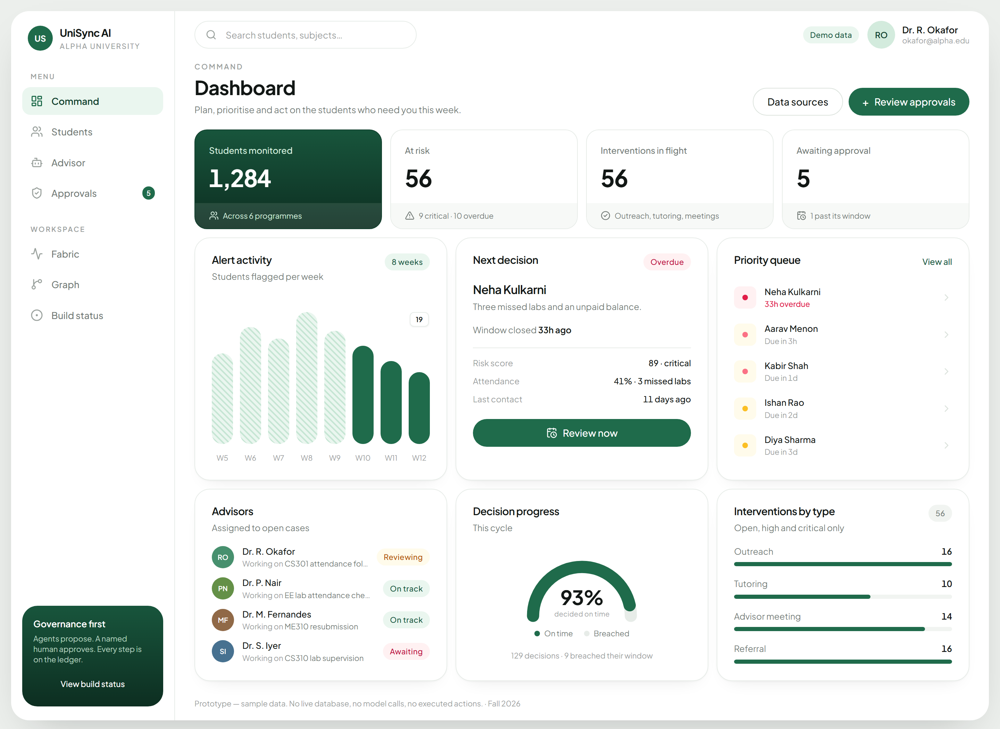
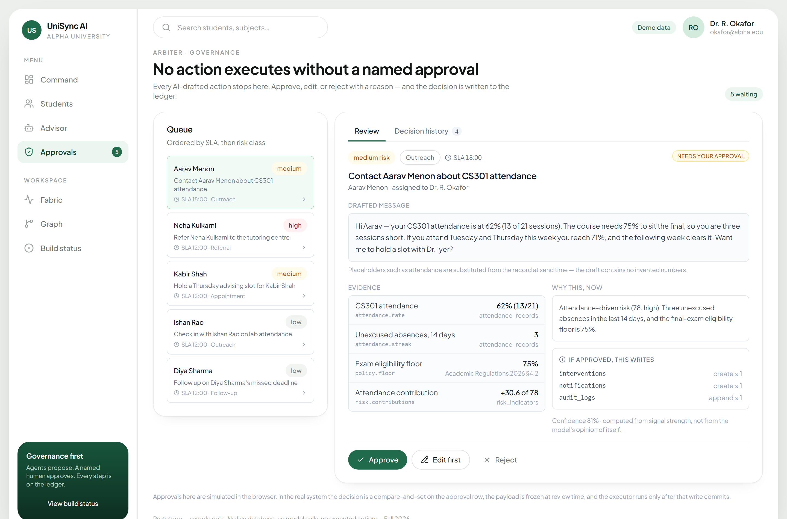

# UniSync AI

**Intelligent Academic Coordination & Personalized Student Support.**

Universities run ERP, LMS, attendance and examination systems in parallel. Students and advisors
reconstruct academic state by hand from four portals, and no single system is responsible for
noticing that a student is drifting until it is too late to intervene.

UniSync AI unifies those signals into one tenant-isolated record and puts a governance layer on top
of it: a deterministic risk score that an advisor can re-derive, a drafted next step that carries its
evidence, and a **named human approval** before anything is written.



---

## Design principles

Three constraints shaped the architecture. None of them are hardening to be added later — they are
the reason the system is shaped this way.

**1. Agents cannot write.** An agent may propose, explain and draft. Writes happen only through an
executor, and only after an approval row has been committed by a named user. Proposals come from a
fixed verb allow-list.

**2. Risk is deterministic.** The score is a pure function of stored features — weighted with
piecewise severity, with every contribution persisted. The same inputs produce the same number, and
the UI shows the arithmetic (`weight × severity`) so an advisor can check it rather than trust it. A
language model may narrate the result; it never produces the score.

**3. Isolation is enforced in the database.** Every tenant table carries a non-null `institution_id`,
references between tenant tables are composite foreign keys that include it, and row-level security is
both `ENABLE`d and `FORCE`d. Cross-tenant references are structurally impossible — not merely
rejected by application code.

> The custom GUC that carries the tenant context (`app.institution_id`) is **accident prevention, not
> a security boundary** — a session can `SET` it. The real boundaries are role grants, the absence of
> `BYPASSRLS`, column privileges, and token possession.

---

## Architecture

Four engines, deliberately separated:

| Engine | Responsibility |
|---|---|
| **Fabric** | Reads institutional data sources in place and composes one student record. Nothing is migrated; each source stays authoritative for its own data. |
| **Agent Graph** | Exposes relationships — enrolment, teaching, advising, interventions — as a view over the academic tables rather than a second copy. |
| **Cortex** | Orchestrates the reasoning workflows: grounded answers with citations, drafted interventions with evidence. |
| **Arbiter** | Holds every consequential action behind human approval, and records the decision. |

### Status

This repository is honest about what is built. See `docs/implementation-log.md` for decisions,
deviations and evidence.

| Area | State |
|---|---|
| Relational core — 17 tenant tables, RLS on all, 2 migrations | **Implemented & tested** (50 tests) |
| Row-level isolation, composite tenant keys, role separation | **Implemented & tested** |
| Web prototype — 7 screens over sample data | **Prototype** (does not read from the database) |
| Authentication, sessions, audit-ledger writer, executors | **Designed**, not implemented |
| Counselling module, degree planning, analytics agents | **Planned** |

There is **no LLM call in this codebase today**. `ALLOW_EXTERNAL_LLM` defaults to `false`, and the
advisor screen is a keyword-matched script that demonstrates the interaction pattern.

---

## Screens

| Dashboard | Arbiter governance |
|---|---|
|  |  |

`/` command dashboard · `/students/[id]` student intelligence · `/advisor` grounded conversation ·
`/approvals` approve, edit or reject · `/fabric` source health · `/graph` relationships ·
`/status` what is real and what is not.

Every screen carries a demo-data disclosure. Sample data is a seeded population of 1,284 students —
deterministic, so server and client render identically — and aggregate figures are computed from it
rather than typed into the markup.

---

## Getting started

### Prerequisites

- **Node.js ≥ 20** and **pnpm**
- **Python 3.11** — not 3.12+ (see the implementation log for why)
- **Docker Desktop**, or a local PostgreSQL 16 with the `pgvector` extension, plus Redis

### 1. Configure

```bash
cp .env.example .env
```

The two database URLs are load-bearing and must stay distinct:

| Variable | Role | Purpose |
|---|---|---|
| `MIGRATION_DATABASE_URL` | `unisync_owner` | Migrations. `BYPASSRLS`, owns the schema. |
| `DATABASE_URL` | `unisync_app` | Runtime. `NOBYPASSRLS`, owns nothing. |

The application refuses to boot if the runtime role is a superuser or has `BYPASSRLS`.

### 2. Infrastructure

```bash
docker compose up -d db redis
```

The bootstrap script (`docker/postgres/init/01-bootstrap.sh`) creates both roles, the `citext` and
`vector` extensions, and the `app` schema. It runs once, on an empty volume.

### 3. API

```bash
cd apps/api
python -m venv .venv
.venv/Scripts/activate           # Windows;  source .venv/bin/activate  on macOS/Linux
python -m pip install --upgrade pip
pip install -e ".[dev]"
```

Apply migrations as the owner, then serve:

```bash
.venv/Scripts/python -m alembic upgrade head
.venv/Scripts/python -m uvicorn app.main:app --reload --port 8000
```

- API → http://localhost:8000 · OpenAPI at `/docs`
- `/healthz` is **liveness only** and does not touch the database. There is deliberately no `/readyz`.

### 4. Web

```bash
pnpm install
pnpm run dev:web                 # http://localhost:3000
```

> **Windows note:** if `NODE_ENV=production` is set in your shell, `next dev` fails silently. Force
> `NODE_ENV=development` before running it.

---

## Commands

| Command | Purpose |
|---|---|
| `pnpm run dev:web` | Next.js dev server on `:3000` |
| `pnpm run build:web` | Production build |
| `pnpm run lint` | Ruff (API) + ESLint (web) |
| `pnpm run typecheck` | mypy (API) + `tsc --noEmit` (web) |
| `pnpm run test` | pytest — **requires the database to be up** |
| `pnpm run verify` | lint + typecheck + test |

The database-backed tests are not mocked: they connect as `unisync_app` and assert that tenant A
cannot read tenant B's rows, that the runtime role owns nothing, and that a malformed tenant context
fails closed. **Start the containers first or they will fail.**

CI runs lint, types and build on every push; the database-backed suite runs locally against a real
PostgreSQL because it needs the roles and RLS policies in place.

---

## Repository layout

```
apps/api/
  app/                 FastAPI service (config, db session, health)
  migrations/versions/ Alembic — 0001 tenancy foundation, 0002 academic core
  tests/               API + database suite (50 tests)
apps/web/
  app/                 Next.js routes
  components/          ui primitives, layout, dashboard, domain components
  lib/dataset/         seeded sample population
  lib/mock/            static sample records
docs/                  architecture, phase designs, implementation log
docker/                PostgreSQL init script (roles, extensions, schema)
```

### Documentation

| Document | Contents |
|---|---|
| [`docs/architecture-v2.md`](docs/architecture-v2.md) | Architecture source of truth |
| [`docs/phase-1.5-design.md`](docs/phase-1.5-design.md) | Auth, authorization, service layer, threat model |
| [`docs/phase-1.3-design.md`](docs/phase-1.3-design.md) | Academic core schema |
| [`docs/implementation-log.md`](docs/implementation-log.md) | Every phase, with evidence and corrections |

---

## Not built yet

Stated plainly so the repository cannot overstate itself:

- Authentication, sessions and credential rotation are **specified**, not implemented.
- The audit-ledger writer does not exist. Nothing claims otherwise.
- The executor services that perform approved writes do not exist — the Arbiter screen simulates the
  decision in browser memory and resets on reload.
- Counselling, degree planning and analytics agents are designed but unapproved.

Several decisions in `docs/phase-1.5-design.md` are still pending owner review; where a design depends
on an unapproved decision, the document says so.

---

## License

Course project — MIT Academy of Engineering, Software Prototyping 2026–2027. Not licensed for
redistribution.
