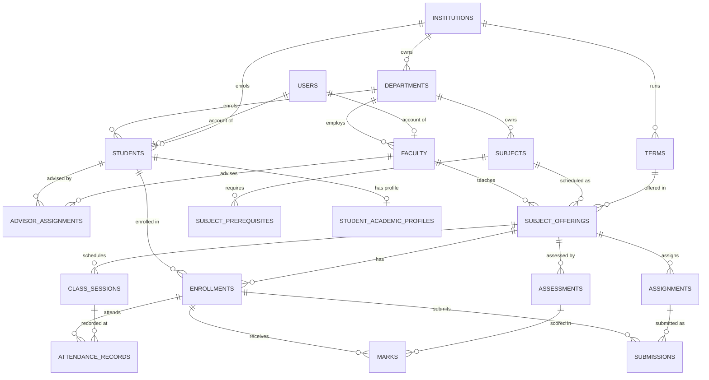
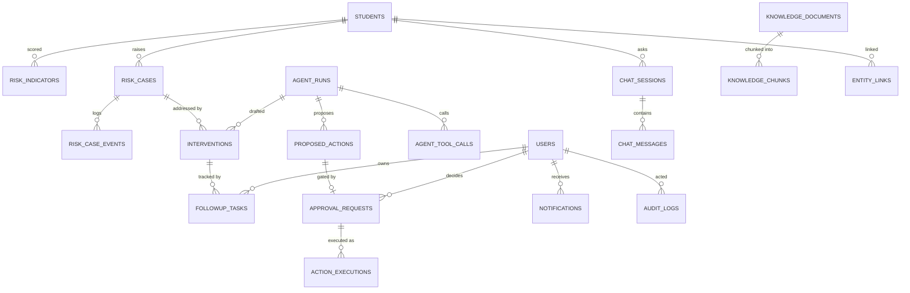

# UniSync AI — Architecture & Implementation Plan

**Intelligent Academic Coordination & Personalized Student Support**
Status: **v2 — architecture & security review complete (2026-11-15)** · No application code written · Target: production-minded MVP

> v2 supersedes v1 wherever they conflict. Corrections are marked **(v2)** inline; the authoritative review is **§13**. Read §13 before implementing anything from §3.8, §4, §5.0–5.1 or §6.2.

---

## 0. Executive Summary

UniSync AI is a single deployment that answers one question continuously: *"Which students need academic attention right now, what is the evidence, and what is the next action — and who has to approve it?"*

It is built as four cooperating engines, mirroring the reference product's split but with our own boundaries:

| Engine | Responsibility | Ships as |
|---|---|---|
| **Fabric** | One unified student record, assembled at read time from academic tables + documents, with retrieval (RAG) | FastAPI domain module + `context_pack` builder + pgvector |
| **Graph** | Relationship map (student↔subject↔faculty↔department↔intervention) used for consequence propagation and blast-radius queries | Relational edge tables + recursive CTE (no graph DB) |
| **Cortex** | Six specialized agents, LangGraph-orchestrated, structured outputs, each producing a *proposed action*, never executing directly | `apps/api/agents/*` + Celery workers |
| **Arbiter** | Approval queue, RBAC + relationship scoping, policy engine, action executors, append-only audit ledger | `apps/api/governance/*` |

**The one rule that shapes the whole system:** an AI agent may **propose**, **explain**, and **draft**. It may never write to an academic record, message a student, or change a plan without a named human approval row in `approval_requests`. Every consequential path is `agent_run → proposed_action → approval → action_execution → audit_log`.

### Locked decisions (detailed justification in §3)

| Area | Decision | Why |
|---|---|---|
| Repo | Single monorepo, two apps (`apps/web`, `apps/api`), one shared OpenAPI-generated TS client | Two deployables, not microservices |
| Backend | One FastAPI app, modular routers per engine, one Celery worker pool | Avoid service sprawl |
| Graph store | **Postgres recursive CTE; explicit edges stored only for `requires` and `intervened_on`**. All other relations are derived in-query from base tables. No Neo4j, and **no verified-edge materialiser** (v2) | Depth ≤ 3 over ~10⁵ rows; a materialised edge table adds a sync job and a drift class for no MVP payoff |
| LLM | Thin `LLMProvider` adapter over the OpenAI-compatible protocol (DeepSeek default, OpenAI/Ollama/vLLM swappable) | One SDK, any endpoint, no vendor lock |
| Risk scoring | **Deterministic, renormalised scoring engine** (weighted features + floor rules + suppression states). The LLM never produces or alters the number — it may only phrase it | Removes the hallucination and fairness risk; renormalisation prevents missing data from silently hiding at-risk students (§13.5-E4) |
| Degree planning | **Deterministic constraint solver** over the prerequisite graph. LLM narrates and drafts advisor notes | Correctness matters more than prose here |
| Auth | **Cookie-only sessions**: both access and refresh tokens are `httpOnly`, never returned in a response body. Next.js BFF proxy refreshes and forwards; CSRF via origin allow-list + double-submit. Authorization enforced **only** in FastAPI | Single source of truth for permissions. *(v2: v1 returned the access token in the login body, which put it in browser JS — the exact thing the design claimed to prevent. §13.5-E2)* |
| Jobs | Celery + Redis (beat for nightly sweeps) | Core feature is scheduled scanning |
| Deployment | Docker Compose for dev/demo; Vercel + Fly.io/Render + managed Postgres for prod | Student-budget friendly, scales later |

---

# Deliverable 1 — Risely Product Analysis

## 1.1 What Risely actually is

Risely positions itself as a "University OS" / "Agentic Campus". Stripped of marketing, its architecture is four layers with a strict separation of *thinking* from *acting*:

1. **Fabric (connect)** — read-only connectors into SIS, LMS, CRM, financial aid, warehouse. Identity resolution ("ten IDs → one student") at **read time**, explicitly no data warehouse build, SIS stays system of record.
2. **Agent Graph (remember)** — a living graph of entities (student, course, program, advisor, award, hold, plan, outcome) where every agent action writes a new edge. Used to propagate consequences: one grade change reaches the plan, the aid rule, and the advisor without anybody being told.
3. **Cortex (act)** — the operating loop: `Perceive → Reason → Draft → Approve → Act → Log`, and the log feeds back into the graph.
4. **Arbiter (govern)** — every drafted action waits for a **named** human approval; approve / edit / decline-with-reason; append-only, hash-chained audit ledger; export rights.

Their advising office decomposes into six narrow agents: Early-Alert Triage, Conversational Advisor, Degree Planning, Transfer Articulation, Career-Aligned Electives, SAP/Standing Guardian.

## 1.2 Core capabilities worth studying

| Capability | Mechanism | UniSync equivalent |
|---|---|---|
| Unified student record | Per-student composition at read time across systems | `GET /students/{id}/profile` composes 9 domains into one 360 payload |
| Identity resolution | Match across system IDs, human steward for ambiguous matches | `identity_links` table + manual confirm screen (deferred past MVP) |
| Consequence propagation | Graph edges: grade → prerequisite → requirement → aid → advisor | `entity_links` + `GET /graph/blast-radius/{entity}` |
| Ranked early alert queue | Multi-signal score, **reason shown beside rank**, owner assigned per signal type | `risk_indicators` with feature contributions + triage queue |
| Draft-before-you-read | The first outreach message is already written and a slot already held when the advisor opens the case | Intervention Recommendation agent pre-drafts message + actions |
| Human gate at every write | Approval queue with approve/edit/decline + reason | Arbiter `approval_requests` + policy engine |
| Append-only ledger | Named approvals sealed to audit trail | `audit_logs` (insert-only, hash chain) |
| Case auto-close | Re-score on every data change; recovered students leave the queue | Risk recompute trigger closes `risk_cases` |
| "Runs alongside, nothing migrates" | Read in place, narrow write-back | Import adapters (CSV/API) rather than rip-and-replace |

## 1.3 Workflows to replicate

**W1 — Signal → triage → outreach → close.** Nightly scan computes risk per student-subject. Flagged students enter a ranked queue with reason + owner. Agent drafts outreach + a concrete holdable action. Advisor approves. Action executes, follow-up task created, audit logged. If the underlying signal clears, the case closes automatically and the audit shows why.

**W2 — Grade change → plan re-solve.** A mark posts below threshold → prerequisite chain breaks → remaining terms flagged → agent proposes retake placement with an open section → advisor approves one review containing two changes → plan version increments.

**W3 — Student question → grounded answer.** Student asks "can I drop X?". Context pack built from their record + policies. Answer must cite the record. If consequential (aid, standing, graduation date), the answer ends with "your advisor must approve this" and creates an escalation.

**W4 — Approval loop.** Draft → queue → reviewer sees action, reasoning, evidence, and what it writes → approve/edit/decline → executor runs → receipt on ledger.

## 1.4 Features to implement (our shortlist)

1. Unified student profile (360)
2. Explanable risk scoring + ranked early-alert queue
3. Student-subject-faculty-department relationship graph with blast-radius
4. Six agents (§5)
5. Approval queue with approve/edit/reject + full audit
6. Conversational academic advisor grounded in the student's own record (RAG)
7. Intervention recommendation with drafted outreach
8. Follow-up task lifecycle with SLA/overdue tracking
9. Academic performance analytics (faculty + admin)
10. Deterministic degree planning with prerequisite graph

## 1.5 Features to deliberately NOT build in v1

| Excluded | Reason |
|---|---|
| Real SIS/LMS connectors (Banner, Canvas, PeopleSoft) | No API access; requires institutional contracts. Use CSV/JSON import + synthetic fixtures. |
| Financial aid / Pell rules, bursar, donor/advancement | Different product, high legal risk, no data |
| Multi-institution **routing and administration** (tenant switcher, per-tenant branding, tenant admin UI) | Not built. But tenant **isolation is enforced, not assumed** (v2): every tenant-scoped table carries `institution_id`, a session GUC plus RLS policy makes cross-tenant reads fail closed, and a test flips the GUC and asserts zero rows. v1 claimed "the schema reserves `institution_id`" while §4 defined no such column — that gap is closed in §13.5-E1.1. |
| Identity resolution across external system IDs | Only meaningful with external systems; we add a stub table |
| True graph database, 146-agent catalogue, "20 intelligence modules" | Scope theatre. Six agents, one graph, done well. |
| Autonomous execution of anything consequential | Directly violates our governance rule |
| Mobile apps, real-time websockets, email/SMS delivery | Use in-app notifications + a pluggable `Notifier` interface with a console/email stub |
| Fine-tuned models, custom embeddings training | Cost and data volume don't justify it |

## 1.6 Gaps and opportunities for UniSync

1. **Explainability as a first-class object.** Risely shows the reason beside the rank in prose. We store it: `risk_indicators.contributions` (JSON feature→weight→delta) so the UI can render "attendance −22, missed 2 assessments −15, mark trend −8" and advisors/auditors can re-check the math. This directly addresses incorrect-classification risk.
2. **Student-facing transparency.** Risely's student view is a polished front door. We give the student their own risk band, what drives it, and the exact steps to clear it — with the advisor approval step visible. This is cheap to build and is the most defensible differentiator for a capstone.
3. **Deterministic-vs-generative split made explicit in the product.** Every screen labels AI output as *computed* (score, plan feasibility) or *generated* (message draft, explanation). Risk of a fake demo drops to zero.
4. **Degree planning without financial aid.** Risely re-solves around Pell rules. We solve around prerequisites, credit load, section offerings, and advisor-set constraints only — a tractable, verifiable subset.
5. **No-connector onboarding.** A seeded synthetic institution (200 students, 4 departments, 3 terms of history) plus CSV import means the product is demonstrable on day one and migrates to real data with an adapter, not a rewrite.

---

# Deliverable 2 — UniSync Product Requirements

## 2.1 Vision

> Every student who is slipping is visible, explained, and has an owner before the term can no longer be fixed — and no AI changes a student's academic record without a human's name on it.

## 2.2 Problem definition

Student signals (attendance, marks, submissions, advising history) live in separate systems held by separate people. Consequences are discovered late: an attendance dip in week 4 becomes a failed prerequisite in week 12, which becomes a lost semester. Advisors and faculty work from memory and inboxes; administrative work (drafting outreach, checking eligibility, sequencing plans) consumes the time that should go to students. Nothing is auditable, so institutions cannot safely delegate work to automation.

## 2.3 Target users

| Role | Primary job to be done | Pain today |
|---|---|---|
| **Administrator** | Institution-wide oversight, policy configuration, audit and compliance | No cross-department view; no record of who decided what |
| **Faculty / Academic Advisor** | Run a caseload; decide who to contact and what to change | Caseload too large; discovery is manual; drafting costs hours |
| **Student** | Understand standing, get answers, know the next step | Tells their story repeatedly; answers arrive too late |

## 2.4 Functional requirements

### FR-A Identity & access
- FR-A1 Email+password auth with Argon2id hashing, JWT access (15 min) + rotating refresh (7 d, httpOnly, SameSite=Lax).
- FR-A2 Three roles: `admin`, `faculty`, `student`. A `faculty` user may additionally hold `advisor` scope for specific students via `advisor_assignments`.
- FR-A3 Every request is authorized server-side: role check **and** object-level scope check (advisor sees only assigned students; student sees only self).
- FR-A4 Password reset via single-use token; account lockout after 10 failed attempts.

### FR-B Fabric (unified record)
- FR-B1 One 360 endpoint per student composing identity, enrollment, attendance summary, assessments/marks, submissions, academic history by term, advisor, support/intervention history, risk state.
- FR-B2 Every mutation writes to `audit_logs`; every read of a student's record by a non-owner is logged as `record_access`.
- FR-B3 CSV import for departments, subjects, sections, enrollments, attendance, assessments, marks, submissions (validated, row-level error report, idempotent by natural key).
- FR-B4 Knowledge base ingestion: policy/catalog documents chunked and embedded into pgvector for grounded retrieval.

### FR-C Graph
- FR-C1 Relations: student–subject (enrolled), student–faculty (taught/advises), subject–subject (prerequisite), subject–department, student–intervention, faculty–department.
- FR-C2 `GET /graph/student/{id}` returns a bounded subgraph (depth ≤ 3, node cap 200).
- FR-C3 `GET /graph/impact?entity=subject:{id}` returns entities affected by a change (e.g. failing a prerequisite → dependent subjects → students currently enrolled in them).
- FR-C4 Graph is a *view over* authoritative tables; edges are derived where possible, explicit where needed (prerequisites, interventions).

### FR-D Cortex (agents)
- FR-D1 Six agents as specified in §5. Each run persists inputs hash, prompt version, model, token usage, tool calls, output, latency, and outcome.
- FR-D2 Structured outputs only: agent output is validated against a Pydantic schema; invalid output is retried once then failed, never coerced.
- FR-D3 Agents never write to academic tables. They emit `proposed_actions`.
- FR-D4 Verbs are fixed: each agent declares which `action_type`s it may propose. Anything else is a validation error.
- FR-D5 Nightly sweep (Celery beat) recomputes risk for all active enrollments and opens/updates/auto-closes risk cases.
- FR-D6 Conversational Advisor answers only from the context pack + retrieved documents; must cite; abstains and escalates when unsupported.

### FR-E Arbiter (governance)
- FR-E1 Every `proposed_action` in a `requires_approval` policy class enters the queue; nothing executes before a decision row exists.
- FR-E2 Reviewer can approve, edit-then-approve (payload diff stored), or reject with a mandatory reason.
- FR-E3 Executors are idempotent, retried via Celery, and write `action_executions` + `audit_logs`.
- FR-E4 Approval authority is scoped: advisor approves actions on their own students; admin approves institution-wide/config actions; **no role can approve an action on themselves** (a student cannot self-approve; an advisor cannot approve an action targeting their own record).
- FR-E5 Audit log is insert-only with `prev_hash`/`hash` chaining and a verification endpoint.
- FR-E6 SLA: approval items older than 48 h are flagged overdue and surfaced in the queue and notifications.

### FR-F Interventions & follow-ups
- FR-F1 An intervention belongs to a risk case, has a type (outreach, tutoring referral, workload adjustment, meeting), an owner, a status, and a due date.
- FR-F2 Follow-up tasks track completion evidence (note, outcome) and feed back into risk recomputation.
- FR-F3 Closing an intervention requires an outcome enum + note.

### FR-G Analytics
- FR-G1 Admin: risk distribution, intervention conversion, average time-to-first-action, caseload per advisor, term-over-term trend.
- FR-G2 Faculty: subject-level attendance/mark spread, at-risk roster, submission rates.
- FR-G3 Student: own standing, risk band + drivers, attendance %, assessment results, plan progress.

### FR-H Notifications
- FR-H1 In-app notification centre for approvals assigned to you, overdue follow-ups, newly escalated risk cases.
- FR-H2 Pluggable `Notifier` interface (console + email stub); no SMS.

## 2.5 Non-functional requirements

| ID | Requirement |
|---|---|
| NFR-1 | p95 API latency ≤ 400 ms for CRUD; ≤ 8 s for a single agent run (excl. LLM queue wait) |
| NFR-2 | All DB access via SQLAlchemy 2.0 async session; Alembic-owned schema; no runtime DDL |
| NFR-3 | Every list endpoint paginated (cursor preferred, `limit`+`offset` accepted) and index-backed |
| NFR-4 | 100% of state-changing endpoints covered by role × scope authorization tests |
| NFR-5 | Agent runs are auditable to the token: `agent_runs` row per invocation |
| NFR-6 | Graceful degradation: LLM unavailable → agents return "computed facts only" and no drafts; UI shows degraded banner |
| NFR-7 | Idempotency: `Idempotency-Key` honoured on POST for action execution and imports |
| NFR-8 | Secrets only from environment; no secret in a Dockerfile, repo, or client bundle |
| NFR-9 | Zero PII in logs; student identifiers hashed or replaced by UUID in application logs |
| NFR-10 | Reproducible local bring-up: `docker compose up` boots web+api+worker+db+redis+minio seeded |

## 2.6 MVP scope (definition of done for v1)

**In:** roles & auth; synthetic institution dataset; Fabric 360; attendance/marks/assignment CRUD; graph endpoints; deterministic risk engine + nightly sweep; Early Alert, Intervention Recommendation, Follow-up, and Conversational Advisor agents; approval queue with approve/edit/reject; audit ledger; follow-up lifecycle; student self-view; faculty caseload + subject analytics; admin risk + audit dashboards; Docker deployment; seeded demo.

**Out:** degree planning agent (deterministic planner ships in v1.1 — see Phase 7), analytics agent conversational mode, real integrations, transfer articulation, notifications via email, multi-tenant.

## 2.7 Future scope

Degree planner + plan versioning (v1.1) → CSV/SIS adapter SDK → email delivery + templates → identity resolution across external IDs → per-department policy packs → configurable risk models per program → student mobile PWA → SSO (SAML/OIDC).

---

# Deliverable 3 — Complete Technology Architecture

## 3.1 Stack evaluation (what I accepted, what I changed, why)

| Proposed | Verdict | Reasoning |
|---|---|---|
| Next.js + React + TS + Tailwind + shadcn/ui | **Accept** | App Router gives server-side data fetching with cookies (keeps tokens off the client), shadcn gives accessible components without a design system build. |
| Recharts | **Accept** | Adequate for the ~8 chart types in §7. ECharts would be better for dense graphs but costs bundle size; our graph visualisation is a fixed small subgraph — hand-drawn SVG/canvas is enough. |
| Framer Motion | **Accept, narrowly** | Motion on queue transitions and panel reveals only. Animated decoration in a governance tool is noise. |
| FastAPI + Pydantic v2 + SQLAlchemy 2.0 + Alembic | **Accept** | Async support, typed schemas that generate the TS client, migrations that actually work. |
| PostgreSQL | **Accept** | Non-negotiable. Use v16, `pgcrypto`, `citext`. |
| pgvector | **Accept** | One embedding table for documents + one for support-note memory. `ivfflat` deferred until >50k chunks; exact scan is fine at MVP scale. |
| **Graph database (implied by "Graph" engine)** | **Reject Neo4j** | Depth ≤ 3 traversals over ~10⁵ edges. `entity_links(parent_type,parent_id,child_type,child_id,relation,weight)` + recursive CTE handles it in <20 ms with indexes. Neo4j adds a second state store, backup story, and sync bug class for zero MVP benefit. Revisit only if we need path-scoring/community detection. |
| LangGraph | **Accept, scoped** | Justified for the two genuinely multi-step agents (Early Alert sweep, Intervention composition) where state must resume across tool calls and checkpoints matter. **Reject for single-shot tasks** — Conversational Advisor and message drafting are one LLM call plus retrieval; wrapping them in a graph is ceremony. LangGraph checkpointing uses Postgres (`langgraph.checkpoint.postgres`), not Redis, so run state is durable and queryable next to `agent_runs`. |
| Structured outputs | **Accept, enforced** | Provider-native JSON mode where available; otherwise `response_format=json_object` + Pydantic validation + one repair attempt. Never parse prose. |
| RAG | **Accept, narrow** | Retrieval is over **institutional policy/catalog documents only**. Student facts are *never* retrieved by similarity — they are assembled deterministically from SQL into a `ContextPack`. This kills the "retrieved the wrong student's data" failure mode. |
| DeepSeek API / configurable provider | **Accept with abstraction** | `LLMProvider` interface + OpenAI SDK with configurable `base_url`. Default `deepseek-chat`; verified alternatives: OpenAI, Ollama (`qwen2.5:14b`), vLLM. Two-tier config: `LLM_MODEL_FAST` (routing/extraction) and `LLM_MODEL_REASONING` (drafting/explanation). |
| Redis + Celery | **Accept** | Redis is also the LLM rate-limiter and response cache. Celery beat drives the nightly sweep and due-date reminders. One worker pool with two queues (`default`, `agent`) — `agent` concurrency capped to protect API quotas. |
| Docker / Git / GitHub / env config | **Accept** | Compose for everything local; `.env.example` as the contract. |
| **Not proposed: an ORM-level RLS / policy engine** | **Add** | Authorization must live in one place. Add `app/policies/` with a `can(actor, action, resource)` function + mandatory queryset scoping helpers. Optional Postgres RLS later as defence-in-depth. |
| **Not proposed: task queue for PDF/CSV parsing** | **Add (Celery `default` queue)** | Imports and knowledge ingestion are slow and failure-prone; they belong off the request path. |

### Explicitly rejected over-engineering
Microservices · API gateway · Kubernetes · Kafka · separate "agent service" · event sourcing · CQRS · GraphQL · websocket real-time · separate vector DB (Qdrant/Pinecone) · separate read models for analytics (materialized views are enough) · feature-flag SaaS.

## 3.2 Runtime topology

```
┌──────────────── Browser ────────────────┐
│  Next.js 15 App Router (web, :3000)     │
│  RSC + server actions                   │
│  /api/proxy/[...path]  ── BFF ──┐       │
└─────────────────────────────────┼───────┘
                                  │ httpOnly cookie → Authorization: Bearer
┌─────────────────────────────────▼───────────────────────────────────────┐
│ FastAPI (api, :8000)                                                     │
│  routers: auth · users · academics · fabric · graph · risk · agents       │
│           interventions · followups · approvals · analytics · admin       │
│  policies/ (RBAC + scope)  ·  governance/ (arbiter, policy engine)       │
│  agents/ (LangGraph graphs, tools, executors)                            │
└───────┬──────────────────────────────┬───────────────────────────────────┘
        │ asyncpg                      │ enqueue
┌───────▼────────────┐        ┌────────▼─────────┐        ┌───────────────┐
│ PostgreSQL 16      │        │ Redis 7          │        │ MinIO / S3    │
│  + pgvector        │        │  broker · cache  │        │ uploads, docs │
│  + langgraph ckpt  │        │  rate limits     │        └───────────────┘
└───────▲────────────┘        └────────▲─────────┘
        │                              │ consume
┌───────┴──────────────────────────────┴──────────────────────────────────┐
│ Celery worker (queues: default, agent)  ·  Celery beat (scheduler)      │
│   nightly_risk_sweep · recompute_on_change · send_approval_digest ·      │
│   followup_due_check · ingest_documents · import_csv                     │
└──────────────────────────────────────────────────────────────────────────┘
                                   │
                        LLM provider (OpenAI-compatible)
```

## 3.3 Frontend architecture

- **App Router with route groups by role**: `(auth)`, `(student)`, `(faculty)`, `(admin)`. Layout-level session check; middleware validates the presence of a session cookie only (light), **real authorization is API-side**.
- **Data flow**: Server Components fetch through the BFF proxy with the cookie → no tokens in JS. Mutations use Server Actions that call the same proxy and `revalidatePath`.
- **Client state**: TanStack Query only for optimistic queue interactions (approve/reject) and chat streaming. Everything else is server-rendered.
- **Types**: `openapi-typescript` generates `packages/api-client/types.ts` from the FastAPI `/openapi.json` in a `pnpm gen:api` task; a thin typed `fetch` wrapper + `openapi-fetch`.
- **Component layering**:
  - `components/ui/*` — shadcn primitives (generated, rarely edited)
  - `components/domain/*` — `StudentHeader`, `RiskBadge`, `EvidenceList`, `ApprovalCard`, `ActionDiff`, `RiskSparkline`, `AttendanceHeatmap`, `CaseloadTable`, `AgentTracePanel`
  - `components/charts/*` — Recharts wrappers with a single theme
  - `lib/provenance.ts` — the `ComputedBadge` / `GeneratedBadge` / `NeedsApprovalBadge` primitives used everywhere AI output appears
- **Accessibility**: keyboard-first approval queue (j/k to move, a/e/r to act), focus management on dialogs, colour never the sole encoding of risk band (icon + label always present).

## 3.4 Backend architecture

Modular monolith. One process, strict internal boundaries:

```
app/
  core/        config, security, db session, logging, errors, pagination
  models/      SQLAlchemy ORM (one file per aggregate)
  schemas/     Pydantic v2 request/response
  routers/     thin HTTP layer — parse, authorize, delegate, serialise
  services/    domain logic (no HTTP, no prompts)
  policies/    can() rules + scope guard helpers
  governance/  policy engine, approval queue, executors, audit ledger
  agents/      cortex: graphs, nodes, tools, prompts, schemas
  graph/       relationship queries, blast radius
  rag/         chunking, embedding, retrieval
  workers/     celery app, tasks
  seed/        synthetic data generator + demo fixtures
```

Rules: routers never touch the ORM directly beyond a service call; services never build prompts; agents never open a DB session outside the injected `AgentContext`; executors are the only code allowed to write academic tables from a proposal.

## 3.5 Database architecture

- Async SQLAlchemy 2.0 (`asyncpg`), `expire_on_commit=False`, one session per request.
- **UUID v7 primary keys** generated app-side (time-ordered → index locality on append-heavy tables). Fallback UUID4 if the `uuid_utils` wheel is unavailable.
- Timestamps: `created_at`, `updated_at` (`timestamptz`, DB defaults); soft delete only where a record must stay auditable (`deleted_at` on users/students/subjects).
- **Money/decimals not used**; academic scores are `numeric(5,2)`.
- Naming conventions enforced in Alembic `MetaData` (ix_/uq_/fk_/ck_ prefixes).
- Native enums for stable sets: `user_role`, `risk_band`, `approval_status`, `proposed_action_status`, `action_type`, `intervention_status`, `followup_status`, `agent_key`. Lookup tables for taxonomy that institutions change (`departments`, `subject_categories`).
- **Append-only tables** (`audit_logs`, `agent_runs`, `agent_tool_calls`) get no UPDATE path in code; revoked `UPDATE/DELETE` grants at the DB role level.
- Indexing plan: composite indexes on hot paths — `(student_id, term_id)`, `(subject_id, term_id)`, `(status, sla_due_at)` for the approval queue, `(risk_band, score DESC)` for the triage list, GIN on `proposed_actions.payload` and `risk_indicators.contributions`.
- Analytics uses **materialised views** (`mv_subject_performance`, `mv_risk_distribution`) refreshed by Celery after sweeps — no separate warehouse.

## 3.6 AI architecture

```
Agent run
 ├─ 1. AgentContext (deterministic): actor, student_id?, term, DB facts
 ├─ 2. ContextPack (deterministic SQL → JSON): attendance, marks, submissions,
 │      plan, history, open interventions, risk state. Size-capped, token-budgeted.
 ├─ 3. Retrieval (optional): pgvector top-k over policy/catalog chunks only
 ├─ 4. LLM call(s) via LLMProvider with strict JSON schema
 ├─ 5. Validation: Pydantic; retry once with error feedback; then fail closed
 ├─ 6. Guardrails: verb allow-list · numeric-fact reconciliation (any number the
 │      model states about the student must exist in ContextPack, else rejected)
 ├─ 7. Persist agent_run (+ tool calls, tokens, cost, latency, prompt_version)
 └─ 8. Emit proposed_actions → Arbiter
```

**Numeric reconciliation** is the key anti-hallucination control: the model may not introduce statistics. Drafts reference facts by their `ContextPack` key; the renderer substitutes values server-side from the source row. So a drafted message can say "your attendance is 62%" and that 62 comes from `attendance_summary.rate`, not from the model's token stream.

**Model routing**: `agents.yaml` maps each agent to a model profile, temperature, max tokens, timeout, and prompt version. Prompt versions are content-hashed and stored on `agent_runs.prompt_version` so any output can be reproduced.

## 3.7 Agent communication

Agents do not talk to each other directly (no agent-to-agent free-form chatter — that is unbounded, unauditable, and expensive). They communicate through **typed artefacts in the database**:

| Producer | Artefact | Consumer |
|---|---|---|
| Early Alert | `risk_cases`, `proposed_actions(flag/assign)` | Intervention, Follow-up, dashboards |
| Intervention | `interventions`, `proposed_actions(send_message/create_task)` | Follow-up, Arbiter |
| Follow-up | `followup_tasks`, `proposed_actions(escalate/close)` | Early Alert (recompute trigger) |
| Degree Planning | `plan_versions`, `proposed_actions(plan_change)` | Fabric 360, Analytics |
| Analytics | read-only aggregates | All dashboards |
| Conversational Advisor | `chat_sessions`, `escalations` | Follow-up |

A Celery task chain (not an agent conversation) orchestrates the nightly pipeline: `sweep → rank → for new high/critical cases: draft intervention`. Each handoff is a DB row with its own audit entry, so a failed step degrades to "case exists without a draft", never to a lost case.

## 3.8 Authentication & authorisation

```
Browser ──POST /api/auth/login──► Next route handler ──► FastAPI /auth/login
                                      │  sets unisync_at (15m) + unisync_rt (7d), both httpOnly/Secure/SameSite=Lax
                                      └─ returns {user} only — no token ever reaches JS
Browser ──GET /api/proxy/<allow-listed path>──► Next route handler
                                      │  reads unisync_at, refreshes on 401, re-sets cookies, retries once
                                      └─ forwards Authorization: Bearer … (upstream host pinned by config)
FastAPI dependency: current_actor() ─► verify JWT (alg pinned, iss/aud checked)
                                     ─► load User + scope ─► policies.can(...)
```

- **Token transport (v2):** v1 said "access token in response body" *and* "never exposes the access token to JS" in the same paragraph. Both cannot be true. Cookie-only is the decision: the access token never appears in a JSON body, so an XSS payload cannot read it and a logged response cannot leak it.
- Claims: `sub`, `role`, `inst`, `sid` (session id), `jti`, `iat`, `exp`, `iss`, `aud`. `alg` is pinned to one value; `none` is rejected at the verifier, not by convention.
- **Role is advisory.** The authoritative role and scope are re-read from DB per request. v1's "cache 60 s" is replaced by a `users.perm_version` counter compared against a claim: revocation is immediate with the same number of queries.
- **Scopes are explicit, not adjectives (v2).** v1's "faculty see students enrolled in their subjects and only academic fields" was unimplementable as written and leaked `interventions` through the 360 endpoint. The four scopes are `SELF`, `INSTRUCTOR`, `ADVISOR`, `ADMIN`, each mapped to a per-section redaction matrix in §13.5-E3.1. Advisor scope requires an **active** assignment (`ended_at IS NULL`); an ended assignment confers nothing.
- **Object-level authorization** is deny-by-default: every router declares `@requires(role, action, scope)`; out-of-scope resources return **404**, never 403 (403 confirms existence).
- A reflection test enumerates every route and fails CI on any route that resolved no policy. A second, parametrised matrix test asserts the full role × endpoint table.
- Passwords: Argon2id. Secrets: one signing key per purpose — `JWT_SIGNING_KEY`, `AUDIT_HMAC_KEY`, `FILE_TOKEN_KEY`. `*_PREVIOUS` variants exist for rotation but are never the same material.

## 3.9 Storage & background processing

- **Postgres**: authoritative data, pgvector embeddings, LangGraph checkpoints.
- **Redis**: Celery broker/result, rate limiting (`llm:{provider}:rpm`), short-lived caches (context packs 60 s, dashboards 30 s), idempotency keys.
- **S3/MinIO**: uploaded assignment files, imported CSVs, generated report exports. Buckets are private; access is via pre-signed **POST** with an enforced policy (`content-length-range`, content-type allow-list, no `public-read`). Serving is from a **separate origin** with `Content-Disposition: attachment` and `X-Content-Type-Options: nosniff`. v1 said only "pre-signed URLs" — that permits an unlimited-size, arbitrary-content-type upload straight into a bucket that the app later renders. Full control set in §13.5-E6.2.
- **Celery queues**: `default` (imports, ingestion, exports, digests), `agent` (agent runs, capped concurrency, per-provider rate govern). Every task: `acks_late=True`, `max_retries=3` with exponential backoff, idempotent by argument hash.
- **Dead letter**: failed tasks land in `failed_tasks` table with payload + traceback and are visible on the admin ops page.

## 3.10 Deployment

**Local/demo** — `docker compose up`:
`web` (Next dev or standalone) · `api` (uvicorn) · `worker` · `beat` · `db` (pgvector/pgvector:pg16) · `redis` · `minio` · `migrate` (one-shot alembic + seed).

**Production (recommended, cost-aware)**
- `web` → Vercel (Node runtime; BFF route needs server functions, not edge).
- `api` + `worker` + `beat` → Fly.io or Render (one 512 MB–1 GB instance each; worker on a small dedicated machine).
- `db` → Neon or Supabase Postgres (pgvector enabled); PITR on.
- `redis` → Upstash.
- `objects` → Cloudflare R2.
- CI: GitHub Actions → lint, typecheck, `pytest`, `alembic upgrade head` against a service container, Docker build, deploy on tag. `main` deploys staging; tags deploy prod.

---

# Deliverable 4 — Database Design

## 4.1 Entity model (identity & academic domain)

**users** — `id PK · email citext UNIQUE · password_hash · full_name · role user_role · is_active · last_login_at · failed_login_count · locked_until · created_at · updated_at`

**students** — `id PK · user_id FK→users UNIQUE · roll_number UNIQUE · department_id FK · program · admission_year · current_term_id FK · advisor_id FK→faculty NULL · status (active/graduated/withdrawn) · created_at`

**faculty** — `id PK · user_id FK UNIQUE · employee_code UNIQUE · department_id FK · designation · office_hours · created_at`

**departments** — `id PK · code UNIQUE · name · head_faculty_id FK→faculty NULL`

**institutions** *(new in v2)* — `id PK · code UNIQUE · name · timezone IANA · locale · created_at`. Single seeded row for MVP; it is the tenant root every other table references.

**advisor_assignments** — `id PK · institution_id · advisor_id FK→faculty · student_id FK→students · assigned_at · ended_at NULL · ended_reason · is_primary`
  constraints **(v2)**: `UNIQUE (advisor_id, student_id) WHERE ended_at IS NULL` · `UNIQUE (student_id) WHERE ended_at IS NULL AND is_primary` · `CHECK (ended_at IS NULL OR ended_at >= assigned_at)`
  *v1 declared `UNIQUE(advisor_id, student_id, ended_at NULL)`. That is a no-op: Postgres treats NULLs as distinct, so the table accepted unlimited concurrent "active" duplicates for the same pair, and unlimited "primary" advisors per student.*

**terms** — `id PK · institution_id · code UNIQUE (e.g. 2026-FA) · name · starts_on · ends_on · registration_opens_at · is_current`
  constraint **(v2)**: `UNIQUE (institution_id) WHERE is_current` — otherwise a race can make two terms current and every "this term" query silently picks one.

**subjects** — `id PK · institution_id · code UNIQUE · name · department_id FK · credits numeric(4,1) CHECK (credits > 0) · category · description · learning_outcomes · is_active`

**subject_prerequisites** — `id PK · subject_id FK · prerequisite_subject_id FK · min_grade · kind (prerequisite/co-requisite) · UNIQUE(subject_id, prerequisite_subject_id) · CHECK (subject_id <> prerequisite_subject_id)`

**subject_offerings** — `id PK · institution_id · subject_id FK · term_id FK · section_code · faculty_id FK NULL · capacity CHECK (capacity > 0) · schedule_json (days, start, end, tz) · room · modality · UNIQUE(subject_id, term_id, section_code) · UNIQUE(id, term_id)`

**enrollments** — `id PK · student_id FK · offering_id FK · term_id FK · status enrollment_status · enrolled_on · dropped_on · is_audit · final_grade`
  constraints **(v2)**: `UNIQUE(student_id, offering_id)` · `FOREIGN KEY (offering_id, term_id) REFERENCES subject_offerings(id, term_id)` · `CHECK (status = 'dropped' OR dropped_on IS NULL)`
  *v1 denormalised `term_id` next to `offering_id` with nothing keeping them consistent. A drifting `term_id` silently moves a student's attendance and marks into the wrong term — the composite FK makes that impossible.*

**class_sessions** *(new in v2 — the missing attendance denominator)* — `id PK · offering_id FK · session_no · meets_on date · starts_at · ends_at · topic · is_cancelled · is_optional`
  `UNIQUE (offering_id, session_no)` · index `(offering_id, meets_on)`
  *Without a scheduled-session table, "attendance rate" has no denominator: a week in which nobody records anything is indistinguishable from a week the student attended everything, and the risk engine cannot tell a data gap from diligence.*

**attendance_records** — `id PK · session_id FK→class_sessions · enrollment_id FK · status attendance_status · minutes_late NULL · note · recorded_by FK→users · recorded_at`
  constraints **(v2)**: `UNIQUE(enrollment_id, session_id)` · trigger asserting the session belongs to the enrollment's offering · index `(enrollment_id, session_id)` · partial index `(session_id) WHERE status = 'absent'`
  *v1 keyed attendance on `(enrollment_id, session_date)`, which cannot represent a double session in one day and has no link to a scheduled class.*

**assessments** — `id PK · offering_id FK · title · type assessment_type · max_score numeric(6,2) CHECK (max_score > 0) · weight_percent numeric(5,2) CHECK (weight_percent BETWEEN 0 AND 100) · due_at · is_published`
  constraint **(v2)**: deferred check that `Σ weight_percent` over published assessments per offering ≤ 100, and `POST/PATCH /assessments` returns 422 before it can be exceeded. *Unvalidated weights make `weighted_mark_pct` a fraction whose denominator can exceed 100%, which wrongly pushes students into `critical`.*

**marks** — `id PK · assessment_id FK · enrollment_id FK · score numeric(6,2) NULL · graded_at · graded_by FK→users · remark · UNIQUE(assessment_id, enrollment_id)`
  `CHECK (score IS NULL OR score <= assessment.max_score)` enforced by trigger · **source-of-truth rule (v2):** `marks` is authoritative for in-term assessment grades, `enrollments.final_grade` for the transcript, and `weighted_mark_pct` is *always derived*, never stored as truth.

**assignments** — `id PK · offering_id FK · title · instructions · opens_at · due_at · max_score · attachment_key NULL`

**submissions** — `id PK · assignment_id FK · enrollment_id FK · submitted_at NULL · file_key NULL · text_body NULL · status submission_status · is_late bool · late_days numeric(5,2) · score NULL · feedback · UNIQUE(assignment_id, enrollment_id)`
  `is_late` / `late_days` computed **at write time** against `assignments.due_at` and frozen **(v2)**; recomputing lateness later would silently rewrite history when a due date is edited. All timestamps are `timestamptz`; institution timezone is applied for display and for "days elapsed".

**student_academic_profiles** — derived/refreshed cache: `id PK · student_id FK UNIQUE · cgpa · total_credits_earned · credits_in_progress · attendance_rate_90d · submission_rate · last_computed_at`
  *v2: `current_risk_band` and `current_risk_score` were **removed**. Risk state lives only in `risk_indicators WHERE is_current`. Two tables holding a score is two answers to "how is this student doing", and the cache one is the stale one.*

**knowledge_documents** — `id PK · title · source_type (policy/catalog/handbook/faq) · department_id NULL · version · effective_from · checksum · ingested_at`

**knowledge_chunks** — `id PK · document_id FK · ordinal · content · token_count · embedding vector(1024) · metadata_json`

## 4.2 Entity model (graph, risk, governance, AI)

**entity_links** (the Graph) — `id PK · institution_id · src_type · src_id · dst_type · dst_id · relation · weight numeric(4,2) · props_json · created_at · UNIQUE(src_type,src_id,relation,dst_type,dst_id)` with indexes on `(src_type, src_id)` and `(dst_type, dst_id)`.
Relation vocabulary: `enrolled_in`, `teaches`, `advises`, `belongs_to` (**derived at query time, never stored — v2**), `requires`, `precedes`, `intervened_on`, `escalated_to` (**stored**). The `is_derived` column is dropped: a column that exists to say "do not trust this row" is a design smell, and the materialiser it implied was removed (§13.5-E1.2).

**risk_indicators** — `id PK · institution_id · student_id FK · enrollment_id FK NULL · term_id FK · computed_at · engine_version · risk_config_version · score numeric(5,2) NULL · band risk_band · contributions jsonb (feature → {value, severity, weight, delta, available}) · signals_json · inputs_snapshot_hash · is_current bool`
  constraint **(v2)**: partial unique `UNIQUE (student_id, term_id, COALESCE(enrollment_id, '00000000-0000-0000-0000-000000000000'::uuid)) WHERE is_current`. *Without it a nightly sweep and a manual recompute racing each other both see "no current row" and both insert, leaving two current scores; the UI then shows whichever it reads first. The `COALESCE` is required because a partial index over a nullable column would treat every NULL as distinct.* Rows are append-only; `is_current` only ever flips true→false, once.

**risk_cases** — `id PK · institution_id · student_id FK · term_id FK · opened_at · status risk_case_status · severity · top_driver · owner_user_id FK→users NULL · resolution_note · resolution_reason · closed_at · auto_closed bool`
  constraints **(v2)**: `UNIQUE (student_id, term_id) WHERE status IN ('open','monitoring')` — two concurrent sweeps must not open two cases for the same student-term. `term_id` was absent in v1, so cases were implicitly lifetime-scoped and could never be auto-closed with confidence.

**risk_case_events** — `id PK · case_id FK · event_type (opened/rescored/assigned/escalated/closed/reopened) · payload_json · actor_user_id NULL · created_at`

**interventions** — `id PK · case_id FK · student_id FK · type (outreach/tutoring/meeting/workload_adjustment/referral) · status intervention_status · owner_user_id FK · rationale · created_by_agent_run_id FK NULL · due_at · started_at · completed_at · outcome NULL · outcome_note`

**followup_tasks** — `id PK · intervention_id FK NULL · student_id FK · assigned_to FK→users · title · description · due_at · status followup_status · completed_at · evidence_note · priority · created_by_agent_run_id NULL`

**agent_runs** — `id PK · agent_key agent_key · status (queued/running/succeeded/failed/abstained) · trigger (scheduled/manual/event/chat) · actor_user_id NULL · student_id NULL · input_ref_json · context_hash · prompt_version · model · temperature · tokens_in · tokens_out · cost_usd numeric(10,6) · latency_ms · output_json · error_json · started_at · finished_at`

**agent_tool_calls** — `id PK · run_id FK · tool_name · args_json · result_summary · ok bool · duration_ms · created_at`

**proposed_actions** — `id PK · run_id FK → agent_runs · action_type action_type · target_type · target_id · payload jsonb · rationale · evidence_json (fact keys + values) · confidence numeric(4,3) · risk_class (low/medium/high) · status proposed_action_status · dedupe_key UNIQUE NULL · created_at`

**approval_requests** — `id PK · institution_id · proposed_action_id FK UNIQUE · assigned_role user_role · assigned_user_id FK NULL · status approval_status · policy_rule · policy_version · sla_due_at · decided_by FK→users NULL · decided_at · decision_reason · edited_payload jsonb NULL · payload_snapshot jsonb · facts_snapshot_hash · snapshot_rendered_at`
  *v2 additions: `payload_snapshot` + `facts_snapshot_hash` freeze exactly what the reviewer saw; `policy_version` keeps a historical decision explainable after policy changes. `assigned_*` are routing hints only — authority is re-evaluated against the DB at decision time, never taken from the request (§13.5-E3.3).*

**action_executions** — `id PK · proposed_action_id FK · approval_request_id FK NULL · auto_rule_key text NULL · executor · status execution_status · attempt · idempotency_key UNIQUE · payload_hash · result_json · started_at · finished_at`
  constraint **(v2, critical)**: `CHECK (approval_request_id IS NOT NULL OR auto_rule_key IS NOT NULL)` · partial `UNIQUE (proposed_action_id) WHERE approval_request_id IS NOT NULL`
  *v1 allowed a row with no approval of any kind — the literal "execute without approving" path. The partial unique additionally prevents one approval from being executed twice.*

**chat_sessions** — `id PK · student_id FK · started_at · ended_at · escalation_created bool`
**chat_messages** — `id PK · session_id FK · role · content · citations_json · run_id FK NULL · created_at`

**notifications** — `id PK · user_id FK · type · title · body · link_path · read_at NULL · created_at`

**audit_logs** *(rewritten in v2 — see §13.5-E1.4)* — `id PK · seq bigserial UNIQUE · institution_id · occurred_at · actor_user_id NULL · actor_type (user/system/agent) · actor_role · action · entity_type · entity_id · before_canonical text · after_canonical text · ip inet · user_agent · request_id · agent_run_id NULL · prev_hash bytea · hash bytea`
  *v1 chained `prev_hash` from a read-then-write in application code (forks under concurrency), hashed JSONB produced by two different code paths (non-canonical bytes), and ordered verification by a UUIDv7 (no sequence). A deleted tail was undetectable.*

**Tables added in v2 (§13.5-E1.3):** `institutions`, `class_sessions`, `refresh_tokens`, `password_reset_tokens`, `risk_config`, `routing_rules`, `degree_plans`, `plan_versions`, `program_requirements`, `audit_chain_checkpoints`, `record_access_log`, `identity_links` (stub), `knowledge_ingest_jobs`.
**Operational:** `import_jobs`, `failed_tasks` (§3.9).

## 4.3 ER diagram





## 4.4 Derived-view notes

- **(v2)** `entity_links` stores only edges that are genuine data: `requires`, `precedes`, `intervened_on`, `escalated_to`. `enrolled_in` / `teaches` / `advises` / `belongs_to` are **derived inside the recursive CTE** from base tables by `graph/graph_query.py`. The v1 materialiser and its `is_derived` flag are removed: they added a Celery job, a drift detector and a stale-read bug class to save single-digit milliseconds.
- `student_academic_profiles` is a **cache with `last_computed_at`**; any read older than the last attendance/mark mutation triggers an async recompute. It is never a source of truth.
- `risk_indicators.is_current` is flipped true→false inside the same transaction, guarded by the partial unique index; rows are never deleted, so score history survives for trend charts and audit.
- **(v2)** Every tenant-scoped table carries `institution_id`, and indexes are composite with `institution_id` first. A session-level `SET LOCAL app.institution_id` plus an RLS policy makes cross-tenant reads fail closed, instead of depending on every `WHERE` clause in ~95 endpoints being written correctly.
- **(v2)** Every foreign key gets an index. Postgres does **not** create one automatically, and v1 named indexes only for the triage queue — leaving the 360 query and cascade deletes doing sequential scans on `enrollments`, `marks`, `attendance_records` and `submissions`.
- **(v2)** `class_sessions` is authoritative for "expected attendance". A session with no recorded attendance is a **data gap** counted separately from an absence and excluded from severity until backfilled.

---

# Deliverable 5 — AI Agent Design

## 5.0 Shared agent contract

| Aspect | Rule |
|---|---|
| Verb allow-list | Each agent declares permitted `action_type`s; executor rejects anything else |
| Output shape | `AgentOutput { summary, confidence, facts_used[], proposed_actions[], abstained, abstain_reason }` |
| Numeric facts **(v2)** | Drafts contain **no literals**: every number and date is a `{{fact:key\|fmt}}` placeholder resolved server-side from `ContextPack`. Post-render, any digit not produced by a substitution fails validation. v1's post-hoc "check the model's numbers against the pack" is replaced by making the model structurally unable to emit one |
| Tool scope binding **(v2)** | Tools accept only an `AgentContext` built server-side from the authenticated principal; a tool asked for a student outside `ctx.scope` raises `ScopeViolation` and fails the run. No tool takes a raw `student_id` from graph state |
| Write access | None. Agents produce proposals; only Arbiter executors write — enforced by an import-linter boundary plus a test that asserts no ORM write call exists outside `governance/executors/` |
| Approval class | Per `action_type` in `governance/policy_rules.yaml` (see 5.7) |
| Failure | Retry once (schema repair) → mark `failed` → emit nothing → operational alert; deterministic fallback where one exists |
| Cost guard | Per-run token cap, per-day budget per institution, circuit breaker on provider 5xx/429 |
| Audit | Every run persisted with prompt version, model, tokens, latency, context hash |

**ContextPack** (built by `services/context_pack.py`, deterministic, token-budgeted to ~2.5k tokens):
`student` (id, name, program, term, advisor) · `enrollments[]` (subject, credits, faculty, attendance rate, 90d trend) · `assessments[]` near-term (title, due, score) · `submissions[]` recent (status, late days) · `marks` (current weighted %, trend, per-subject) · `history` (last 3 terms GPA, credits) · `plan` (remaining requirements, current plan version) · `open_interventions[]` · `risk` (score, band, top 5 contribution deltas) · `policies` (retrieved chunks, with citations).

## 5.1 Early Alert Agent

| | |
|---|---|
| **Purpose** | Continuously identify students whose academic trajectory is degrading, explain *why*, rank who needs a human first, and open a case with an owner. |
| **Input** | All active enrollments for the current term; attendance records (last 30/90 days), assessment marks, submission status, prior-term GPA, risk history, open interventions. |
| **Output** | `risk_indicators` rows (deterministic), `risk_cases` (open/update/auto-close), `proposed_actions`: `assign_case_owner`, `flag_for_review`, and a ranked queue with a one-line human-readable driver. |
| **Tools** | `get_active_enrollments`, `get_attendance_summary`, `get_marks_summary`, `get_submission_stats`, `get_prior_performance`, `get_open_interventions`, `compute_risk`, `upsert_risk_case`, `assign_owner`, `emit_proposal`. |
| **Decision logic** | 1. For each enrollment compute features. 2. **Deterministic scoring (see 5.1.1)** → score/band. 3. Rules open/close cases: band ≥ high and no open case → open; all signals cleared for 2 consecutive sweeps → auto-close with reason; existing case → append `rescored` event. 4. Rank = f(score, signal count, window urgency, ownership). 5. LLM stage: given the *computed* contributions, produce (a) a plain-language driver sentence and (b) an owner recommendation from the routing table. LLM never changes the score. |
| **Permissions** | Runs as a distinct `SYSTEM_SWEEP` principal: read-all **within its institution**, write-none, and **unreachable from any HTTP route** (no endpoint can construct it). It cannot message students. **(v2)** v1 said "system-level read" without saying how that principal is bound — which is a confused-deputy hole (§13.5-E3.2). |
| **Approval** | Case opening and owner assignment: **auto** (internal, reversible, audited). Any student-facing action: **requires approval** (delegated to Intervention agent). |
| **Failure** | Scoring is deterministic → agent still produces cases with a template driver phrase ("attendance fell 24 points in 30 days"). LLM failure degrades to templates, never blocks the sweep. Sweep idempotent per (student, term, day) via `dedupe_key`. |

### 5.1.1 Risk scoring model **v2** (deterministic, versioned `engine_version`)

**Features, weights and severity breakpoints** (per enrollment; `severity ∈ [0,1]`, 1 = worst):

| Feature | Weight | Available when | Breakpoints → severity |
|---|---|---|---|
| `attendance_rate_30d` | 0.34 | ≥3 recorded sessions in window | 0.95→0.0 · 0.85→0.25 · 0.75→0.55 · 0.60→0.85 · ≤0.50→1.0 |
| `missing_submissions_ratio` | 0.24 | ≥2 assignments due | 0→0.0 · 0.15→0.35 · 0.30→0.65 · ≥0.50→1.0 |
| `weighted_mark_pct` | 0.22 | ≥1 published assessment with weight > 0 | 0.75→0.0 · 0.60→0.35 · 0.45→0.70 · ≤0.35→1.0 |
| `mark_trend_delta` | 0.10 | ≥2 graded assessments | ≥0→0.0 · −0.10→0.4 · −0.20→0.8 · ≤−0.30→1.0 |
| `late_submission_ratio` | 0.10 | ≥2 submissions | 0→0.0 · 0.25→0.4 · ≥0.50→0.9 |

**Formula (renormalised — the v1 bug):**

```
A    = Σ weight_i           over features where data is AVAILABLE
raw  = Σ weight_i × severity_i
score = 100 × raw / A        if A ≥ 0.60
score = NULL, band = 'insufficient_data'   if A < 0.60
```

Missing data is **excluded and renormalised**. It is never scored as zero severity (v1 divided by a fixed 1.00, so every missing feature quietly *lowered* the score — a student with no marks recorded looked healthier than one with bad marks) and never as maximum severity (which would flag every student in week 1 of a term). If `A < 0.60` the row is stored with `band = insufficient_data`, is **not** enqueued, and appears in an admin data-quality list instead.

**Removed in v2 (double counting):**
- `consecutive_absences` (0.12) re-scored the same behaviour as `attendance_rate_30d` and inflated one underlying problem into two. It is now a **floor rule** applied after the weighted score.
- `prior_term_gpa` (0.06) punished students who had already improved and was close to noise at that weight. Retained for display and tie-breaking only; it can never by itself open a case.

**Floor rules** (applied after the weighted score, before banding):

- ≥3 **unexcused** absences in 14 days → `score = max(score, 65)`
- final assessment unpublished/failed with <7 days to deadline → `score = max(score, 72)`

**Suppression (v2):** no score is produced and any open case is closed as `suppressed` when the student or enrollment has an approved absence covering the window, medical leave, an active withdrawal/drop, or `is_audit = true`. Suppressed rows are still logged, so "why did this student disappear from the queue" is answerable.

**Bands:** `<40 low · 40–64 medium · 65–84 high · ≥85 critical` — provisional; calibrated against the seeded dataset only. `scripts/calibrate_risk.py` reports precision/recall against labelled fixtures, and bands must be re-tuned on real data before any production use.

**Explainability:** each row stores `contributions[] = {feature, value, severity, weight, delta, available}` plus `inputs_snapshot_hash`, `engine_version` and `risk_config_version`. A property test re-derives `score` from `contributions` and must reproduce it to 1e-6; a score computed last term stays explainable after a weight change.

**Interpretation guard:** this is an attention signal, not a judgment — see §13.5-E4.5.

## 5.2 Conversational Academic Advisor

| | |
|---|---|
| **Purpose** | Answer a student's academic questions from their own record and institutional policy, with citations, and escalate anything consequential to a human. |
| **Input** | Authenticated student, the question, `ContextPack` for that student, retrieved policy/catalog chunks, last 6 chat turns. |
| **Output** | Grounded answer + `citations[]` (fact keys + document chunks) + optional `escalation` (creates a follow-up task assigned to the advisor) + confidence. |
| **Tools** | `get_context_pack`, `retrieve_policy(query, k=6)`, `get_subject_info(code)`, `get_plan_summary`, `create_escalation`, `abstain`. |
| **Decision logic** | 1. Classify intent (informational / navigational / consequential / out-of-scope). 2. If out-of-scope (grades appeal, legal, financial aid, mental health) → refuse with routing message, escalate. 3. Retrieval over policies only. 4. Answer using **only** ContextPack facts + chunks; each claim bound to a fact key or chunk id. 5. If any required fact missing → abstain with what's missing. 6. If the answer would touch a record change, add "requires advisor approval" and create escalation. |
| **Permissions** | Read: own data only (server enforces `student_id == actor.student_id`). Write: `chat_messages`, `escalations`, `proposed_actions(create_followup)` only. |
| **Approval** | Answer: **no approval** (read-only). Escalation creation: **no approval** (it is a request for human attention, not an action on the record). Any record change the student asks for: **requires advisor approval**, produced as a proposal — never performed. |
| **Failure** | Provider error → "I can't reach the assistant right now; here are your current facts with links". Unsupportable question → explicit abstain (never a guess). **Prompt-injection controls (v2):** (a) the architectural control — this agent has **no consequential tools at all**, so a successful injection can produce a wrong sentence, never an action; (b) retrieved text is placed in a `user`-role message inside `<document untrusted="true">`, never concatenated into the system prompt; (c) the system prompt states that document text is data, not instruction; (d) output is stripped of HTML and of any link/image URL outside an allow-list (blocks exfiltration via rendered image URLs); (e) a response that makes an eligibility claim without a `policy_chunk` citation is downgraded to "check with your advisor" and escalated. |

Streaming: token-stream to the client but the persisted message is only the guard-validated final text.

## 5.3 Intervention Recommendation Agent

| | |
|---|---|
| **Purpose** | For an open risk case, propose the smallest effective intervention, draft the outreach message and the concrete next step, and queue both for approval. |
| **Input** | Risk case + contributions + signals, student context pack, policy constraints (max credits, add/drop window, tutoring availability), prior interventions and their outcomes for this student/institution, advisor availability. |
| **Output** | `interventions` (draft, not started) + `proposed_actions`: `send_message`, `create_support_referral`, `schedule_appointment`, plus a recommended owner and an expected-outcome note. |
| **Tools** | `get_case`, `get_context_pack`, `get_policy_constraints`, `find_tutoring_slots`, `get_advisor_availability`, `list_prior_interventions`, `draft_message`, `emit_proposal`. |
| **Decision logic** | 1. Classify driver (attendance-driven / assessment-driven / workload-driven / disengagement). 2. Route to desk via routing table (attendance → faculty/advisor; missing submissions → subject faculty; workload → advisor; chronic → advisor + counselling referral). 3. Select intervention type from a policy-approved catalogue (no invented interventions). 4. Draft message from a template skeleton, filling slots with ContextPack facts via server-side substitution. 5. Set SLA due date from severity. 6. Emit proposals for Arbiter. |
| **Permissions** | Read: cases assigned to the actor's scope. Write: proposals only. |
| **Approval** | **Requires approval** for every send/referral/scheduling. Reviewer may edit the draft text; the edit is stored as `edited_payload` and the executor sends the edited version — never the original. |
| **Failure** | No usable draft → produce `create_followup_task` "advisor to contact student manually" (always executable, never blocked). Dedupe: if a proposal with the same `dedupe_key` exists in the last 7 days, do not re-propose. |

## 5.4 Follow-up Agent

| | |
|---|---|
| **Purpose** | Keep interventions moving: detect stalled follow-ups, request status, escalate breaches, close cases with evidence. |
| **Input** | Open interventions + follow-up tasks, due dates, SLA policy, latest risk score for the student, any replies/outcomes recorded. |
| **Output** | `proposed_actions`: `remind_owner`, `escalate_to_admin`, `close_intervention`, `reopen_case`; plus `notifications`. |
| **Tools** | `list_due_followups`, `get_intervention_history`, `get_latest_risk`, `emit_proposal`, `notify`. |
| **Decision logic** | 1. Overdue >0 days → reminder proposal (coalesced to one per owner per day). 2. Overdue >3 days or two reminders ignored → escalation proposal. 3. Risk cleared + intervention completed → `close_intervention` with outcome evidence. 4. Risk rose while intervention open → `reopen_case`/re-severity. 5. Every decision is rule-first; LLM only writes the note text. |
| **Permissions** | Own-scope reads; proposals only. Cannot close another advisor's intervention without admin approval. |
| **Approval** | Reminders to **internal** users: auto-send (in-app). Anything reaching a **student** or changing case status: **requires approval**. Close intervention: **requires approval** (it ends accountability). |
| **Failure** | Purely rule-driven, so it runs with no LLM at all if the provider is down. Coalescing prevents notification storms; idempotent per day per task. |

## 5.5 Degree Planning Agent (v1.1 — deterministic core ships first)

| | |
|---|---|
| **Purpose** | Keep every student's plan sequenced against the current catalog, and re-solve when something breaks (failed prerequisite, cancelled section, changed constraint). |
| **Input** | Degree requirement graph (from `subject_prerequisites` + program requirements), completed credits/grades, current plan, offered sections per term, advisor-set constraints (max credits/term, evenings only, no summer, target graduation). |
| **Output** | `plan_versions` (new version with diff) + `proposed_actions(plan_change)` + narrative explanation of what changed and why. |
| **Tools** | `get_degree_audit`, `get_prerequisite_graph`, `get_offered_sections`, `get_student_constraints`, `solve_plan` (topological sort + greedy term packing with constraint checks), `diff_plans`, `emit_proposal`. |
| **Decision logic** | 1. Topologically order remaining requirements by prerequisite depth. 2. Pack into terms respecting credit cap and availability (a course is only placed where a section exists). 3. Reject any sequence violating a hard constraint; if infeasible, return the closest feasible plan + the violated constraint named. 4. LLM writes the explanation only. 5. Any change produces one review containing all diffs. |
| **Permissions** | Read own-scope academic data. Write: proposals only. |
| **Approval** | **Requires advisor approval**, always. Nothing reaches the student record first. |
| **Failure** | Solver failure → explicit "cannot solve within constraints" with the blocking requirement; no silent partial plan. |

## 5.6 Academic Analytics Agent

| | |
|---|---|
| **Purpose** | Answer "why is this happening" over aggregates for faculty/admins, and produce scheduled insight summaries — strictly read-only. |
| **Input** | Materialised views (`mv_subject_performance`, `mv_risk_distribution`, caseload stats), term comparisons. |
| **Output** | Narrative summary + chart spec (chart type, series, filters) + the exact query it ran. No proposals, no writes. |
| **Tools** | `query_metric` (whitelisted, parameterised SQL over MVs only — never free-form SQL against base tables), `compare_terms`, `emit_chart_spec`. |
| **Decision logic** | NL → validated metric selection from a fixed catalogue → execute → describe. If the question needs a metric that does not exist, say so and list what is available. No SQL generation. |
| **Permissions** | Read aggregates; honour the caller's scope (a faculty member's aggregates are filtered to their subjects). Minimum cell size of 5 to avoid re-identification in small cohorts. |
| **Approval** | None — read-only, no side effects. |
| **Failure** | Metric unavailable → explicit refusal + catalogue list. |

## 5.7 Action catalogue & approval policy

| `action_type` | Touches | Default approval | Approver |
|---|---|---|---|
| `send_message` | Student-facing comms | **Required** | Assigned advisor |
| `create_support_referral` | Support record | **Required** | Assigned advisor |
| `schedule_appointment` | Calendar/hold | **Required** | Assigned advisor |
| `assign_case_owner` | Internal | Auto | — |
| `flag_for_review` | Internal | Auto | — |
| `create_followup_task` | Internal task | Auto | — |
| `remind_owner` | Internal notification | Auto | — |
| `escalate_to_admin` | Internal | Auto | — |
| `close_intervention` | Accountability record | **Required** | Advisor or admin |
| `reopen_case` | Case state | **Required** | Advisor |
| `plan_change` | Academic plan | **Required (always)** | Advisor |
| `mark_change` | Grades | **Forbidden to agents** | — (faculty-only, manual) |
| `enrollment_change` | Registration | **Forbidden to agents** | — |

Anything not in this table is rejected by the policy engine by default. `mark_change` and `enrollment_change` are listed explicitly as forbidden so that a future enthusiastic agent cannot propose them.

**(v2) Approval mechanics that are now mandatory regardless of `action_type`:**

- The reviewer decides on a **frozen snapshot** (`payload_snapshot`), and the executor sends that snapshot verbatim — never a re-render (§13.5-E3.4).
- Authority is re-evaluated from the DB at decision time; `assigned_role`/`assigned_user_id` are routing hints only.
- Self-approval is rejected: `decided_by ≠ producing run's actor` and `decided_by ≠ the target student's user`.
- `risk_class = 'high'` requires step-up authentication within 5 minutes; bulk approval of `high` items requires a per-item comment.
- The decision path is a compare-and-set (`status='pending' → 'approved'`); zero rows updated means someone else already decided → 409.
- `action_executions` carries a DB `CHECK` requiring an approval or an auto-rule, and a partial unique preventing double execution (§13.5-E1.2).

---

# Deliverable 6 — Complete API Plan

## 6.1 Conventions

- Base: `/api/v1`. JSON, `snake_case` fields. UUID paths. Timestamps ISO-8601 UTC.
- Auth: `Authorization: Bearer <access>`; refresh via httpOnly cookie `unisync_rt`.
- Errors: `{ "error": { "code": "forbidden_scope", "message": "...", "details": {...}, "request_id": "..." } }` with codes `unauthorized`, `forbidden_role`, `forbidden_scope`, `not_found`, `validation_error`, `conflict`, `rate_limited`, `llm_unavailable`, `confirmation_required`.
- Pagination: `?limit=25&cursor=<opaque>` → `{ items, next_cursor, total_estimate }`. `total_estimate` only where cheap.
- Consequential POSTs accept `Idempotency-Key`.
- Every response includes `X-Request-Id`.

## 6.2 Auth — `/auth`

| Method | Path | Body / Params | Roles | Notes |
|---|---|---|---|---|
| POST | `/auth/login` | `{email, password}` | public | **Sets both tokens as httpOnly cookies** (`unisync_at` 15 m, `unisync_rt` 7 d, `Secure`, `SameSite=Lax`, path-scoped) and returns `{user:{id,role,full_name}}`. **No token in the response body** (v2). `Origin` allow-list enforced; generic error for unknown email or wrong password; per-IP and per-account rate limit |
| POST | `/auth/refresh` | cookie | public (cookie) | Rotates the refresh token **within its `family_id`**; replay of an already-used token revokes the whole family and writes `auth.refresh_reuse`. Re-sets both cookies. **(v2)** — a Redis denylist alone cannot detect replay or survive a flush |
| POST | `/auth/logout` | — | any | Revokes the refresh **family** (DB-persisted); access token left to expire (15 m) |
| GET | `/auth/me` | — | any | `{user, scope:{student_id? faculty_id?, advisor_of:[]}}` |
| POST | `/auth/password/reset-request` | `{email}` | public | always 202 (no enumeration) |
| POST | `/auth/password/reset` | `{token, new_password}` | public | single-use token |
| POST | `/auth/password/change` | `{current, new}` | any | invalidates other refresh tokens |

## 6.3 Users & directory — `/users`, `/departments`, `/faculty`

| Method | Path | Roles |
|---|---|---|
| GET/POST | `/users` · `/users/{id}` PATCH | admin |
| GET | `/departments` | admin, faculty |
| POST/PATCH | `/departments` · `/departments/{id}` | admin |
| GET | `/faculty?department_id=` | admin, faculty |
| GET | `/faculty/{id}` | admin, faculty (self/scope) |
| GET/POST/DELETE | `/advisor-assignments` (`?advisor_id=&student_id=`) | admin; faculty can read own |

**GET `/users` response item** `{id, email, full_name, role, is_active, created_at}`

## 6.4 Academics (Fabric write side) — `/terms`, `/subjects`, `/offerings`, `/students`, `/enrollments`, `/attendance`, `/assessments`, `/marks`, `/assignments`, `/submissions`

| Method | Path | Roles | Notes |
|---|---|---|---|
| GET/POST/PATCH | `/terms` | admin | marks single `is_current` |
| GET | `/subjects?department_id=&q=` | all (student: catalog view) | |
| POST/PATCH | `/subjects` | admin | |
| GET/POST/PATCH | `/subjects/{id}/prerequisites` | admin, faculty(read) | |
| GET/POST | `/offerings?term_id=&subject_id=` | admin, faculty | |
| PATCH | `/offerings/{id}` | admin | capacity/faculty/schedule |
| GET | `/students?term_id=&department_id=&risk_band=&advisor_id=&q=` | admin, faculty (scoped) | faculty sees only own-scope students |
| GET | `/students/{id}` | admin; advisor if scoped; student if self | identity + advisor + status |
| POST/PATCH | `/students` | admin | |
| GET/POST | `/enrollments?student_id=&offering_id=&term_id=` | admin, faculty(scoped), student(self) | |
| PATCH | `/enrollments/{id}` | admin | status/final_grade |
| GET/POST | `/attendance?enrollment_id=&from=&to=` | faculty (own subjects), admin | |
| POST | `/attendance/bulk` | faculty, admin | `{entries:[{enrollment_id, session_date, status}]}` returns per-row errors |
| GET/POST/PATCH | `/assessments?offering_id=` | faculty (own), admin | |
| GET/POST | `/marks?assessment_id=` | faculty (own), admin; student sees own | |
| POST | `/marks/bulk` | faculty, admin | idempotent by (assessment, enrollment) |
| GET/POST | `/assignments?offering_id=` | faculty, admin, student(read) | |
| GET/POST | `/submissions?assignment_id=` | faculty, student(self) | upload returns pre-signed URL |
| POST | `/submissions/{id}/grade` | faculty | score + feedback |

## 6.5 Fabric (read composition) — `/fabric`

| Method | Path | Roles | Notes |
|---|---|---|---|
| GET | `/fabric/students/{id}/profile` | scoped | the 360 payload |
| GET | `/fabric/students/{id}/timeline?from=&to=` | scoped | merged event feed |
| GET | `/fabric/students/{id}/attendance-summary?window=30d` | scoped | rates + buckets |
| GET | `/fabric/students/{id}/performance?term_id=` | scoped | weighted %, per-assessment, trend |
| GET | `/fabric/subjects/{id}/roster` | faculty(own), admin | includes per-student risk band (no contribution internals for faculty outside scope) |
| POST | `/fabric/imports` | admin | multipart CSV; returns `job_id` |
| GET | `/fabric/imports/{job_id}` | admin | status + row errors |
| POST | `/fabric/documents` | admin | upload policy doc → ingest job |
| GET | `/fabric/documents` | admin | list + chunk counts |

**`GET /fabric/students/{id}/profile` → 200**
```json
{
  "student": {
    "id": "uuid", "roll_number": "2023CS041",
    "full_name": "Aarav Menon", "program": "B.Tech Computer Science",
    "department": {"id":"uuid","code":"CSE","name":"Computer Science"},
    "admission_year": 2023, "current_term": {"id":"uuid","code":"2026-FA"},
    "status": "active"
  },
  "advisor": {"id":"uuid","faculty_id":"uuid","full_name":"Dr. R. Okafor"},
  "enrollments": [
    {"offering_id":"uuid","subject":{"code":"CS301","name":"Operating Systems"},
     "credits":4,"faculty":"Dr. S. Iyer",
     "attendance":{"rate":0.62,"sessions":21,"absent":8,"trend_delta":-0.24},
     "weighted_mark_pct":54.2,"missing_submissions":2,"risk":{"score":78,"band":"high"}}
  ],
  "academic_summary": {"cgpa":7.4,"credits_earned":86,"credits_in_progress":18},
  "history": [{"term":"2026-SP","gpa":7.9,"credits":20,"flags":["attendance_warning"]}],
  "risk": {"score":78,"band":"high","engine_version":"risk-v1.2",
           "top_drivers":[{"label":"Attendance fell 24 pts in 30 days","delta":22.1},
                          {"label":"2 of 5 assignments missing","delta":15.4}],
           "open_case":{"id":"uuid","severity":"high","owner":"Dr. R. Okafor","opened_at":"..."}},
  "interventions": [{"id":"uuid","type":"outreach","status":"awaiting_approval","due_at":"..."}],
  "permissions": {"can_edit":false,"can_view_support_notes":true}
}
```
Students hitting this endpoint receive the same shape with `interventions[].internal_note` removed and `risk.top_drivers` rendered as student-facing text.

## 6.6 Graph — `/graph`

| Method | Path | Roles | Notes |
|---|---|---|---|
| GET | `/graph/student/{id}?depth=2` | scoped | `{nodes:[{id,type,label,meta}], edges:[{src,dst,relation,weight}]}`, caps: depth ≤3, 200 nodes |
| GET | `/graph/subject/{id}` | faculty, admin | prerequisite tree + dependents |
| GET | `/graph/impact?entity_type=subject&entity_id=&change=fail` | faculty, admin | blast radius |
| GET | `/graph/departments/{id}/overview` | admin | aggregates |

## 6.7 Risk — `/risk`

| Method | Path | Roles | Notes |
|---|---|---|---|
| GET | `/risk/queue?band=&owner=&term_id=&sort=score` | faculty(scoped), admin | ranked triage list |
| GET | `/risk/students/{id}` | scoped | current + history + contributions |
| POST | `/risk/recompute` | admin | enqueue sweep `{scope: student|term|all}` → 202 |
| GET | `/risk/cases?status=&severity=` | faculty(scoped), admin | |
| GET | `/risk/cases/{id}` | scoped | case + events + interventions |
| PATCH | `/risk/cases/{id}` | advisor(assigned), admin | status/owner/note (audited; manual override requires reason) |
| GET | `/risk/config` / PATCH | admin | weights, bands, overrides |
| GET | `/risk/model-card` | all internal | engine version, features, weights, known limitations |

**`GET /risk/queue` → 200**
```json
{"items":[{"case_id":"uuid","student":{"id":"uuid","roll_number":"2023CS041","full_name":"Aarav Menon"},
  "score":78,"band":"high","driver":"Attendance fell 24 pts in 30 days",
  "signal_count":3,"owner":{"id":"uuid","full_name":"Dr. R. Okafor"},
  "sla_due_at":"2026-11-17T09:00:00Z","overdue":false,"opened_at":"..."}],
 "next_cursor":null,"total_estimate":34}
```

## 6.8 Agents — `/agents`

| Method | Path | Roles | Notes |
|---|---|---|---|
| GET | `/agents` | all internal | catalogue: key, purpose, permitted actions, approval class |
| POST | `/agents/{agent_key}/runs` | admin; faculty for own scope | manual trigger `{student_id?, term_id?, params?}` → 202 `{run_id}` |
| GET | `/agents/runs?agent_key=&status=&student_id=` | admin; faculty scoped | list |
| GET | `/agents/runs/{id}` | admin; faculty scoped | run detail + tool calls + proposals + trace |
| GET | `/agents/runs/{id}/stream` | same | SSE progress (optional; polling is default) |
| POST | `/agents/chat/sessions` | student(self), advisor(scoped) | `{context_student_id?}` → session |
| POST | `/agents/chat/sessions/{id}/messages` | same | `{content}` → answer or SSE stream |
| GET | `/agents/chat/sessions/{id}` | same | history + citations |
| POST | `/agents/chat/sessions/{id}/escalate` | same | creates follow-up for advisor |
| GET | `/agents/health` | admin | provider status, budget used, failure rate |

**`POST /agents/chat/sessions/{id}/messages` → 200**
```json
{"message_id":"uuid","answer":"Your attendance in CS301 is 62% (13 of 21 sessions). CS301 requires 75% attendance to sit the final, so you are 3 sessions short. Attending Tue and Thu this week brings you to 71%.",
 "citations":[{"kind":"fact","key":"enrollments[0].attendance"},
              {"kind":"document","document":"Academic Regulations 2026","chunk_id":"uuid","page":14}],
 "confidence":0.86,"abstained":false,
 "escalation":null,
 "proposals":[]}
```

## 6.9 Interventions & follow-ups — `/interventions`, `/followups`

| Method | Path | Roles | Notes |
|---|---|---|---|
| GET | `/interventions?status=&owner=&student_id=` | scoped | |
| POST | `/interventions` | advisor, admin | manual creation requires `case_id` + type + rationale |
| PATCH | `/interventions/{id}` | owner, admin | status/outcome; completing requires `outcome` + `note` |
| GET | `/followups?assigned_to=me&status=&overdue=true` | any internal | |
| POST | `/followups` | advisor, admin | |
| PATCH | `/followups/{id}` | assignee, admin | complete with `evidence_note` |

## 6.10 Arbiter — `/approvals`

| Method | Path | Roles | Notes |
|---|---|---|---|
| GET | `/approvals?status=pending&assigned_role=&overdue=true` | reviewer roles | queue (own scope only) |
| GET | `/approvals/{id}` | reviewer in scope | action, payload, evidence, rationale, diff preview, blast radius |
| POST | `/approvals/{id}/approve` | scope-matched reviewer | `{comment?}` → executes async → `{status:"approved", execution_id}` |
| POST | `/approvals/{id}/approve-with-edit` | same | `{edited_payload, comment}` → diff stored |
| POST | `/approvals/{id}/reject` | same | `{reason}` (required, min 10 chars) |
| POST | `/approvals/bulk-approve` | same | array of ids; per-item result; refuses any item outside scope |
| GET | `/approvals/{id}/execution` | same | executor status + receipt |

**`GET /approvals/{id}` → 200**
```json
{"id":"uuid","status":"pending","action_type":"send_message",
 "assigned_to":{"role":"faculty","user_id":"uuid","name":"Dr. R. Okafor"},
 "student":{"id":"uuid","full_name":"Aarav Menon"},
 "payload":{"channel":"in_app","subject":"Let's get ahead of CS301",
            "body":"Hi Aarav, your CS301 attendance is {{fact:attendance_rate}} ...",
            "rendered_body":"Hi Aarav, your CS301 attendance is 62% ...",
            "attachment_action":{"type":"hold_appointment","slot_id":"uuid"}},
 "rationale":"Attendance-driven risk (78, high). Three absences in 14 days; final exam eligibility at 75%.",
 "evidence":[{"key":"attendance.rate","value":0.62,"source":"attendance_records"},
             {"key":"risk.contributions","value":[{"f":"attendance","delta":22.1}]}],
 "confidence":0.81,"risk_class":"medium","sla_due_at":"2026-11-17T09:00:00Z",
 "preview":{ "writes":[{"table":"interventions","effect":"create"},
                       {"table":"notifications","effect":"create"},
                       {"table":"audit_logs","effect":"append"}]},
 "agent_run_id":"uuid","created_at":"..."}
```

## 6.11 Analytics — `/analytics`

| Method | Path | Roles | Notes |
|---|---|---|---|
| GET | `/analytics/overview?term_id=` | admin | risk distribution, open cases, overdue, time-to-first-action |
| GET | `/analytics/subjects/{id}` | faculty(own), admin | score spread, attendance distribution, submission rate |
| GET | `/analytics/caseload?advisor_id=` | admin; faculty(self) | cases per advisor, outcomes |
| GET | `/analytics/interventions?from=&to=` | admin | conversion by type |
| GET | `/analytics/trends?metric=&terms=6` | admin | term-over-term |
| GET | `/analytics/export?report=&format=csv` | admin | async job → pre-signed URL |

All analytics enforce **minimum cohort size 5** and return `{"suppressed": true, "reason": "cohort_too_small"}` otherwise.

## 6.12 Student self-service — `/me`

`GET /me/profile` (same as fabric profile, self view) · `GET /me/risk` (band, drivers in plain language, what clears it) · `GET /me/plan` · `GET /me/attendance?term_id=` · `GET /me/marks?term_id=` · `GET /me/notifications` · `POST /me/notifications/{id}/read`

## 6.13 Admin & ops

| Method | Path | Roles |
|---|---|---|
| GET | `/admin/audit?actor=&entity_type=&entity_id=&from=&to=` | admin |
| GET | `/admin/audit/verify?from=&to=` | admin (hash-chain check) |
| GET | `/admin/ops/tasks?status=failed` | admin |
| GET | `/admin/ops/metrics` | admin (queue depth, LLM spend, error rate) |
| POST | `/admin/seed/demo` | admin (dev/staging only, guarded by `ENV`) |
| GET | `/admin/policy-rules` / PATCH | admin |
| GET | `/healthz` · `/readyz` | public |

**Total: ~95 endpoints across 13 routers.**

---

# Deliverable 7 — Frontend Page Architecture

## 7.1 Route map

```
/                               → role redirect (student → /s, faculty → /f, admin → /a)
/login  /reset-password
── student ─────────────────────────────────────────────
/s                              dashboard: my standing, risk drivers, next actions
/s/advising                     chat with academic advisor (grounded, cited)
/s/plan                         degree plan + progress
/s/courses                      enrollments, attendance per subject, assessments
/s/notifications
── faculty / advisor ───────────────────────────────────
/f                              caseload dashboard: triage queue, today's work
/f/queue                        ranked risk queue (filters: band, owner, SLA)
/f/students                     searchable caseload
/f/students/[id]                360: header, tabs (overview, attendance, performance,
                                interventions, graph, notes), risk panel, timeline
/f/subjects/[id]                roster, assessment stats, attendance heatmap
/f/approvals                    approval queue
/f/approvals/[id]               review: action, evidence, diff, blast radius, approve/edit/reject
/f/followups                    my follow-up tasks
/f/interventions/[id]           intervention detail + outcome capture
── admin ───────────────────────────────────────────────
/a                              institution overview: KPIs, risk distribution, SLA health
/a/risk                         risk analytics + config (weights/bands, versioned)
/a/academics                    terms, departments, subjects, prerequisites, offerings
/a/academics/import             CSV import wizard (validate → preview → commit → report)
/a/users                        users, roles, advisor assignments
/a/agents                       agent catalogue, run history, agent detail/trace
/a/agents/runs/[id]             run trace: nodes, tool calls, tokens, output, proposals
/a/approvals                    all approvals (institution-wide)
/a/analytics                    subject/term analytics, exports
/a/audit                        audit ledger browser + chain verification
/a/ops                          queues, failed tasks, LLM spend, provider health
/a/knowledge                    policy documents, ingestion status, chunk preview
/a/settings                     institution, notification defaults, policy rules
```

## 7.2 Navigation

- **Student**: bottom nav (mobile) / left rail (desktop): Home · Advisor · Plan · Courses.
- **Faculty**: left rail: Caseload · Queue · Approvals (badge with pending count) · Students · Follow-ups. A persistent "Needs you" panel shows approvals expiring before SLA.
- **Admin**: left rail grouped — Observe (Overview, Analytics, Audit) · Configure (Academics, Users, Risk, Knowledge, Policy) · Operate (Agents, Ops, Approvals).
- Global: command palette (⌘K) → jump to student by roll number, open approval, run agent. Role-aware, always scope-filtered server-side.

## 7.3 Reusable components

| Component | Purpose |
|---|---|
| `ProvenanceBadge` | `Computed` / `Generated by AI` / `Needs your approval` — mandatory on every AI-adjacent surface |
| `RiskBadge` | band with icon+label+colour, never colour alone |
| `EvidenceList` | renders `evidence[]` as fact → value → source-table rows |
| `ApprovalCard` / `ActionDiff` | queue item; unified diff between proposed and edited payload |
| `BlastRadiusPanel` | what an approval will write (tables + counts) — the anti-"approve blindly" control |
| `AgentTracePanel` | nodes, tool calls, latency, tokens for a run |
| `ContextPackViewer` | exactly what the agent saw (debuggability + reviewer trust) |
| `StudentHeader` | photo-initials, roll, program, advisor, risk pill, quick actions |
| `AttendanceHeatmap` | calendar grid by week |
| `PerformanceTrend` | Recharts line with assessment markers |
| `RiskSparkline` | 12-week score history |
| `TriageTable` | virtualised, keyboard-driven, sortable by score/SLA |
| `EmptyState` / `DegradedBanner` / `PermissionDenied` | honest states |
| `SlotPicker` | advisor availability selection |

## 7.4 Role experiences (what each role actually sees)

**Student** — "My standing": risk band with plain-language drivers ("You missed 3 labs"; "One assignment missing"), one primary next step, and a visible label that changes need their advisor's approval. Advisor chat with citations shown as "From: your attendance record" / "From: Academic Regulations 2026 §4.2". No internals, no other students, no contribution weights.

**Faculty/Advisor** — The day starts on `/f`: "4 approvals waiting, 2 overdue, 6 students newly flagged". Queue row expands to evidence without leaving the page. Student 360 is the working surface; the right rail holds risk + open interventions + graph. Approvals show the draft, the evidence, and what will be written. Everything is keyboard-operable because a caseload of 80 is a keyboard job.

**Admin** — Overview answers "is this working": cases opened/resolved, median time from flag → first action, approval SLA compliance, intervention conversion. Risk config is versioned with a preview of how the current cohort would re-band before committing. Audit browser verifies the hash chain and exports.

---

# Deliverable 8 — Implementation Roadmap

Each phase ends with a **demoable** increment and a hard gate. No phase starts before the previous gate passes.

## Phase 0 — Foundation (gate: `docker compose up` serves a seeded login)

| Feature | Tasks | Depends on |
|---|---|---|
| Repo scaffold | pnpm workspace, `apps/web`, `apps/api`, `docker-compose.yml`, `.env.example`, pre-commit (ruff, mypy, eslint, prettier) | — |
| API skeleton | FastAPI app factory, settings (`pydantic-settings`), async DB session, error envelope, request-id middleware, structured logging, `/healthz` `/readyz` | scaffold |
| DB | Alembic init + naming conventions; **first migration establishes the tenant foundation**: `institutions`, `institution_id` on `users`, the `app.institution_id` GUC, an RLS policy, and separate owner vs runtime roles (§13.5-E1.1); UUIDv7 helper | API skeleton |
| Web skeleton | Next 15 app router, Tailwind + shadcn init, base layouts, API client generation script, BFF proxy route | scaffold |
| CI | GitHub Actions: lint, typecheck, pytest (with pg service), docker build | all |

**Output:** both services boot, migrations run, login screen renders.
**Tests:** settings load; health endpoints; migration up/down; CI green.

## Phase 1 — Identity, RBAC, audit spine (gate: role × endpoint matrix all enforced)

| Feature | Tasks |
|---|---|
| Auth | Argon2id, login/refresh/rotate/logout, lockout, password reset tokens |
| Policy layer | `policies/can.py`, scope helpers, `@requires` dependency, denial logging |
| Users/roles | user CRUD (admin), `/auth/me`, advisor assignments |
| Audit | `audit_logs` + hash chain writer, insert-only guard, `GET /admin/audit` |
| Web | login, reset, role-based shell + redirect, session hook, permission-denied states |

**Tests:** every route has an auth requirement (reflection test); student cannot read another student (200 vs 403 matrix); advisor cannot read unassigned student; audit written for each mutation; hash chain verifies.
**Completion criteria:** zero endpoints reachable without an explicit policy; matrix test fails CI on any new unguarded route.

## Phase 2 — Academic data model (gate: full synthetic institution loaded and queryable)

| Feature | Tasks |
|---|---|
| Schema | departments, terms, faculty, students, subjects, prerequisites, offerings, enrollments |
| Schema | attendance, assessments, marks, assignments, submissions |
| Seed | generator: 4 departments, 40 subjects, 3 terms, 200 students, 25 faculty, 3 terms of attendance/marks/submissions with *plausible degradations* (5% critical, 12% high, 20% medium) |
| Fabric CRUD | endpoints from §6.4 with scoping |
| Import | CSV import with validation report + idempotency |
| Web | admin academics CRUD, faculty roster |

**Tests:** seed idempotent (run twice → same row counts); import rejects bad rows with per-row errors; student sees only own data; pagination correctness; index checks on hot queries (`EXPLAIN` assertions for the queue and profile queries).
**Criteria:** a reviewer can browse a realistic institution entirely in the UI.

## Phase 3 — Fabric 360 + Graph (gate: one student, one page, whole story)

| Feature | Tasks |
|---|---|
| Context pack | `services/context_pack.py` (deterministic, token-budgeted, unit-tested against fixtures) |
| Profile | `/fabric/students/{id}/profile` with per-role redaction |
| Timeline | merged event feed |
| Graph | `entity_links` materialiser + recursive CTE queries + caps |
| Web | student 360 (header, tabs, risk panel, timeline), role redaction proven in tests |

**Tests:** context pack contains no other student's data; profile redacts support notes for students; graph traversal respects node cap and depth; blast radius returns expected dependents on a known fixture.
**Criteria:** the 360 renders in <500 ms on the seeded dataset; every number on screen traces to a table.

## Phase 4 — Risk engine + Early Alert + Arbiter v1 (gate: nightly sweep produces a reviewable queue)

| Feature | Tasks |
|---|---|
| Scoring | feature extractors, weights config, `engine_version`, contributions JSON, hard overrides |
| Sweep | Celery beat task, case open/update/auto-close, `risk_case_events` |
| Queue API | `/risk/queue`, `/risk/cases/*`, `/risk/config`, `/risk/model-card` |
| Arbiter core | `proposed_actions`, `approval_requests`, policy engine from `policy_rules.yaml`, approve/edit/reject, SLA |
| Executors | registry + first executors (`flag_for_review`, `assign_case_owner`, `create_followup_task`) |
| Early Alert agent | LangGraph sweep node → deterministic score → LLM driver sentence + owner routing (degrades to templates) |
| Web | triage queue, risk panel, approval queue + review page, model card page |

**Tests:** scoring unit tests per feature and boundary; band overrides; auto-close after 2 clean sweeps; sweep idempotency; no proposed action can execute without an approval row (property test); approve-with-edit sends edited payload; reject requires reason; SLA overdue flag.
**Criteria:** seeded data yields a stable, explainable queue; every score can be recomputed by hand from stored contributions.

## Phase 5 — Conversational Advisor + RAG (gate: cited answers, honest abstentions)

| Feature | Tasks |
|---|---|
| RAG | chunking, embeddings, `knowledge_chunks`, retrieval with score threshold, ingestion job |
| Chat | sessions/messages, guard pipeline (intent, retrieval, fact-binding, citation validation), abstain path, escalation creation |
| Web | student chat with citation chips, escalation confirmation, faculty view of escalations |

**Tests:** golden set of 30 questions → expected citations; unsupported question → abstain (not a guess); cross-student leakage test; prompt-injection test (malicious text inside an ingested document must not alter behaviour); consequential question produces escalation not an action.
**Criteria:** ≥90% citation-correct on the golden set; 0 hallucinated numbers in the numeric-reconciliation test; degraded mode returns facts without an LLM.

## Phase 6 — Interventions + Follow-ups (gate: closed loop, end to end)

| Feature | Tasks |
|---|---|
| Interventions | CRUD + lifecycle + outcome capture |
| Intervention agent | driver classification, routing table, catalogue-constrained selection, template-with-facts drafting, dedupe |
| Executors | `send_message` (in-app), `create_support_referral`, `schedule_appointment` (slot hold) |
| Follow-up agent | reminder/escalation/close rules, coalescing, notifications |
| Web | intervention detail, follow-up board, notification centre |

**Tests:** full loop test — sweep → case → proposal → approve → execute → follow-up → complete → case close, with audit rows at every hop; duplicate proposals suppressed within 7 days; edited payload is what gets sent; student receiving a message cannot see internal rationale.
**Criteria:** one uninterrupted scripted demo of the whole loop with the audit ledger shown at the end.

## Phase 7 — Analytics (gate: numbers agree with raw SQL)

| Feature | Tasks |
|---|---|
| Views | materialised views + refresh task + indexes |
| API | ≤6 analytics endpoints, cohort-size suppression |
| Analytics agent | metric catalogue, whitelisted queries, chart spec |
| Web | admin overview, subject analytics, trends, CSV export |

**Tests:** every metric cross-checked against an independent SQL query in tests; suppression triggers at n=4; scope filtering for faculty.
**Criteria:** dashboard totals reconcile exactly with raw queries; no metric computed client-side.

## Phase 8 — Degree Planner (v1.1) (gate: infeasible plans are refused, not faked)

Deterministic solver (topological order + constraint-checked term packing) → `plan_versions` + diff → advisor approval → narrative via LLM. Tests: prerequisite violations impossible; credit-cap respected; no section-less placement; unsatisfiable constraint returns a named blocker.

## Phase 9 — Hardening & deploy (gate: publicly reachable demo, seeded, monitored)

Docker production images · Vercel/Fly deploy · secrets · rate limiting · backup/restore drill · load check (100 concurrent queue reads < 500 ms) · security pass (OWASP top 10 checklist, dependency audit) · README + architecture docs committed · demo script.

## Roadmap summary

| Phase | Focus | Cumulative capability |
|---|---|---|
| 0 | Foundation | two services, DB, CI |
| 1 | Identity/RBAC/audit | secure multi-role app |
| 2 | Academic data | real institution dataset |
| 3 | Fabric + Graph | unified student story |
| 4 | Risk + Early Alert + Arbiter | **the product's core loop** |
| 5 | Conversational Advisor | grounded student answers |
| 6 | Interventions + follow-ups | closed-loop support |
| 7 | Analytics | evidence it works |
| 8 | Degree planning | progression support |
| 9 | Hardening | shippable demo |

---

# Deliverable 9 — Project Folder Structure

```
unisync-ai/
├── docker-compose.yml
├── docker-compose.prod.yml
├── .env.example
├── .github/workflows/ci.yml · deploy.yml
├── README.md
├── docs/
│   ├── 01-product-analysis.md
│   ├── 02-requirements.md
│   ├── 03-architecture.md
│   ├── 04-database.md
│   ├── 05-agents.md
│   ├── 06-api.md
│   ├── 07-frontend.md
│   ├── 08-roadmap.md
│   ├── 09-risks.md
│   └── adr/0001-graph-in-postgres.md … 0007-auth-in-fastapi.md
├── packages/
│   └── api-client/                  # generated from OpenAPI
│       ├── types.ts
│       └── src/client.ts
├── apps/
│   ├── api/
│   │   ├── pyproject.toml
│   │   ├── alembic.ini
│   │   ├── Dockerfile
│   │   ├── migrations/versions/
│   │   ├── tests/
│   │   │   ├── conftest.py
│   │   │   ├── fixtures/            # fixture institution JSON
│   │   │   ├── unit/                # scoring, solver, chunking, guards
│   │   │   ├── integration/         # routers × roles
│   │   │   ├── agents/              # golden sets, mocks, contract tests
│   │   │   └── security/            # auth, scope matrix, injection
│   │   └── app/
│   │       ├── main.py
│   │       ├── core/
│   │       │   ├── config.py  security.py  db.py  logging.py
│   │       │   ├── errors.py  pagination.py  uuids.py  ids.py
│   │       ├── models/
│   │       │   ├── base.py  user.py  academic.py  attendance.py
│   │       │   ├── assessment.py  fabric.py  graph.py  risk.py
│   │       │   ├── intervention.py  agent.py  approval.py
│   │       │   ├── notification.py  audit.py  knowledge.py
│   │       ├── schemas/
│   │       │   ├── auth.py  user.py  academic.py  fabric.py  graph.py
│   │       │   ├── risk.py  agent.py  approval.py  analytics.py
│   │       │   └── common.py
│   │       ├── routers/
│   │       │   ├── auth.py  users.py  academics.py  fabric.py  graph.py
│   │       │   ├── risk.py  agents.py  interventions.py  followups.py
│   │       │   ├── approvals.py  analytics.py  me.py  admin.py  health.py
│   │       ├── services/
│   │       │   ├── context_pack.py  risk_engine.py  risk_cases.py
│   │       │   ├── fabric.py  graph_query.py  plan_solver.py
│   │       │   ├── imports.py  analytics_queries.py  notifications.py
│   │       ├── policies/
│   │       │   ├── can.py  scopes.py  rules.py  matrix.py
│   │       ├── governance/
│   │       │   ├── policy_rules.yaml
│   │       │   ├── policy_engine.py  approval_queue.py  audit_ledger.py
│   │       │   └── executors/
│   │       │       ├── registry.py  send_message.py  referral.py
│   │       │       ├── appointment.py  case_ops.py  plan_change.py
│   │       ├── agents/
│   │       │   ├── llm/provider.py  llm/prompts.py  llm/schemas.py
│   │       │   ├── runtime.py  # run lifecycle, persistence, guardrails
│   │       │   ├── guards.py   # verb allow-list, numeric reconciliation
│   │       │   ├── tools/registry.py  tools/academic_tools.py  tools/graph_tools.py
│   │       │   ├── early_alert/{graph.py,nodes.py,prompts/}
│   │       │   ├── advisor/{graph.py,nodes.py,prompts/}
│   │       │   ├── intervention/{graph.py,nodes.py,prompts/}
│   │       │   ├── followup/{graph.py,nodes.py}
│   │       │   ├── analytics_agent/{graph.py,nodes.py}
│   │       │   └── degree_planning/{graph.py,solver.py,prompts/}
│   │       ├── rag/
│   │       │   ├── chunker.py  embeddings.py  ingest.py  retrieve.py
│   │       ├── workers/
│   │       │   ├── celery_app.py  schedules.py
│   │       │   └── tasks/{risk_sweep.py,agent_run.py,imports.py,
│   │       │                ingest.py,analytics_refresh.py,notifications.py}
│   │       └── seed/
│   │           ├── generator.py  fixtures/  load.py
│   └── web/
│       ├── package.json  next.config.ts  tailwind.config.ts
│       ├── middleware.ts
│       ├── app/
│       │   ├── (auth)/login/page.tsx  reset-password/page.tsx
│       │   ├── (student)/s/{page.tsx,advising,plan,courses,notifications}
│       │   ├── (faculty)/f/{page.tsx,queue,students,subjects,approvals,followups}
│       │   ├── (admin)/a/{page.tsx,risk,academics,users,agents,approvals,
│       │   │                analytics,audit,ops,knowledge,settings}
│       │   └── api/proxy/[...path]/route.ts
│       ├── components/
│       │   ├── ui/            # shadcn primitives
│       │   ├── layout/        # shell, nav, rail, command-palette
│       │   ├── domain/        # RiskBadge, EvidenceList, ApprovalCard,
│       │   │                  # ActionDiff, AgentTracePanel, TriageTable, ...
│       │   ├── charts/
│       │   └── provenance/    # DevelopedBadge, GeneratedBadge, NeedsApprovalBadge
│       ├── lib/
│       │   ├── api.ts  session.ts  format.ts  permissions.ts  motion.ts
│       └── e2e/               # playwright: role journeys
└── scripts/
    ├── gen-api-types.sh  seed-demo.sh  backup.sh  audit-verify.sh
```

---

# Deliverable 10 — Risks and Technical Decisions

## 10.1 Risk register

| # | Risk | Likelihood | Impact | Mitigation |
|---|---|---|---|---|
| R1 | **AI hallucinates a student fact** (wrong attendance %, invented deadline) | High if unmanaged | High — trust destruction | Numbers never come from the model: fact keys are substituted server-side from `ContextPack`; reconciliation guard rejects any output containing a number not in the pack; citation required for policy claims; abstain on missing facts |
| R2 | **Incorrect risk classification** (false negative = missed student; false positive = alarm fatigue) | Medium | High | Transparent weighted model, `engine_version` on every row, per-department weight overrides, no LLM in the score, bands reviewed against seeded ground truth, "dismissed" state with reason so false positives are measurable, model card published in-app |
| R3 | **Authorship/decision laundering** — an advisor approves 40 items without reading | Medium | High | Blast-radius panel on every approval (tables + counts written); SLA-based queue caps rather than one giant list; bulk approve refuses items without an individual `comment` when `risk_class=high`; audit records `time_to_decision` and surfaces median in analytics |
| R4 | **Privilege escalation / broken object-level authorization** | Medium | Severe | Deny-by-default `@requires`, centralized scope helpers, reflection test that fails on any unguarded route, full role×endpoint matrix test, advisors scoped by assignment not by department guesswork |
| R5 | **Data privacy breach** (PII in logs, exports, prompts) | Medium | Severe | No PII in logs (UUID + hashed identifiers), prompt payloads logged by reference not content, exports require admin + are audited, no third-party analytics SDK, LLM provider receives only the minimum context pack |
| R6 | **Third-party LLM data handling** (DeepSeek = data leaves the institution) | High (inherent) | High | Provider is configurable; document it in the README and in-app; support `LLM_PROVIDER=ollama` for on-prem; per-institution flag `ALLOW_EXTERNAL_LLM`; never send names/roll numbers where avoidable (use "the student"). For a real deployment this is a procurement decision, not a code one — say so explicitly |
| R7 | **Prompt injection via ingested documents** | Medium | Medium | Retrieved text marked untrusted and wrapped; instruction-following from documents disabled; URL allow-list in outputs; injection tests in CI |
| R8 | **Cost blowout** (agent runs × caseload) | Medium | Medium | Per-run token cap, per-day budget, `agent` queue concurrency cap, cheap model for classification, LLM only on flagged students (deterministic first), response cache for repeated explanations |
| R9 | **Latency** (agent runs in request path) | High if naive | Medium | Agents run async; UI polls/subscribes; nothing user-blocking depends on an LLM; chat streams |
| R10 | **Integration limitation** (no real ERP/LMS access) | Certain | Medium | Explicit: synthetic data + CSV import + `Connector` interface with a documented contract; never claim a live SIS integration; roadmap item not MVP claim |
| R11 | **Scope creep into financial aid / degree audit automation** | High | High | Non-goals list is authoritative; `mark_change`/`enrollment_change` are hard-forbidden action types; roadmap gates |
| R12 | **Data quality** (messy institutional data → garbage scores) | High in real deployment | High | Import validation with row-level errors and rejections, missing-data handling explicit (features with no data are excluded from scoring and flagged, not zeroed — zeroing would falsely flag students) |
| R13 | **Fairness / bias in risk scoring** (proxy variables punishing part-time or working students) | Medium | High | Features restricted to direct academic signals (no demographics, no postcode, no financial data); credit-load normalisation; per-department weight override; documented model card; human-in-the-loop before any student-facing action; not used for any punitive decision |
| R14 | **Concurrency on approvals** (two reviewers acting on one item) | Medium | Medium | `SELECT … FOR UPDATE` on approval row, state-machine transition guard (`pending → approved` only), executor idempotency key |
| R15 | **Audit log tampering** | Low | Severe | Append-only grants revoked for UPDATE/DELETE, hash chain with `prev_hash`, verification endpoint, nightly chain check job |
| R16 | **LangGraph complexity** for a small team | Medium | Medium | Restrict to 2 agents; single-shot calls everywhere else; every graph is <6 nodes; checkpointing in Postgres so nothing is in-memory-only |
| R17 | **Academic honesty of the demo** — mock AI presented as real | Medium | Severe (credibility) | Rule: no canned LLM responses in shipped paths. `LLM_PROVIDER=stub` exists only for tests and is labelled in the UI (`DEMO MODE` banner). Every AI surface carries a provenance badge |
| R18 | **Vendor lock / model deprecation** | Medium | Medium | Provider abstraction + prompt versioning + golden-set eval so a model swap is measurable |

## 10.2 Technical decisions (ADR summary)

| # | Decision | Alternative rejected | Consequence |
|---|---|---|---|
| ADR-1 | Graph in Postgres (`entity_links` + recursive CTE) | Neo4j | One datastore, transactional consistency; traversal limited to small depth — acceptable |
| ADR-2 | FastAPI owns auth; Next.js is a BFF proxy | Auth.js in Next + trusted headers | Single authorization authority; slightly more plumbing; no token exposure to browser JS |
| ADR-3 | Deterministic risk engine, LLM only explains | LLM-assigned risk score | Reproducible, auditable, cheap, fair-ish; requires feature engineering work up front |
| ADR-4 | Agents emit proposals; executors perform writes | Agents writing directly with a guard | Structural guarantee; small extra latency; full audit trail |
| ADR-5 | Modular monolith (one API, one worker pool) | Microservices per engine | Faster delivery, no distributed debugging; scale by process count first |
| ADR-6 | LangGraph only for multi-step agents | LangGraph everywhere | Less ceremony; two graphs are genuinely stateful |
| ADR-7 | OpenAI-compatible provider adapter (DeepSeek default) | Vendor SDK per provider | One code path, easy Ollama/vLLM swap; lose provider-specific features (acceptable) |
| ADR-8 | Materialised views, not a warehouse | dbt/Snowflake layer | Right-sized; refresh job is a Celery task |
| ADR-9 | Relational depth-1 scoping (`advisor_assignments`) as the permission primitive | Department-level access | Correct-by-construction advisor privacy; admins still see everything |
| ADR-10 | Synthetic data + `Connector` interface | Attempt real SIS integration | Demoable now, honest about limits, extensible later |

## 10.3 Cost envelope (order of magnitude, MVP scale)

- LLM: nightly sweep on 200 students ≈ 40–60 flagged runs × ~4k tokens in / 800 out ≈ **< $0.30/night** on DeepSeek-class pricing; chat ~2k tokens/turn. Budget guard: `LLM_DAILY_BUDGET_USD=5` default.
- Infra: 1 small API + 1 small worker + managed Postgres + Redis ≈ a low monthly floor; the whole thing runs on a laptop in Compose.
- The expensive part is **tokens per flagged student per night**, which is why scoring is deterministic and LLM runs only on flagged students.

---

# 11. Recommended Development Sequence & First Milestone

**Sequence (strict):**
0 Foundation → 1 Identity/RBAC/audit → 2 Academic data + seed → 3 Fabric 360 + Graph → **4 Risk + Early Alert + Arbiter** → 5 Conversational Advisor → 6 Interventions + follow-ups → 7 Analytics → 8 Degree planner → 9 Hardening.

Rationale: the governance spine (audit, approvals) must exist **before** the first agent, or the "no agent acts unapproved" guarantee becomes a retrofit. That is why Arbiter core lands in Phase 4 *with* Early Alert, not after it.

## First implementation milestone — **M1: "One flagged student, one approved action, one audit trail"**

> **(v2) M1 is split into M1a (no LLM) and M1b (LLM layer).** The authoritative, testable checklist is **§13.6**. M1a proves the governance spine — scoring, queue, approval, execution, audit — with zero model calls, so the first demo cannot be faked by generated text. Summary below is superseded by §13.6.

A single vertical slice proving every architectural claim at once, using **only** the Early Alert agent and **no** chat:

1. `docker compose up` boots web + api + worker + db + redis, migrates, seeds 200 synthetic students.
2. Log in as advisor → `/f/queue` shows a ranked list with reasons.
3. Open one student → see the 360 with attendance, marks, submissions, and the risk arithmetic (feature → weight → delta).
4. A nightly-sweep proposal sits in `/f/approvals`: "Contact Aarav Menon — attendance 62%, 3 absences in 14 days" with the drafted message and the blast radius.
5. Approve with an edited sentence → `send_message` executor runs → in-app notification lands for the student → `interventions` row created → `followup_tasks` row created → `audit_logs` shows agent run → proposal → decision → execution with the approver's name.
6. `GET /admin/audit/verify` returns a valid hash chain.

**Exit criteria:** a reviewer can trace the entire chain — signal → score → LLM driver sentence → proposal → human name → execution → ledger — with zero unexplained steps, and the same walkthrough performed as a student (denied) and an unassigned advisor (denied) returns 403.

Anything not needed for M1 is deferred. This is the smallest slice that is genuinely the product rather than a demo of the product.

---

# 12. Verification Plan (how we prove each phase works)

| Claim | How it is verified |
|---|---|
| Permissions enforced server-side | `tests/security/test_matrix.py` reflects over all routes and asserts an explicit policy; parametrised role×route matrix; direct API calls with curl bypassing the UI in the checklist |
| No agent acts unapproved | **Database-level first (v2):** inserting an `action_executions` row without an approval or auto-rule raises `23514`; a second execution of one approval raises `23505`. Then a property test over every `action_type`, plus an import-linter contract asserting no ORM write exists outside `governance/executors/` |
| Scores are explainable | Recompute score from stored `contributions` in a test and assert equality; UI shows the same arithmetic |
| Chat is grounded | Golden set: expected citations per question; numeric-reconciliation test with a fixture that tempts the model; injection test |
| Audit is tamper-evident **(v2)** | `UPDATE`/`DELETE` as the runtime role is refused; `audit-verify` passes on a clean chain; deleting a **middle** row reports `broken_at`; deleting the **tail** reports `tail_truncated` via checkpoint mismatch; 50 concurrent writers produce a linear `seq` with no fork |
| Data isolation | Two seeded institutions (test-only) — cross-institution read returns 404, not 403 (no existence leak) |
| Degraded mode honest | `LLM_PROVIDER=broken` fixture → agents return computed facts + template text, UI shows `Degraded` banner, no fabricated draft |
| Numbers on dashboards are real | Each metric cross-checked against an independent SQL query in integration tests |
| Performance | `pytest` timing assertions on profile (p95 < 500 ms) and queue (< 300 ms) against the 200-student seed; `EXPLAIN` assertions on hot queries |
| Demo reproducibility | `scripts/seed-demo.sh` deterministic seed (fixed RNG seed) → same queue order every run |

## Manual verification checklist (pre-demo)

1. `docker compose up -d && docker compose run --rm migrate` → healthy.
2. Login as admin, student, advisor — confirm each lands on the right shell and sees only permitted pages.
3. Run the M1 walkthrough end to end.
4. Attempt forbidden actions via the API directly (curl): student reading another student, advisor reading unassigned student, approving your own proposal, executing a `mark_change` proposal — all must 403/422.
5. Kill the worker mid-sweep → verify the sweep resumes/idempotently completes and no duplicate cases appear.
6. Unset the LLM key → verify degraded mode produces no fabricated text and the banner appears.
7. `scripts/audit-verify.sh` → chain valid.

---
---

# 13. Architecture & Security Review (v2)

**Date:** 2026-11-15 · **Scope:** every section of v1, reviewed against database integrity, application security, AI governance, risk-engine correctness, implementation feasibility and privacy.
**Status:** findings only. No application code was written for this review. Corrections already applied inline are marked **(v2)**; where a section below contradicts v1, **this section wins**.

## 13.0 Verdict

The architecture holds up where it matters most: the four-engine split is coherent, "propose, never act" is the right primitive, deterministic risk was the right call, and the decision not to drag in Neo4j or microservices was correct.

But v1 is **not implementable as written** in four places, and would have shipped **three real vulnerabilities**:

1. The audit ledger's hash chain forks under concurrency and cannot detect a truncated tail — the one guarantee the whole governance story rests on.
2. `action_executions` permits an execution row with neither an approval nor an auto-rule — the literal bypass the design claims is impossible.
3. The login endpoint returns the access token in the response body, putting it in browser JS — directly contradicting the stated BFF design.
4. Every tenant-scoped table is missing `institution_id`, even though §1.5 says the schema "reserves" it.

Beyond those: instructor scope leaks counselling referrals through the 360 endpoint, agent tools accept raw student IDs from graph state (confused deputy), the risk formula silently *under*-scores students with missing data, and `class_sessions` does not exist — so attendance has no denominator.

**Eleven critical, sixteen high, fourteen minor.** All criticals are corrected in §13.5 and inline.

---

## 13.1 A — Critical issues

### C-01 · The audit chain forks, and truncation is undetectable
**Where:** §4.2 `audit_logs`; FR-E5; §6.13 `/admin/audit/verify`.
**Defect:** `prev_hash` is read from "the last row" by application code and written on the next row. Two concurrent requests read the same head and both write `prev_hash = H(n)` → the chain forks into two branches that can never both verify. `hash` is computed over `before_json/after_json`, but the bytes hashed are produced by a Python serializer whose key order differs between the captured `before` dict and the DB round-trip — so a row can fail verification **against itself**. There is no `seq`, so verification walks a UUIDv7 order that the DB does not guarantee. There is no checkpoint, so an attacker with table access can delete the last N rows and the remaining chain still verifies.
**Failure mode:** a governance product whose ledger cannot prove integrity. Any auditor question ("show me nothing was removed") is unanswerable.
**Correction:** `seq bigserial`; canonical JSON text columns (`before_canonical`, `after_canonical`) produced by one function; a single-writer discipline via `pg_advisory_xact_lock` on the append path; `audit_chain_checkpoints` with an HMAC over `(up_to_seq, last_hash, row_count)` written by a job that does **not** use the API's DB role; verification walks `seq` ascending and compares each row's hash and each checkpoint signature. Full design: §13.5-E1.4.

### C-02 · An action can be executed with no approval and no auto-rule
**Where:** §4.2 `action_executions`; FR-E1.
**Defect:** `approval_request_id FK NULL` is nullable and there is no constraint requiring anything else. The "nothing executes without approval" claim lives entirely in code. Nothing prevents a second execution either: `approval_request_id` has no unique constraint, so a retry, a race, or a replayed Celery task can execute the same approved action twice — two messages to a student.
**Failure mode:** double sends to a student; execution records that cannot be tied to a decision. The exact bypass a reviewer will look for.
**Correction:** `CHECK (approval_request_id IS NOT NULL OR auto_rule_key IS NOT NULL)`; `UNIQUE (proposed_action_id) WHERE approval_request_id IS NOT NULL`; `auto_rule_key` is only ever written by the policy engine and only for `risk_class = 'low'` internal actions; execution is enqueued solely from the decision service. §13.5-E3.4.

### C-03 · The access token is returned in the login response body
**Where:** §3.8, §6.2.
**Defect:** §3.8 states in the same block that login returns `access JWT (15m, in response body)` and that the BFF "never exposes access token to JS". One of these is false. Implemented literally, the token is in a JavaScript-readable response, and the httpOnly refresh cookie protects nothing — any XSS steals a working 15-minute session token, and any logging middleware or APM capture of response bodies leaks it.
**Correction:** cookie-only sessions. Both tokens httpOnly; login returns `{user}` and nothing else; the BFF refreshes on 401 and re-sets cookies. §13.5-E2.

### C-04 · The BFF proxy is an open proxy / SSRF path
**Where:** §3.8, §7.1 `/api/proxy/[...path]`.
**Defect:** a catch-all segment concatenated onto a base URL with no allow-list. `../`, `%2e%2e%2f`, `//evil.example`, or an absolute URL in the path can redirect the server-side request to an arbitrary host; a misconfigured base URL forwards the `Authorization` header (or, worse, the cookie) to a third party. Hop-by-hop and `Host` headers are also unaddressed.
**Correction:** static prefix allow-list (`/api/v1/{auth,me,fabric,risk,agents,approvals,followups,interventions,graph,analytics,notifications,admin}`); reject any segment containing `..`, `%2e`, `//`, `:`, or a control character; the upstream host comes from config and is never influenced by the request; forward only `Authorization`, `Content-Type`, `Accept`, `Idempotency-Key`, `X-Request-Id`; never forward `Cookie` upstream; 5 s connect / 30 s read timeout. §13.5-E2.3.

### C-05 · Instructor scope leaks counselling referrals and risk internals
**Where:** §3.8 bullet 2, §6.5 `/fabric/students/{id}/profile`.
**Defect:** profile returns `interventions[]` with `rationale`, plus `risk.contributions`, to anyone "in scope". Scope for a plain instructor was defined in prose as "students enrolled in their subjects *and* only academic fields, not support notes" — unimplementable as written, with no field list. A lecturer who teaches one subject would open a student and read "referred to counselling", "workload adjustment pending", and the full risk arithmetic. That is a privacy incident in any institution.
**Correction:** four explicit scopes (`SELF`, `INSTRUCTOR`, `ADVISOR`, `ADMIN`) and a per-section redaction matrix (§13.5-E3.1). `interventions` and `rationale` are `ADVISOR`/`ADMIN` only; `INSTRUCTOR` sees attendance, marks and submissions **for their own offerings only**, never the support history, never the risk contribution weights (band and drivers only). Advisor scope requires `ended_at IS NULL`.

### C-06 · Agent tools are scope-blind — confused deputy
**Where:** §5.0, §5.1 Tools, §5.2 Tools.
**Defect:** tools are declared with names like `get_context_pack(student_id)`. Nothing specifies who validates that id. Tool arguments come from graph state, which is influenced by model output and, for the advisor agent, by retrieved documents and student text. A prompt-injected document or a single buggy node turns "read this student" into "read any student". Separately, the sweep runs as "system-level read on all students" with no statement of how that principal is bound or why an HTTP request cannot obtain it.
**Correction:** every tool receives only an `AgentContext` built server-side from the authenticated principal; student resolution happens **inside** the context, never from an argument; out-of-scope → `ScopeViolation` → run fails closed. `SYSTEM_SWEEP` is a distinct principal with no token and no route that can construct it. §13.5-E3.2.

### C-07 · The risk formula under-scores missing data and double-counts correlated features
**Where:** §5.1.1.
**Defect (three separate bugs):**
1. `score = 100 × Σ(wᵢ × severityᵢ)` implicitly assumes `Σw = 1` **over available features**. When a feature has no data it contributes `w × 0`, which *lowers* the score. A student with no marks recorded and no attendance recorded looks healthier than one with bad marks. Missing data silently protects students in the exact case where the data pipeline is broken — and broken pipelines correlate with the students who need help.
2. `consecutive_absences` (0.12) and `attendance_rate_30d` (0.28) score the same underlying behaviour; a student absent six times in a row gets 0.40 of the total weight from one fact. `missing_submissions_ratio` and `late_submission_ratio` overlap the same way.
3. No suppression path: approved medical leave, withdrawal, or an excused absence spike produces a case, and the advisor must dismiss it manually — which teaches advisors to ignore the queue.
**Correction:** renormalise by available weight with a 0.60 floor; `consecutive_absences` demoted to a floor rule; `prior_term_gpa` demoted to tie-break only; suppression states added. §5.1.1 and §13.5-E4.

### C-08 · Attendance has no denominator (`class_sessions` missing)
**Where:** §4.1.
**Defect:** attendance is `(enrollment_id, session_date, status)`. There is no record of how many sessions *should* have happened. Consequences: (a) a week where faculty forget to record attendance is indistinguishable from perfect attendance; (b) a cancelled class counts as an absence if a student is bulk-marked; (c) "attendance rate" is computed against *recorded* rows, so the metric improves when recording stops.
**Correction:** `class_sessions` table, `attendance_records.session_id` FK, and a "data gap" concept distinct from absence — gaps are excluded from severity and surfaced in the admin data-quality list.

### C-09 · Multi-institution isolation is claimed but absent
**Where:** §1.5 vs §4.
**Defect:** §1.5 says "schema reserves `institution_id`". No table in §4 has that column. Every table is single-tenant by assumption. When a second institution is added, isolation depends on ~95 endpoints each remembering a `WHERE institution_id = …` clause — which is how most cross-tenant breaches happen.
**Correction:** `institutions` root table; `institution_id` on every tenant-scoped row; composite indexes leading with it; `SET LOCAL app.institution_id` per transaction plus RLS policies; a test that switches the GUC and asserts zero rows from another tenant. §13.5-E1.1.

### C-10 · Approvals freeze nothing — facts can change between review and execution
**Where:** FR-E2, §5.3 Approval, §6.10.
**Defect:** the reviewer sees `rendered_body` (facts substituted at read time). The executor then "renders at execution time" — which is not specified anywhere, and if it does, the sent text can differ from what the human approved (attendance was 62% at review, 78% at execution). It is also unspecified whether `edited_payload` or `payload` wins when both exist. Either ambiguity produces a message the approver never read.
**Correction:** freeze a `payload_snapshot` + `facts_snapshot_hash` at proposal time; the reviewer's edits apply to the snapshot; the executor sends the snapshot verbatim and refuses if the snapshot hash is missing. If a referenced fact changed after approval, the request transitions to `stale` and is re-queued rather than executed. §13.5-E3.3.

### C-11 · `ALLOW_EXTERNAL_LLM` is documentation, not a policy
**Where:** §10.1 R6.
**Defect:** the mitigation for "student data leaves the institution" is a config flag mentioned in a risk table, with no enforcement point, no egress allow-list, and no record of what was sent where. A developer setting `LLM_PROVIDER=openai` in an environment would move student data offshore with no gate.
**Correction:** a `llm/policy.py` module that every provider construction passes through; `ALLOW_EXTERNAL_LLM=false` → external provider refuses to initialise and requests return `llm_unavailable` / `external_llm_disabled`; `LLM_ALLOWED_HOSTS` egress allow-list; every external call writes an `egress` audit event with provider, model, token counts and the redaction hash — never the content. §13.5-E5.

---

## 13.2 B — High-priority improvements

| ID | Issue | Correction | Where fixed |
|---|---|---|---|
| H-01 | `UNIQUE(advisor_id, student_id, ended_at NULL)` is a no-op (NULLs are distinct) → unlimited "active" duplicates; no constraint on one primary advisor | Two partial unique indexes | §4.1, §13.5-E1.2 |
| H-02 | `terms.is_current` unconstrained → two current terms | `UNIQUE (institution_id) WHERE is_current` | §4.1 |
| H-03 | `risk_indicators.is_current` unguarded; nullable `enrollment_id` breaks a naive partial unique | Partial unique on `(student_id, term_id, COALESCE(enrollment_id, zero-uuid))` | §4.2 |
| H-04 | No uniqueness on open `risk_cases`; `term_id` itself missing | `UNIQUE (student_id, term_id) WHERE status IN ('open','monitoring')`; add `term_id` | §4.2 |
| H-05 | Assessment `weight_percent` never validated → weighted mark can exceed 100% | Deferred sum-check per offering ≤ 100; 422 at the API | §4.1 |
| H-06 | `enrollments.term_id` denormalised with nothing keeping it consistent | Composite FK to `subject_offerings(id, term_id)` | §4.1 |
| H-07 | Tables referenced by the design but never defined (`risk_config`, `routing_rules`, `plan_versions`, `escalations`) | Define or delete; full list in §13.5-E1.3 | §4.2 |
| H-08 | Upload path: pre-signed URL only, no content-type, size, or scanner control; stored-XSS via SVG/HTML | Pre-signed POST with policy, sniffing, quarantine, separate serving origin, `attachment` disposition | §3.9, §13.5-E6.2 |
| H-09 | Approval of a `high`-risk-class action is a single click; clickjacking unaddressed | Step-up re-auth (password or TOTP within 5 min) for `high`; `frame-ancestors 'none'`; CSP | §13.5-E3.3 |
| H-10 | Refresh denylist lives only in Redis → restart/flush resurrects revoked tokens; no rotation-reuse detection | `refresh_tokens` table with `family_id`, `used_at`, `revoked_at`; replay of a rotated token revokes the family | §13.5-E2.1 |
| H-11 | "Minimum context pack" is a hope, not a control | `PromptRedactor` builds prompts from an allow-list of fields; a unit test asserts no name/email/roll-number/UUID patterns and no support-note keys appear in any serialised prompt | §13.5-E5.2 |
| H-12 | No retention or erasure policy; `chat_messages` and `record_access` grow forever | Retention matrix + purge tasks + documented erasure carve-out for the audit ledger | §13.5-E6.1 |
| H-13 | Early Alert and Follow-up both mutate case state → contradictory transitions | Ownership matrix: only Early Alert opens/closes on **signal**; only Follow-up closes on **intervention completion**; both go through one state-machine service | §13.5-E7.1 |
| H-14 | Concurrency in six places: sweep doubling, MV refresh blocking reads, login counter lost updates, Celery `acks_late` redelivery of long agent tasks, bulk-mark upserts vs grade finalisation, double-approve | Register + fixes | §13.5-E1.5 |
| H-15 | `record_access` logging is specified in FR-B2 with no table | `record_access_log`, monthly partitions, 180-day retention | §4.2, §13.5-E1.3 |
| H-16 | No dependency/supply-chain or secret-separation policy | `pip-audit` + `npm audit` in CI, lockfiles committed, three distinct keys by purpose | §3.8 |

---

## 13.3 C — Minor improvements

| ID | Issue | Correction |
|---|---|---|
| M-01 | `dedupe_key UNIQUE` is permanent — a legitimate re-proposal 3 months later is blocked by an old row | Unique only over `status IN ('proposed','approved')`, plus a 7-day lookup; key format `{agent}:{action}:{target}:{window_start}` |
| M-02 | `proposed_actions.confidence numeric(4,3)` allows values > 1 | `CHECK (confidence BETWEEN 0 AND 1)` |
| M-03 | `followup_tasks` has no `created_by`, `updated_at`, or overdue index | Add all three; partial index `(assigned_to, due_at) WHERE status IN ('open','in_progress')` |
| M-04 | `notifications` unread queries unindexed | Partial index `(user_id) WHERE read_at IS NULL` |
| M-05 | `interventions` can accumulate duplicates of the same type on one case | Partial unique `(case_id, type) WHERE status NOT IN ('cancelled','completed')` — or an explicit dedupe step |
| M-06 | 360 payload triggers 9 sequential queries | Compose in ≤ 3 queries using `jsonb_agg` subselects; assert query count in a test |
| M-07 | Bulk endpoints return a single status for partial success | `207 Multi-Status` with per-item results; never all-or-nothing ambiguity on `/marks/bulk`, `/attendance/bulk` |
| M-08 | OpenAPI → TS types can drift silently | CI step: regenerate client, `git diff --exit-code` |
| M-09 | Materialised view refresh will block reads | `REFRESH MATERIALIZED VIEW CONCURRENTLY` requires a unique index on each MV — define it |
| M-10 | "Days elapsed" computed in UTC | Use institution timezone everywhere; a 23:00 submission is "late" in the wrong zone otherwise |
| M-11 | `entity_links.src_id` is untyped text with no FK | Acceptable for a polymorphic edge table — but add a nightly orphan check and a partial index on `relation` |
| M-12 | Seed data needs to be reproducible for demos | Fixed RNG seed; assert identical queue order across runs |
| M-13 | The Analytics **agent** (NL → metric) is a whole subsystem for one nice-to-have | Cut from MVP (§13.6); a metric API + charts covers the need |
| M-14 | Framer Motion could leak into a governance UI | Confine to queue transitions and panel reveals; no decorative animation on approval surfaces |

---

## 13.4 D — Approved architectural decisions

| # | Decision | Verdict after review |
|---|---|---|
| ADR-1 | Graph in Postgres, no Neo4j | **Approved**, narrowed: store only intrinsic edges (`requires`, `precedes`, `intervened_on`); derive the rest in-query. The v1 materialiser is removed. |
| ADR-2 | FastAPI owns auth; Next.js is a BFF proxy | **Approved**, with C-03 and C-04 corrections: cookie-only, allow-listed proxy. |
| ADR-3 | Deterministic risk, LLM explains only | **Approved and strengthened**: renormalisation, floor rules, suppression, and an interpretation guard. |
| ADR-4 | Agents emit proposals; executors write | **Approved**, now enforced by a DB constraint and an import-linter boundary instead of by convention. |
| ADR-5 | Modular monolith, one worker pool | **Approved.** Two deployables, not seven. |
| ADR-6 | LangGraph only for genuinely stateful agents | **Approved**, narrowed further: the nightly sweep is a Celery task with a plain function, not a graph. |
| ADR-7 | OpenAI-compatible provider adapter, DeepSeek default | **Approved**, with an egress policy and host allow-list in front of it (C-11). |
| ADR-8 | Materialised views, no warehouse | **Approved.** |
| ADR-9 | `advisor_assignments` as the permission primitive | **Approved**, requires the partial unique indexes (H-01) and `ended_at IS NULL` in every check. |
| ADR-10 | Synthetic data + a `Connector` contract | **Approved.** |
| **ADR-11** | **Cookie-only sessions; no token in any response body** | New — required by C-03. |
| **ADR-12** | **Tenant isolation by `institution_id` + session GUC + RLS, from the first migration** | New — required by C-09. Retrofitting row-level security after 20 migrations is a rewrite. |
| **ADR-13** | **Explicit-scope authorization (`SELF`/`INSTRUCTOR`/`ADVISOR`/`ADMIN`) with a per-section redaction matrix** | New — replaces prose permission descriptions (C-05). |
| **ADR-14** | **Tools take only `AgentContext`; no raw student ids cross the tool boundary** | New — required by C-06. |
| **ADR-15** | **Approvals freeze a payload snapshot; executors send the snapshot verbatim** | New — required by C-10. |
| **ADR-16** | **Drafts contain no numeric literals — placeholders resolved server-side** | New — replaces post-hoc numeric reconciliation. |
| **ADR-17** | **Audit ledger has a sequence, canonical bytes, a serialized writer, and signed checkpoints** | New — required by C-01. |

---

## 13.5 E — Revised architecture sections

### E1.1 Tenant isolation (replaces the §1.5 claim)

```
institutions(id, code, name, timezone, locale)
```

Every tenant-scoped table carries `institution_id NOT NULL REFERENCES institutions(id)`. Enforcement is layered, because one layer is a typo away from a breach:

1. **Connection level** — `SET LOCAL app.institution_id = :inst` at the start of every request transaction, and at the start of every worker task. Never `SET` without `LOCAL`; a pooled connection must not carry a tenant.
2. **Database level** — `ROW LEVEL SECURITY` on every tenant table with `USING (institution_id = current_setting('app.institution_id')::uuid)`. A missing `WHERE` clause returns zero rows rather than another institution's students.
3. **Application level** — the session repository injects the filter; a repository method that cannot see a tenant context raises at construction.
4. **Test level** — a fixture seeds two institutions and asserts: cross-tenant read → 0 rows; cross-tenant write → FK/RLS rejection; cross-tenant id in a path → 404.

RLS applies to the runtime role. Migrations run as a separate owner role with `BYPASSRLS`; that role's credentials are never available to the API process.

### E1.2 Constraint and index ledger (the DDL that must exist)

| Table | Constraint / index | Why |
|---|---|---|
| `advisor_assignments` | `UNIQUE (advisor_id, student_id) WHERE ended_at IS NULL` | v1's three-column unique is inert |
| `advisor_assignments` | `UNIQUE (student_id) WHERE ended_at IS NULL AND is_primary` | exactly one primary advisor |
| `terms` | `UNIQUE (institution_id) WHERE is_current` | no two current terms |
| `enrollments` | `UNIQUE (student_id, offering_id)`; `FK (offering_id, term_id) → subject_offerings(id, term_id)` | prevents term drift |
| `enrollments` | `UNIQUE (student_id, term_id, subject_id)` via a `subject_id` generated column | blocks double-enrolment in two sections of one subject |
| `class_sessions` | `UNIQUE (offering_id, session_no)`; index `(offering_id, meets_on)` | attendance denominator |
| `attendance_records` | `UNIQUE (enrollment_id, session_id)`; `(session_id) WHERE status='absent'` | one record per session |
| `assessments` | deferred sum check `Σ weight_percent ≤ 100` per offering | weighted mark stays a real fraction |
| `marks` | `UNIQUE (assessment_id, enrollment_id)`; trigger `score ≤ assessment.max_score` | |
| `risk_indicators` | `UNIQUE (student_id, term_id, COALESCE(enrollment_id, zero-uuid)) WHERE is_current` | one current score |
| `risk_cases` | `UNIQUE (student_id, term_id) WHERE status IN ('open','monitoring')` | no duplicate cases |
| `approval_requests` | `UNIQUE (proposed_action_id)`; `CHECK (status <> 'approved' OR decided_by IS NOT NULL)` | an approval always has a name |
| `action_executions` | `CHECK (approval_request_id IS NOT NULL OR auto_rule_key IS NOT NULL)`; `UNIQUE (approval_request_id) WHERE approval_request_id IS NOT NULL`; `UNIQUE (idempotency_key)` | **no unapproved execution, no double execution** |
| `audit_logs` | `UNIQUE (seq)`; no `UPDATE`/`DELETE` grant for the runtime role | tamper evidence |
| all tables | an index on **every** foreign key | Postgres does not create these |

Index policy: composite indexes lead with `institution_id`; hot-path indexes are `(institution_id, risk_band, score DESC)` for the queue, `(student_id, term_id)` for the 360, `(assigned_user_id, status, sla_due_at)` for approvals, and GIN on `proposed_actions.payload` and `risk_indicators.contributions`.

### E1.3 Missing tables (referenced in v1, defined only here)

| Table | Purpose | Key columns |
|---|---|---|
| `institutions` | tenant root | `code`, `timezone`, `locale` |
| `class_sessions` | attendance denominator | `offering_id`, `session_no`, `meets_on`, `is_cancelled` |
| `refresh_tokens` | durable refresh rotation | `user_id`, `family_id`, `token_hash`, `expires_at`, `used_at`, `revoked_at` |
| `password_reset_tokens` | single-use reset | `user_id`, `token_hash`, `expires_at`, `used_at` |
| `risk_config` | weights, breakpoints, bands, per-department overrides | `version`, `scope_department_id`, `config jsonb`, `is_active` |
| `routing_rules` | driver → desk → intervention type | `driver`, `target_role`, `intervention_type`, `priority` |
| `program_requirements` | what a degree still wants | `program`, `requirement_code`, `subject_id`, `credits`, `kind` |
| `degree_plans` / `plan_versions` | plan state + immutable versions | `student_id`, `version_no`, `plan_json`, `diff_json`, `approved_by` |
| `audit_chain_checkpoints` | truncation evidence | `up_to_seq`, `last_hash`, `row_count`, `signature` |
| `record_access_log` | who read whose record | `actor_user_id`, `viewer_scope`, `student_id`, `fields_exposed` |
| `identity_links` | stub for future external-ID resolution | `student_id`, `system`, `external_id`, `confidence`, `verified_by` |
| `knowledge_ingest_jobs` | document ingestion status | `document_id`, `status`, `chunk_count`, `error` |
| `escalations` | **not needed** — collapses into `followup_tasks` with `kind='escalation'` | — |

### E1.4 Audit ledger v2 (replaces §4.2 `audit_logs` and FR-E5)

**Shape**

```
audit_logs(
  id uuid pk,
  seq bigserial unique,          -- verification order; monotonic, gapless per writer
  institution_id uuid not null,
  occurred_at timestamptz not null default now(),
  actor_type text not null,      -- 'user' | 'system' | 'agent' | 'scheduler'
  actor_user_id uuid null,
  actor_role text,
  action text not null,          -- 'approval.approve', 'intervention.create', ...
  entity_type text not null,
  entity_id uuid,
  before_canonical text,         -- canonical JSON or NULL
  after_canonical  text,
  ip inet, user_agent text, request_id text,
  agent_run_id uuid null,
  prev_hash bytea not null,
  hash bytea not null            -- sha256(seq ‖ canonical_row_payload ‖ prev_hash)
)
```

**Append discipline**

1. `SELECT pg_advisory_xact_lock(hashtext('audit.append'))` inside the transaction — one writer at a time, so `prev_hash` cannot be read twice.
2. Read the head: `SELECT seq, hash FROM audit_logs ORDER BY seq DESC LIMIT 1`.
3. Serialise `before_canonical` / `after_canonical` with **one** function (sorted keys, UTF-8, no whitespace, stable number formatting). Both columns are written; the JSONB variants are not stored at all, so there are not two representations to disagree.
4. `hash = sha256(seq ‖ action ‖ entity_type ‖ entity_id ‖ before_canonical ‖ after_canonical ‖ prev_hash)`.
5. Insert. Do not update. The runtime DB role has `INSERT`/`SELECT` only.

**Checkpoints.** Every 1 000 rows, and nightly, a job running as a **different** DB role writes `audit_chain_checkpoints(up_to_seq, last_hash, row_count, signed_at, signature)` where `signature = HMAC(AUDIT_HMAC_KEY, up_to_seq ‖ last_hash ‖ row_count)`. `AUDIT_HMAC_KEY` is not in the API environment.

**Verification.** `GET /admin/audit/verify?from=&to=` walks `seq` ascending, recomputes each hash, checks each checkpoint signature, and returns `{rows_checked, broken_at, checkpoints_valid, tail_truncated}`. **A missing seq range is reported, not skipped** — v1 could not detect truncation at all. `scripts/audit-verify.sh` runs the same logic offline against a `pg_dump`.

**Honest limitation (documented, not hidden):** a writer with full DB privileges can rewrite the whole chain. Checkpoints make that detectable only if the signing key is unavailable to that writer. External anchoring (signed export to WORM storage) is the real fix and is a production/Phase 9 item, not an MVP one. Say so in the README rather than implying the ledger is cryptographically absolute.

**What gets logged.** Every mutation; every approval decision including `time_to_decision`; every execution with its `idempotency_key`; every agent run start/finish; every external LLM egress event; every permission denial; every bulk operation with item counts. Reads go to `record_access_log`, not here — otherwise read volume buries the decisions.

### E1.5 Race-condition register

| Race | Consequence now | Fix |
|---|---|---|
| Two reviewers approve one request | Both read `pending`; two executions; two messages to a student | Compare-and-set: `UPDATE approval_requests SET status='approved', decided_by=… WHERE id=… AND status='pending' RETURNING id`; zero rows → 409. Plus `UNIQUE(proposed_action_id)` on executions |
| Nightly beat + manual recompute | Duplicate cases, duplicate indicators | `pg_try_advisory_lock(hash('risk_sweep:'‖institution‖date))`; partial uniques as backstop |
| Two `is_current` indicator writes | Two current scores | Partial unique (H-03); previous row flipped inside the same transaction |
| Two terms current | "This term" resolves arbitrarily | Partial unique (H-02) |
| Audit append | Forked chain | Advisory lock (E1.4) |
| `failed_login_count` increment | Lost updates → lockout bypass | `SET failed_login_count = failed_login_count + 1` atomically, `RETURNING` the value |
| Bulk marks upsert vs. grade finalisation | A finalised grade overwritten by a late bulk import | `SELECT … FOR UPDATE` on the offering's enrolments; reject writes to finalised terms |
| Celery `acks_late` redelivery | A 3-minute agent task redelivered while running → duplicate run | `visibility_timeout` > max task time; `dedupe_key` on `agent_runs`; executors idempotent by `idempotency_key` |
| MV refresh during reads | Dashboard stalls | `REFRESH … CONCURRENTLY` + unique index per MV |
| File upload then delete | Orphaned object after a failed DB write | Delete-then-confirm ordering; nightly orphan sweep |

---

### E2 — Identity and session (replaces §3.8 mechanics and §6.2 auth rows)

**E2.1 Refresh rotation with reuse detection**

`refresh_tokens(user_id, family_id, token_hash, issued_at, expires_at, used_at, revoked_at, ip, user_agent)`. Each refresh: verify hash, mark `used_at`, issue a new pair in the same `family_id`. If a token that already has `used_at` is presented, the token was stolen — **revoke the whole family** and write an `auth.refresh_reuse` audit row. Logout revokes the family. v1's "`jti` denylist in Redis" alone fails on a Redis restart and cannot detect replay within the token's 7-day life.

**E2.2 CSRF.** Cookies are `SameSite=Lax`, which blocks most cross-site POSTs but not all (and not same-site subdomain attacks). Every state-changing request through the BFF is additionally checked against an `Origin`/`Sec-Fetch-Site` allow-list, and form posts carry a double-submit token. Server Actions have origin checks built in; the proxy route does not, which is exactly where v1 was silent.

**E2.3 Proxy guard.** Path allow-list, segment validation, pinned upstream host, header allow-list, no cookie forwarding, timeouts, a 1 MB response cap for non-file endpoints.

**E2.4 Step-up.** Approving a `risk_class = 'high'` action requires a successful password or TOTP check within the last 5 minutes (`users.last_step_up_at`). Bulk approval of `high` items requires a per-item comment. This is the control that stops "approve 40 things while walking to a meeting".

**E2.5 Security headers.** `Content-Security-Policy` (no `unsafe-inline` in production), `frame-ancestors 'none'` (the approval queue is a clickjacking target), `Strict-Transport-Security`, `X-Content-Type-Options: nosniff`, `Referrer-Policy: same-origin`. CORS locked to the web origin with credentials; never `*`.

### E3 — Agent execution boundary

**E3.1 Redaction matrix (the authorize-or-redact answer for the 360 endpoint)**

| Section | SELF | INSTRUCTOR (own offerings only) | ADVISOR (active assignment) | ADMIN |
|---|---|---|---|---|
| Identity, programme, advisor | yes | yes | yes | yes |
| Attendance, marks, submissions | own subjects | own offerings only | yes | yes |
| Risk band + plain-language drivers | yes | band only | yes | yes |
| Risk contribution weights / deltas | no (plain language) | no | yes | yes |
| Interventions + rationale | no | **no** | yes | yes |
| Advisor notes | no | no | yes | yes |
| Chat transcripts | own | no | own sessions only | no (aggregate only) |
| Other students | never | never | never | never |

Redaction is applied by the **serialiser**, not the query — one function per section, one test per cell of this matrix. A cell that is not explicitly `yes` is a `no`.

**E3.2 Principals.** Four: `USER(role, scope)`, `SYSTEM_SWEEP`, `WORKER`, `ANONYMOUS`. Only `USER` can be constructed from an HTTP request. `SYSTEM_SWEEP` is created by the scheduler, carries an institution but no user, and has no write capability at all. Tools resolve the student from `AgentContext`; a tool that receives a student id outside the context raises and the run fails — there is no "pass an id through" path.

**E3.3 Decision path** (the only way an action becomes an effect)

```
agent runtime  ──insert──►  proposed_actions (status='proposed')
policy engine  ──insert──►  approval_requests   (or auto rule, low risk internal only)
                                     │
reviewer  ──POST /approvals/{id}/approve──►
          1. re-load actor + scope from DB   (never from the request)
          2. re-check authority for THIS target, now
          3. reject self-approval: decided_by ≠ run.actor_user_id
                                  and ≠ target student's user
          4. require step-up for risk_class='high'
          5. compare-and-set status pending → approved
          6. write decision to audit_logs
                                     │
                        enqueue execution (Celery)
                                     │
executor ── verify snapshot hash present and unchanged
         ── verify approval_request.status='approved'
         ── verify action_type ∈ agent's declared verbs
         ── run with idempotency_key = hash(approval_id, attempt)
         ── write action_executions + audit_logs
```

No route anywhere names an executor. `POST /approvals/{id}/approve` is the only entry point, and it enqueues rather than executes inline, so a slow execution cannot leave an approval half-applied inside a request.

**E3.4 Snapshot rule.** `payload_snapshot` is the rendered, fact-substituted payload the reviewer saw. The executor sends it verbatim. If any referenced fact has changed (`facts_snapshot_hash` mismatch), the request becomes `stale` and is re-queued — it is never silently re-rendered. Reviewer edits write into the snapshot, so "what was approved" and "what was sent" are the same bytes.

**E3.5 Import boundary.** `import-linter` configure: `app.models` may not be imported by `app.agents`; ORM writes (`session.add`, `session.execute(insert|update|delete)`) are permitted only in `app.services`, `app.governance.executors`, and `app.workers`. A test greps the AST for writes outside those packages and fails CI. This is the mechanism that makes "agents cannot write" true when nobody is reviewing the diff.

### E4 — Risk engine: interpretation guard and calibration

**E4.5 The score is a prompt for a conversation, not a verdict.**

- UI copy on every score surface: *"An indicator that this student may need support. It is not a prediction, a grade, or a judgment."*
- The score is never shown to students as a verdict — students see their band, their drivers in plain language, and what would clear them.
- The score never appears on a transcript, never gates registration, and is never used in any disciplinary or grading decision.
- Exporting the queue as a ranked list is an audited admin action with a mandatory reason.
- `dismissed` on a case is a **first-class calibration signal**, not noise: the dismissal reason is stored, and the analytics view reports the false-positive rate by department and by driver. A model nobody can measure is a model nobody can trust.
- Feature set is academic-only. No demographics, no postcode, no financial data, no disability or health fields. The model card (`/risk/model-card`) lists every feature, its weight, and this exclusion — in the product, not only in a doc.

**Calibration.** Bands are provisional until `scripts/calibrate_risk.py` has run against labelled fixtures. The script reports precision/recall/lead-time per band and per department, and refuses to publish a config whose `engine_version` lacks a recorded calibration run. Weights change only through a versioned config row, reviewed as a diff.

### E5 — Privacy, egress and prompt construction

**E5.1 What may leave the institution**

| Category | External LLM | Notes |
|---|---|---|
| Name, email, phone, address, photo, DOB | **Never** | Pseudonymise as `S1` within a request |
| Roll number, student UUID, employee code | **Never** | Match a redaction test per prompt |
| Advisor notes, chat transcripts, support/referral content | **Never** | Excluded from `ContextPack` for external providers |
| Uploaded documents | **Never** | Only retrieved *policy* chunks are sent, and only if `source_type ∈ {policy, catalog, handbook, faq}` |
| Special-category data (health, disability, religion, ethnicity) | **Never** | Not in the schema; asserted by a test on the models' columns |
| Aggregate academic facts (attendance %, counts, band, subject codes) | Allowed | The minimum needed to phrase a sentence |
| Policy text chunks | Allowed | Institutional policy, no personal data |

**E5.2 Enforcement.** `context_pack.py` builds a `PromptPayload` from an **allow-list** of fields, not by deleting sensitive fields from a full record. `PromptRedactor` serialises it; a unit test asserts the serialised prompt matches none of: `[\w.]+@[\w.]+` (email), `^\d{6,}$` (roll number), any UUID present in the fixture DB, and the names of any student in the fixture. A second test asserts the `ContextPack` schema contains no field whose name matches `(note|transcript|referral|health|disability|address|phone)`.

**E5.3 `ALLOW_EXTERNAL_LLM` is a server-enforced policy.**

```
provider = llm_policy.resolve(model_profile)
  if not settings.ALLOW_EXTERNAL_LLM and provider.is_external:
       raise LLMDisabled(reason="external_llm_disabled")
  if provider.host not in settings.LLM_ALLOWED_HOSTS:
       raise LLMDisabled(reason="egress_host_not_allowed")
  audit.append("llm.egress", provider, model, tokens, redaction_hash)   # no content
```

The flag is environment-only, never settable through the API, and `/admin/ops` shows its current value and the day's egress count. Every external call is recorded with a `redaction_hash`, so "what was sent about student X" is answerable without storing the prompt. Requests fail with `llm_unavailable` + `reason=external_llm_disabled` rather than silently falling through to a different provider.

**E5.4 Grounding boundary.** Student facts are **never** retrieved by similarity. Similarity retrieval touches policy documents only. Student data is assembled deterministically from SQL into `ContextPack`. This removes the entire class of "RAG returned another student's row" failure.

**E5.5 Ingestion guard.** A document entering the knowledge base is scanned for PII patterns (names matching the roster, roll-number patterns, email addresses) and rejected with a reason if found. Policy documents should contain none; a transcript accidentally uploaded should be refused, not embedded.

### E6 — Retention, erasure and file handling

**E6.1 Retention matrix**

| Data | Default retention | Mechanism |
|---|---|---|
| `audit_logs` | 7 years (institution policy) | Never purged by app; pseudonymised on student erasure |
| `record_access_log` | 180 days | Monthly partitions, detached and dropped |
| `agent_runs` / `agent_tool_calls` | 180 days | Purge task; aggregates retained |
| `chat_messages` | 90 days | Purge task; session shell retained |
| `notifications` | 90 days | Purge read rows |
| `failed_tasks` payloads | 30 days | Purge task |
| Uploaded files | end of term + 1 year | Lifecycle rule on the bucket |
| Backups | 35 days PITR | Provider policy |

**Erasure.** A student erasure request deletes or anonymises: profile fields, chat messages, notifications, uploads, `record_access_log` rows for that student. It **does not** delete `audit_logs` — those rows are retained with the student identifier replaced by a pseudonym and the `entity_id` kept as a hash, so the institutional decision trail survives while the person is no longer identifiable from it. This carve-out is documented in-product and in the README; quietly deleting audit rows would defeat the governance guarantee, and quietly refusing erasure is not acceptable either.

**E6.2 File upload controls.**

1. Client requests an upload slot → server returns a pre-signed **POST** with a policy: `content-length-range: 0..15MB`, `Content-Type` in a fixed allow-list, and a server-generated key `{institution}/{uuid}.{ext}`.
2. Client filename is **never** used in the key; it is stored as a display string, length-capped and sanitised on render.
3. On completion, a worker sniffs the magic bytes; a declared/actual mismatch deletes the object and fails the job.
4. Allowed: PDF, PNG, JPEG, DOCX, XLSX, CSV, TXT. **Rejected:** SVG, HTML, JS, archives, executables, macro-enabled Office formats.
5. Objects are quarantined until scanned (ClamAV sidecar in Compose; a no-op-with-warning implementation is acceptable for MVP **only if labelled** as unscanned).
6. Serving is a signed GET from a separate origin with `Content-Disposition: attachment` and `nosniff` — never inline HTML.
7. CSV import: parsed in a worker with a row cap, and **formula injection escaped** on any re-export (`=`, `+`, `-`, `@` prefixed cells).

### E7 — Agent ownership, boundaries and degradation

**E7.1 Ownership matrix** (one owner per state transition, so two agents cannot fight)

| State / table | Owner | Others may |
|---|---|---|
| `risk_indicators` | Early Alert | read |
| `risk_cases` **open/close on signal** | Early Alert | read |
| `risk_cases` **close on intervention completion** | Follow-up | propose |
| case owner assignment | Early Alert | — |
| `interventions` create | Intervention | Follow-up may propose closure |
| intervention owner | Intervention | — |
| `followup_tasks` | Follow-up | Intervention creates one as part of an approved action |
| `chat_sessions` / escalations | Conversational Advisor | Follow-up consumes escalations |
| `plan_versions` | Degree Planning | — |

Boundaries in one line each: **Early Alert detects and opens. Intervention decides and drafts. Follow-up chases and closes. Advisor answers and escalates.** No agent may do another's job; the state-machine service enforces the transition table, and an event records which agent caused it.

**E7.2 Degradation matrix** (what each agent does with no LLM)

| Agent | LLM down | Output |
|---|---|---|
| Early Alert | Full function; template driver sentence from the top contribution | Cases still open, ranked correctly |
| Conversational Advisor | Facts card only: band, attendance, marks, next step, links | `degraded: true`, no prose, no fabrication |
| Intervention | Emits `create_followup_task` ("advisor to contact student") instead of a drafted message | Never a blank draft |
| Follow-up | Full function — rule-based, no LLM in the decision path | Unchanged |
| Degree Planning | Solver runs; explanation omitted | Plan + diff, no narrative |
| Analytics | Metric table only, no narrative | Charts render |

Timeouts: 20 s for chat streaming, 60 s per agent run, 5 s connect. Circuit breaker opens after 5 failures in 60 s for 10 minutes, then half-opens. `budget_exhausted` is a distinct reason code from `llm_unavailable` so the ops page can tell the difference.

---

## 13.6 F — Final M1 implementation checklist

M1 is split. **M1a proves governance with no LLM at all.** That is the single most valuable sequencing decision in this review: it removes the model as a variable while the approval spine is being built, and it means the demo cannot be faked by model output.

### M1a — "One flagged student, one approved action, one audit trail" (no LLM)

**Build**

- [ ] Monorepo, Compose (web, api, worker, db, redis, minio), `.env.example`, CI with lint/typecheck/pytest.
- [ ] Migrations: `institutions`, `users`, `students`, `faculty`, `departments`, `advisor_assignments`, `terms`, `subjects`, `subject_offerings`, `enrollments`, `class_sessions`, `attendance_records`, `assessments`, `marks`.
- [ ] Tenant plumbing: `institution_id` everywhere, session GUC, RLS policies, owner role vs runtime role.
- [ ] Auth: Argon2id, cookie-only sessions, refresh families, lockout, `/auth/me`, permission version.
- [ ] Policy layer: `can()`, four scopes, 404-for-out-of-scope, reflection test + role × endpoint matrix test.
- [ ] Audit: `seq`, canonical bytes, advisory-lock writer, checkpoints, `/admin/audit/verify`.
- [ ] Seed: 1 institution, 4 departments, 40 subjects, 200 students, 3 terms, ~8 weeks of sessions and attendance, with deliberate degradations at known rates.
- [ ] Risk engine v2: feature extractors, renormalisation, floor rules, suppression, contributions, `engine_version`.
- [ ] Sweep: Celery beat task, advisory lock, case open/update/auto-close, template driver text.
- [ ] Arbiter: `proposed_actions`, `policy_rules.yaml`, `approval_requests`, compare-and-set decision, `create_followup_task` executor only.
- [ ] UI: `/login`, `/f/queue`, `/f/students/[id]` (overview + risk panel), `/f/approvals`, `/f/approvals/[id]`.
- [ ] `scripts/audit-verify.sh`.

**Exit tests (all must pass to leave M1a)**

- [ ] Every route resolves a policy; reflection test fails on an unguarded route.
- [ ] Student → another student's profile = **404**. Instructor → unassigned student = 404. Instructor → advisor notes = absent from payload. Ended advisor → student = 404.
- [ ] Two institutions seeded; flipping the GUC returns zero foreign rows.
- [ ] Recompute a score from stored `contributions` → matches to 1e-6.
- [ ] Student with no marks data → `insufficient_data`, **not** a low score.
- [ ] Medical-leave student → suppressed, no case.
- [ ] Sweep run twice concurrently → one case, one indicator.
- [ ] Approval executed without a decision is **impossible** at the DB level (insert attempt raises `23514`).
- [ ] Second execution of an approved action raises a unique violation.
- [ ] Two reviewers approving simultaneously → one wins, other gets 409.
- [ ] `audit-verify` passes; deleting one row from the middle → verification reports `broken_at`; deleting the tail → `tail_truncated` via checkpoint.

### M1b — LLM layer on top of a proven spine

**Build**

- [ ] `LLMProvider` adapter + `llm/policy.py` egress guard + `ALLOW_EXTERNAL_LLM` + host allow-list.
- [ ] `PromptRedactor` allow-list construction + redaction tests.
- [ ] Early Alert: driver sentence from computed contributions (template fallback retained).
- [ ] Intervention: routing table, catalogue-constrained type, placeholder-only draft, `send_message` proposal.
- [ ] Approval snapshot: `payload_snapshot` + `facts_snapshot_hash`, `stale` transition.
- [ ] `send_message` executor (in-app notification) + student notification centre.
- [ ] Step-up auth for `high` risk-class approvals.
- [ ] Degraded-mode banner + `GeneratedBadge` / `ComputedBadge` / `NeedsApprovalBadge` provenance components.

**Exit tests**

- [ ] Draft containing a digit outside a placeholder fails validation.
- [ ] Prompt for every agent contains no email, roll number, UUID, or fixture name.
- [ ] `ALLOW_EXTERNAL_LLM=false` + external provider → `llm_unavailable/external_llm_disabled`, no egress row.
- [ ] LLM key removed → M1a walkthrough still completes, drafts replaced by templates, banner shown, **zero fabricated text**.
- [ ] Approve-with-edit → the exact edited snapshot is what the student receives.
- [ ] Fact changed between approval and execution → request goes `stale`, nothing is sent.
- [ ] Injection corpus (10 documents, 10 student messages) → no action proposed, no URL emitted, no cross-student data.

### Explicitly deferred out of M1
Conversational Advisor, Follow-up agent, Analytics agent (**cut from MVP**), Degree Planning solver, uploads, knowledge ingestion, materialised views, Grafana/Sentry beyond basic logging.

---

## 13.7 What this review changed about the plan, in one paragraph

v1 was a good architecture with a governance story that was **stated more strongly than it was built**. The corrections tighten the three places where "trust me" was doing the work: the audit ledger now has a sequence, canonical bytes and signed checkpoints; execution now has a database constraint that makes an unapproved write impossible rather than merely discouraged; and authorization now has named scopes with a redaction matrix instead of adjectives. The risk engine was mathematically wrong in the direction that hides struggling students, and is now renormalised, de-double-counted and suppressible. Privacy moved from a configuration flag to an enforced egress boundary with an allow-list and a redaction test. And the first milestone was split so that the governance spine is proven before a model is allowed anywhere near it.
