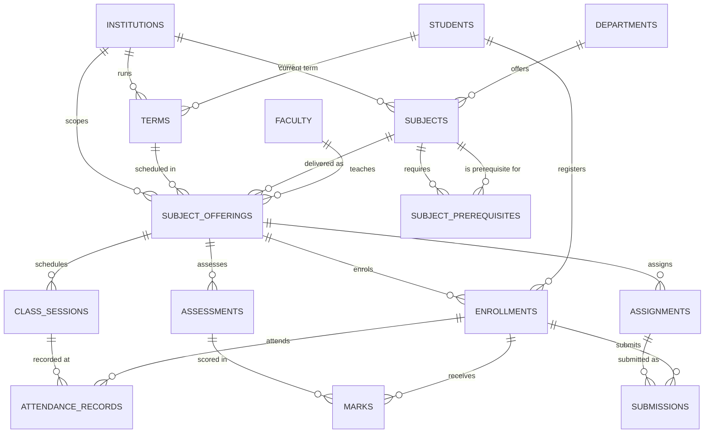

# Phase 1.3 — Migration 0002: Academic Core (design)

Status: **APPROVED for documentation checkpoint (2026-11-16).** Design only — no migration file,
no schema change, no code. Implementation is a separate, later phase.
Base: `e17e404` (Phase 1.2, migration `0001_tenancy`).
Authoritative specification: [`architecture-v2.md`](./architecture-v2.md) §4.1, §13.5-E1.1–E1.3, §13.5-E1.5.

Items marked **P** are proposals that are **not** in architecture-v2 and need explicit sign-off.
Items marked **Q** are unresolved questions.

---

## 0. Checkpoint verification

| Check | Result |
|---|---|
| Local head | `e17e404703896df2389ba53304a8caade6450a97` |
| `origin/main` | `e17e404703896df2389ba53304a8caade6450a97` — **matches** |
| Phase 1.2 commit on origin | `e17e404` present |
| Documentation commit on origin | `336c391` present |
| Working tree | **not strictly clean** — `.commandcode/taste/taste.md` modified, `.commandcode/taste/taste/` untracked. Both are written by the taste learning system, not by application work. |
| Alembic head | `0001_tenancy (head)` — single head |
| Migration SHA-256 on disk | `747d056e184aae321cf02f59889ddcfae65eff20b19c425abab03430f43c3d8d` — **matches** the value recorded in `docs/implementation-log.md` |
| `alembic current` | **could not run** — Docker daemon is down (`dockerDesktopLinuxEngine` pipe not found). Head verified statically via `alembic heads`, which does not need a database. |

Nothing blocks the design. The database will need to be running before migration 0002 can be applied or tested.

### 0.1 Approval record (2026-11-16)

| Decision | Outcome |
|---|---|
| **R1** — E1.2's "generated column" is not implementable | **Approved:** stored `subject_id`, pinned by the four-column composite FK `(offering_id, subject_id, term_id, institution_id)`. This supersedes the generated-column wording in §13.5-E1.2. |
| **Q7** — `submission_status` | **Approved:** enum is `(missing, submitted, graded)`. Lateness is represented exclusively by `is_late`. |
| **Q6** — attempt/version handling | **Approved:** one submission per assignment for MVP. Attempts and versioning are recorded as a future extension. |
| **P3** — registration window | **Approved:** add `registration_closes_at` alongside `registration_opens_at`. |
| Remaining recommendations (P4, P5, P6, P8, Q1, Q3, Q4) | **Accepted** as written in this document. |
| **Q2, Q5** | Accepted as recorded; both are documentation-level notes, not schema changes. |

No migration exists for this design. `0002` is not written, not applied.

---

## 1. Table inventory

11 new tables, all tenant-scoped, plus one column added to an existing table.

| # | Group | Table | Rows expected | Notes |
|---|---|---|---|---|
| 1 | Academic structure | `terms` | 10s | academic calendar, one current per institution |
| 2 | Academic structure | `subjects` | 100s | catalogue |
| 3 | Academic structure | `subject_prerequisites` | 100s | DAG edges, tenant-pinned |
| 4 | Academic structure | `subject_offerings` | 1 000s | subject × term × section |
| 5 | Registration | `enrollments` | 10 000s | student × offering |
| 6 | Classroom | `class_sessions` | 100 000s | the attendance denominator |
| 7 | Classroom | `attendance_records` | 1 000 000s | highest-volume table |
| 8 | Evaluation | `assessments` | 10 000s | weighted components |
| 9 | Evaluation | `marks` | 100 000s | one per student per assessment |
| 10 | Coursework | `assignments` | 10 000s | |
| 11 | Coursework | `submissions` | 100 000s | one per student per assignment |

**Altered:** `students` gains `current_term_id uuid NULL` (deferred from 0001 by D6).

**Not in this migration:** `student_academic_profiles` (derived cache), `assignments`-adjacent
submission history/attempts, anything governance or risk. Those stay in their own phases.

---

## 2. Relationship diagram



The diagram shows the *logical* relationships. The physical schema additionally carries a
denormalised `offering_id` on `attendance_records`, `marks` and `submissions`; §3.6 explains why —
it is the mechanism that makes those relationships structurally consistent rather than merely
intended.

---

## 3. Table-by-table schema

Conventions applied to all 11 tables, inherited from Phase 1.2:

- `id uuid PRIMARY KEY` — **UUIDv7 generated by the application** (D7). No database default.
- `institution_id uuid NOT NULL` with a direct `REFERENCES institutions(id) ON DELETE RESTRICT`.
- `created_at` / `updated_at timestamptz NOT NULL DEFAULT now()` where the table is mutable,
  maintained by the existing `public.set_updated_at()` trigger.
- `ENABLE ROW LEVEL SECURITY` + `FORCE ROW LEVEL SECURITY` + `tenant_isolation` policy with
  both `USING` and `WITH CHECK`.
- Every foreign key indexed.

### 3.1 `terms`

| Column | Type | Null | Default | Notes |
|---|---|---|---|---|
| `id` | uuid | no | — | PK, UUIDv7 |
| `institution_id` | uuid | no | — | FK `institutions` |
| `code` | citext | no | — | e.g. `2026-FA` |
| `name` | text | no | — | |
| `starts_on` | date | no | — | |
| `ends_on` | date | no | — | |
| `registration_opens_at` | timestamptz | yes | — | v2 §4.1 |
| `registration_closes_at` | timestamptz | yes | — | **P3 — APPROVED.** v2 omits it; a window with only an opening is not a window |
| `is_current` | boolean | no | `false` | |
| `created_at` / `updated_at` | timestamptz | no | `now()` | |

Constraints: `UNIQUE (institution_id, code)` · `UNIQUE (id, institution_id)` ·
`CHECK (ends_on > starts_on)` · `CHECK (registration_closes_at IS NULL OR registration_opens_at IS NULL OR registration_closes_at > registration_opens_at)`.
**Partial unique (required):** `UNIQUE (institution_id) WHERE is_current` — v2 §13.5-E1.2.
The flag is mutable; §13.5-E1.5 already registers the race it prevents.

### 3.2 `subjects`

| Column | Type | Null | Default |
|---|---|---|---|
| `id` | uuid | no | — |
| `institution_id` | uuid | no | — |
| `code` | citext | no | — |
| `name` | text | no | — |
| `department_id` | uuid | no | — |
| `credits` | numeric(4,1) | no | — |
| `category` | text | yes | — |
| `description` | text | yes | — |
| `learning_outcomes` | text | yes | — |
| `is_active` | boolean | no | `true` |
| `created_at` / `updated_at` | timestamptz | no | `now()` |

Constraints: `UNIQUE (institution_id, code)` · `UNIQUE (id, institution_id)` ·
`FK (department_id, institution_id) → departments (id, institution_id)` ·
`CHECK (credits > 0)` · **P4** `CHECK (credits <= 30)`.
`numeric(4,1)` alone permits 999.9 credits; a sanity ceiling is cheap. Labelled a proposal because
v2 only specifies `> 0`.

### 3.3 `subject_prerequisites`

| Column | Type | Null | Default |
|---|---|---|---|
| `id` | uuid | no | — |
| `institution_id` | uuid | no | — |
| `subject_id` | uuid | no | — |
| `prerequisite_subject_id` | uuid | no | — |
| `min_grade` | numeric(5,2) | yes | — |
| `kind` | `prerequisite_kind` | no | `'prerequisite'` |
| `created_at` | timestamptz | no | `now()` |

Constraints: `UNIQUE (subject_id, prerequisite_subject_id)` ·
`FK (subject_id, institution_id) → subjects (id, institution_id)` ·
`FK (prerequisite_subject_id, institution_id) → subjects (id, institution_id)` ·
`CHECK (subject_id <> prerequisite_subject_id)`.

**Cross-institution prerequisites are impossible** because both edges carry `institution_id` in
their composite FK, and both target the same `institution_id` column on this row. A row cannot
name a subject in another tenant without failing one of the two FKs.

**Q1 — `min_grade` scale is undefined in v2.** `numeric(5,2)` assumes a 0–100 scale. Alternatives:
a `grade_letter` enum, or a `(scale, value)` pair. Recommend 0–100 now and revisit when transcript
grades are modelled. **Q2 —** `UNIQUE (subject_id, prerequisite_subject_id)` ignores `kind`, so a
pair cannot be both a prerequisite and a co-requisite. Acceptable; recorded.

### 3.4 `subject_offerings`

| Column | Type | Null | Default |
|---|---|---|---|
| `id` | uuid | no | — |
| `institution_id` | uuid | no | — |
| `subject_id` | uuid | no | — |
| `term_id` | uuid | no | — |
| `section_code` | citext | no | — |
| `faculty_id` | uuid | yes | — |
| `capacity` | integer | yes | — |
| `schedule_json` | jsonb | yes | — |
| `room` | text | yes | — |
| `modality` | `delivery_modality` | no | `'in_person'` |
| `created_at` / `updated_at` | timestamptz | no | `now()` |

Constraints:
- `UNIQUE (subject_id, term_id, section_code)` — business key
- `UNIQUE (id, institution_id)` — target for 2-column child FKs
- `UNIQUE (id, subject_id, term_id, institution_id)` — target for the `enrollments` FK
- `FK (subject_id, institution_id) → subjects (id, institution_id)`
- `FK (term_id, institution_id) → terms (id, institution_id)`
- `FK (faculty_id, institution_id) → faculty (id, institution_id)` — nullable; `MATCH SIMPLE`
  means an unassigned offering is not checked, which is the intent
- `CHECK (capacity IS NULL OR capacity > 0)` — **P8**, `NULL` = uncapped

**Q3 — `schedule_json` vs `class_sessions`.** v2 carries both. Interpretation proposed here:
`schedule_json` is a **recurrence description** used to *generate* sessions; `class_sessions` rows
are authoritative for attendance. Without that rule there are two sources of truth for "when does
this class meet". This is the interpretation I would implement; confirm it.

### 3.5 `enrollments`

| Column | Type | Null | Default |
|---|---|---|---|
| `id` | uuid | no | — |
| `institution_id` | uuid | no | — |
| `student_id` | uuid | no | — |
| `offering_id` | uuid | no | — |
| `subject_id` | uuid | no | — | **denormalised** |
| `term_id` | uuid | no | — | **denormalised** |
| `status` | `enrollment_status` | no | `'enrolled'` |
| `enrolled_on` | date | no | `current_date` |
| `dropped_on` | date | yes | — |
| `is_audit` | boolean | no | `false` |
| `final_grade` | numeric(5,2) | yes | — |
| `created_at` / `updated_at` | timestamptz | no | `now()` |

Constraints:
- `FK (student_id, institution_id) → students (id, institution_id)`
- **`FK (offering_id, subject_id, term_id, institution_id) → subject_offerings (id, subject_id, term_id, institution_id)`**
- `UNIQUE (student_id, offering_id)` — no duplicate row per section
- `UNIQUE (student_id, term_id, subject_id)` — no two sections of one subject in one term
- `UNIQUE (id, offering_id, institution_id)` — target for attendance/marks/submissions
- `CHECK (status <> 'dropped' OR dropped_on IS NOT NULL)` — **P5**
- `CHECK (status = 'dropped' OR dropped_on IS NULL)` — v2's constraint
- `CHECK (dropped_on IS NULL OR dropped_on >= enrolled_on)`

**Why `subject_id` and `term_id` are physically present.** §13.5-E1.2 requires
`UNIQUE (student_id, term_id, subject_id)` and describes `subject_id` as a *generated column*.
PostgreSQL generated columns cannot reference another table, so that is not implementable — the
column must be stored. Storing it naively would let it drift from the offering, which is precisely
the class of bug the composite FK exists to prevent. The four-column FK removes that risk: the
stored `subject_id`/`term_id` are **required to equal** the offering's. This is the correction to
E1.2 — it preserves the intent (and is stronger, since the term is pinned too) while being
implementable.

**Q4 — retakes.** `UNIQUE (student_id, term_id, subject_id)` also blocks a same-term retake. That
is an acceptable MVP restriction; retakes across terms are unaffected.

### 3.6 `class_sessions`

| Column | Type | Null | Default |
|---|---|---|---|
| `id` | uuid | no | — |
| `institution_id` | uuid | no | — |
| `offering_id` | uuid | no | — |
| `session_no` | integer | no | — |
| `meets_on` | date | no | — |
| `starts_at` | timestamptz | no | — |
| `ends_at` | timestamptz | no | — |
| `topic` | text | yes | — |
| `is_cancelled` | boolean | no | `false` |
| `is_optional` | boolean | no | `false` |
| `created_at` | timestamptz | no | `now()` |

Constraints: `UNIQUE (offering_id, session_no)` · `UNIQUE (id, offering_id, institution_id)` ·
`FK (offering_id, institution_id) → subject_offerings (id, institution_id)` ·
`CHECK (session_no > 0)` · `CHECK (ends_at > starts_at)`.
Index `(offering_id, meets_on)` — v2 §13.5-E1.2.

**Q5 —** `meets_on` is derivable from `starts_at` in the institution's timezone. It is stored
because the risk engine groups by calendar day and a date column indexes far better than an
expression across a join to `institutions.timezone`. Invariant: `meets_on` equals the local date of
`starts_at` (application-enforced; cannot be a CHECK without a cross-table lookup).

### 3.7 `attendance_records`

| Column | Type | Null | Default |
|---|---|---|---|
| `id` | uuid | no | — |
| `institution_id` | uuid | no | — |
| `session_id` | uuid | no | — |
| `enrollment_id` | uuid | no | — |
| `offering_id` | uuid | no | — | **the pinning column** |
| `status` | `attendance_status` | no | — |
| `minutes_late` | integer | yes | — |
| `note` | text | yes | — |
| `recorded_by` | uuid | yes | — |
| `recorded_at` | timestamptz | no | `now()` |

Constraints:
- `FK (session_id, offering_id, institution_id) → class_sessions (id, offering_id, institution_id)`
- `FK (enrollment_id, offering_id, institution_id) → enrollments (id, offering_id, institution_id)`
- `UNIQUE (enrollment_id, session_id)`
- `CHECK (minutes_late IS NULL OR minutes_late >= 0)`
- **P6** `CHECK (status <> 'late' OR minutes_late IS NOT NULL)`
- `FK (recorded_by, institution_id) → users (id, institution_id)` (nullable)

Indexes: `(institution_id)`; partial `(session_id) WHERE status = 'absent'` (v2).

### 3.8 `assessments`

| Column | Type | Null | Default |
|---|---|---|---|
| `id` | uuid | no | — |
| `institution_id` | uuid | no | — |
| `offering_id` | uuid | no | — |
| `title` | text | no | — |
| `type` | `assessment_type` | no | — |
| `max_score` | numeric(6,2) | no | — |
| `weight_percent` | numeric(5,2) | no | `0` |
| `due_at` | timestamptz | yes | — |
| `is_published` | boolean | no | `false` |
| `created_at` / `updated_at` | timestamptz | no | `now()` |

Constraints: `FK (offering_id, institution_id) → subject_offerings (id, institution_id)` ·
`UNIQUE (id, offering_id, institution_id)` · `CHECK (max_score > 0)` ·
`CHECK (weight_percent >= 0 AND weight_percent <= 100)`.
Index `(offering_id)`; index `(offering_id) WHERE is_published`.

**Aggregate weights.** A `CHECK` cannot aggregate. Implemented as a **deferred constraint
trigger** (`DEFERRABLE INITIALLY DEFERRED`) that, at commit, asserts
`SUM(weight_percent) ≤ 100` over `is_published` assessments for each affected offering. Deferred
matters: a bulk import inserts several assessments in one transaction and would trip an
immediate trigger on the intermediate states. The API still returns 422 before attempting the
write — the trigger is the backstop, not the UX.

### 3.9 `marks`

| Column | Type | Null | Default |
|---|---|---|---|
| `id` | uuid | no | — |
| `institution_id` | uuid | no | — |
| `assessment_id` | uuid | no | — |
| `enrollment_id` | uuid | no | — |
| `offering_id` | uuid | no | — | **the pinning column** |
| `score` | numeric(6,2) | yes | — |
| `graded_at` | timestamptz | yes | — |
| `graded_by` | uuid | yes | — |
| `remark` | text | yes | — |
| `created_at` / `updated_at` | timestamptz | no | `now()` |

Constraints:
- `FK (assessment_id, offering_id, institution_id) → assessments (id, offering_id, institution_id)`
- `FK (enrollment_id, offering_id, institution_id) → enrollments (id, offering_id, institution_id)`
- `UNIQUE (assessment_id, enrollment_id)`
- `CHECK (score IS NULL OR score >= 0)`
- **P7** `CHECK (score IS NULL OR graded_at IS NOT NULL)`
- Trigger `score <= assessments.max_score` (cross-row, so not a CHECK)
- `FK (graded_by, institution_id) → users (id, institution_id)` (nullable)

### 3.10 `assignments`

| Column | Type | Null | Default |
|---|---|---|---|
| `id` | uuid | no | — |
| `institution_id` | uuid | no | — |
| `offering_id` | uuid | no | — |
| `title` | text | no | — |
| `instructions` | text | yes | — |
| `opens_at` | timestamptz | yes | — |
| `due_at` | timestamptz | no | — |
| `max_score` | numeric(6,2) | no | — |
| `attachment_key` | text | yes | — |
| `created_at` / `updated_at` | timestamptz | no | `now()` |

Constraints: `FK (offering_id, institution_id) → subject_offerings (id, institution_id)` ·
`UNIQUE (id, offering_id, institution_id)` · `CHECK (max_score > 0)` ·
`CHECK (opens_at IS NULL OR due_at > opens_at)`.

### 3.11 `submissions`

| Column | Type | Null | Default |
|---|---|---|---|
| `id` | uuid | no | — |
| `institution_id` | uuid | no | — |
| `assignment_id` | uuid | no | — |
| `enrollment_id` | uuid | no | — |
| `offering_id` | uuid | no | — | **the pinning column** |
| `submitted_at` | timestamptz | yes | — |
| `file_key` | text | yes | — |
| `text_body` | text | yes | — |
| `status` | `submission_status` | no | `'missing'` |
| `is_late` | boolean | no | `false` |
| `late_days` | numeric(5,2) | yes | — |
| `score` | numeric(6,2) | yes | — |
| `feedback` | text | yes | — |
| `created_at` / `updated_at` | timestamptz | no | `now()` |

Constraints:
- `FK (assignment_id, offering_id, institution_id) → assignments (id, offering_id, institution_id)`
- `FK (enrollment_id, offering_id, institution_id) → enrollments (id, offering_id, institution_id)`
- `UNIQUE (assignment_id, enrollment_id)`
- `CHECK (late_days IS NULL OR late_days >= 0)`
- `CHECK (status <> 'submitted' OR submitted_at IS NOT NULL)`
- `CHECK (score IS NULL OR score >= 0)`
- Trigger `score <= assignments.max_score`

`is_late` / `late_days` are computed **at write time** against `assignments.due_at` and frozen
(v2 §4.1). Editing a due date later must not rewrite history.

**Q6 — attempt/version handling. APPROVED: one submission per assignment for MVP.** The task asks
for "appropriate attempt/version handling"; v2 specifies `UNIQUE (assignment_id, enrollment_id)` —
one submission per student per assignment, no attempt history. No M1a requirement needs
resubmission history, and adding it introduces a "which attempt is current" invariant that must
then be protected. **Future extension** (not in 0002): add `attempt_no smallint NOT NULL DEFAULT 1`,
widen the unique to `(assignment_id, enrollment_id, attempt_no)`, and add a partial unique on the
current attempt.

**Q7 — `submission_status` redundancy. APPROVED:** v2's enum included `late` while `is_late` also
exists, and the two disagree after grading (a graded late submission would have
`status='graded'`, `is_late=true`). The enum is `(missing, submitted, graded)`; lateness is
represented exclusively by `is_late`. This deviates from v2's enumerated values by decision, not
by accident.

### 3.12 `students` alteration

```sql
ALTER TABLE students
  ADD COLUMN current_term_id uuid NULL,
  ADD CONSTRAINT fk_students_current_term
    FOREIGN KEY (current_term_id, institution_id)
    REFERENCES terms (id, institution_id) ON DELETE RESTRICT;
CREATE INDEX ix_students_current_term_id ON students (current_term_id);
```
`MATCH SIMPLE` means a student with no current term (graduated, on leave) is valid.

---

## 4. Constraint and index inventory

### 4.1 Unique constraints — every one, and why

| Table | Constraint | Kind | Purpose |
|---|---|---|---|
| `terms` | `(institution_id, code)` | full | business key |
| `terms` | `(id, institution_id)` | full | FK target |
| `terms` | `(institution_id) WHERE is_current` | **partial** | one current term (E1.2) |
| `subjects` | `(institution_id, code)` | full | business key |
| `subjects` | `(id, institution_id)` | full | FK target |
| `subject_prerequisites` | `(subject_id, prerequisite_subject_id)` | full | no duplicate edge |
| `subject_offerings` | `(subject_id, term_id, section_code)` | full | business key |
| `subject_offerings` | `(id, institution_id)` | full | FK target (2-col) |
| `subject_offerings` | `(id, subject_id, term_id, institution_id)` | full | FK target (enrollments) |
| `enrollments` | `(student_id, offering_id)` | full | one row per section |
| `enrollments` | `(student_id, term_id, subject_id)` | full | no double enrolment (E1.2) |
| `enrollments` | `(id, offering_id, institution_id)` | full | FK target |
| `class_sessions` | `(offering_id, session_no)` | full | session numbering |
| `class_sessions` | `(id, offering_id, institution_id)` | full | FK target |
| `attendance_records` | `(enrollment_id, session_id)` | full | one record per student-session |
| `assessments` | `(id, offering_id, institution_id)` | full | FK target |
| `marks` | `(assessment_id, enrollment_id)` | full | one mark per student-assessment |
| `assignments` | `(id, offering_id, institution_id)` | full | FK target |
| `submissions` | `(assignment_id, enrollment_id)` | full | one submission per student-assignment |

Only **one** partial unique index is required this migration: `terms (institution_id) WHERE is_current`.

### 4.2 Foreign keys — 24 in total

All `ON DELETE RESTRICT`. Every FK is composite on `institution_id` (or on a 3/4-column key that
includes it), so a cross-tenant reference cannot be represented.

| Child | Columns | Parent | Cols |
|---|---|---|---|
| all 11 | `institution_id` | `institutions` | `id` |
| `subjects` | `(department_id, institution_id)` | `departments` | `(id, institution_id)` |
| `subject_prerequisites` | `(subject_id, institution_id)` | `subjects` | `(id, institution_id)` |
| `subject_prerequisites` | `(prerequisite_subject_id, institution_id)` | `subjects` | `(id, institution_id)` |
| `subject_offerings` | `(subject_id, institution_id)` | `subjects` | `(id, institution_id)` |
| `subject_offerings` | `(term_id, institution_id)` | `terms` | `(id, institution_id)` |
| `subject_offerings` | `(faculty_id, institution_id)` | `faculty` | `(id, institution_id)` |
| `enrollments` | `(student_id, institution_id)` | `students` | `(id, institution_id)` |
| `enrollments` | `(offering_id, subject_id, term_id, institution_id)` | `subject_offerings` | `(id, subject_id, term_id, institution_id)` |
| `class_sessions` | `(offering_id, institution_id)` | `subject_offerings` | `(id, institution_id)` |
| `attendance_records` | `(session_id, offering_id, institution_id)` | `class_sessions` | `(id, offering_id, institution_id)` |
| `attendance_records` | `(enrollment_id, offering_id, institution_id)` | `enrollments` | `(id, offering_id, institution_id)` |
| `attendance_records` | `(recorded_by, institution_id)` | `users` | `(id, institution_id)` |
| `assessments` | `(offering_id, institution_id)` | `subject_offerings` | `(id, institution_id)` |
| `marks` | `(assessment_id, offering_id, institution_id)` | `assessments` | `(id, offering_id, institution_id)` |
| `marks` | `(enrollment_id, offering_id, institution_id)` | `enrollments` | `(id, offering_id, institution_id)` |
| `marks` | `(graded_by, institution_id)` | `users` | `(id, institution_id)` |
| `assignments` | `(offering_id, institution_id)` | `subject_offerings` | `(id, institution_id)` |
| `submissions` | `(assignment_id, offering_id, institution_id)` | `assignments` | `(id, offering_id, institution_id)` |
| `submissions` | `(enrollment_id, offering_id, institution_id)` | `enrollments` | `(id, offering_id, institution_id)` |
| `students` | `(current_term_id, institution_id)` | `terms` | `(id, institution_id)` |

### 4.3 Indexes

| Table | Index | Reason |
|---|---|---|
| `terms` | `(institution_id, starts_on)` | calendar scans |
| `subjects` | `(institution_id, department_id)` | catalogue by department |
| `subject_prerequisites` | `(prerequisite_subject_id, institution_id)` | "who requires me" traversal for the degree planner |
| `subject_offerings` | `(term_id, institution_id)`, `(faculty_id, institution_id)`, `(subject_id, institution_id)` | roster and timetable queries |
| `enrollments` | `(student_id, term_id)`, `(offering_id)`, `(institution_id)` | the 360 and roster paths |
| `class_sessions` | `(offering_id, meets_on)` | session list, attendance denominator |
| `attendance_records` | `(institution_id)`, `(enrollment_id, session_id)`, partial `(session_id) WHERE status='absent'` | volume path + early-alert scan |
| `assessments` | `(offering_id)`, `(offering_id) WHERE is_published` | weighting and publication |
| `marks` | `(enrollment_id)`, `(assessment_id)` | performance rollups |
| `assignments` | `(offering_id)`, `(due_at)` | submission windows |
| `submissions` | `(assignment_id)`, `(enrollment_id)`, `(assignment_id, is_late)` | missing-work detection |
| `students` | `(current_term_id)` | new FK |

The `attendance_records` partial index on absent rows is the one the early-alert sweep will lean
on; without it, the nightly scan reads the whole table instead of the exceptions.

### 4.4 Enumerations added

`prerequisite_kind` (`prerequisite`, `co_requisite`) · `delivery_modality` (`in_person`, `online`,
`hybrid`) · `enrollment_status` (`enrolled`, `dropped`, `completed`) · `attendance_status`
(`present`, `absent`, `late`, `excused`) · `assessment_type` (`quiz`, `midterm`, `final`,
`project`, `lab`) · `submission_status` (`missing`, `submitted`, `graded` — lateness is `is_late`,
see Q7).

---

## 5. RLS and tenant consistency strategy

Identical to Phase 1.2, applied mechanically to all 11 tables:

```sql
ALTER TABLE <t> ENABLE ROW LEVEL SECURITY;
ALTER TABLE <t> FORCE  ROW LEVEL SECURITY;
CREATE POLICY tenant_isolation ON <t> FOR ALL
  USING      (institution_id = app.current_institution())
  WITH CHECK (institution_id = app.current_institution());
```

| Guarantee | Mechanism | Survives an application bug? |
|---|---|---|
| No cross-tenant read | RLS `USING` | yes |
| No cross-tenant write | RLS `WITH CHECK` | yes |
| No cross-tenant reference | composite FK | **yes, even with RLS disabled** |
| Correct student ↔ offering | shared `offering_id` + two composite FKs (§3.7/§3.9/§3.11) | **yes, even with RLS disabled** |
| No missing-context access | `app.current_institution()` → NULL | yes |
| No privilege escalation | `unisync_app` has no DDL/TRUNCATE | yes |

**Why "shared `offering_id` + two composite FKs" works.** `attendance_records` holds one
`offering_id`. Two FKs force it to equal both `class_sessions.offering_id` and
`enrollments.offering_id`. Therefore those two parents necessarily agree — with no trigger and no
application code. The same construction pins `marks` to the assessment's offering and
`submissions` to the assignment's offering. This is the answer to "do not assume a simple FK
guarantees the student is in the same offering": a simple FK does not, and this is the mechanism
that does.

**Threat model (unchanged from 1.2).** `app.institution_id` is a custom GUC any session can set.
RLS protects against query mistakes, not against a compromised application. Tenant identity must
come from authenticated server-side identity.

---

## 6. Invariants that cannot be enforced by FK or CHECK

| # | Invariant | Why not expressible | Where enforced |
|---|---|---|---|
| I1 | `subject_prerequisites` contains no cycle (`A→B→A`) | recursive transitive closure | service check with a recursive CTE inside the write transaction; optional deferred trigger as a backstop (P9) |
| I2 | Session falls inside its term's date range | cross-table (`class_sessions` → `subject_offerings` → `terms`) | service validation on session creation; report-only nightly check |
| I3 | `class_sessions.meets_on` equals the local date of `starts_at` | needs `institutions.timezone` | service; Q5 |
| I4 | Attendance only for enrollments active on the session date | time comparison between two parents | service rule: reject when `enrollment.status <> 'enrolled'` or the session date precedes `enrolled_on` / follows `dropped_on` |
| I5 | `marks.score ≤ assessments.max_score` | cross-row | trigger (§3.9) — a trigger *can* do this, so it is enforced, not merely registered |
| I6 | `Σ weight_percent ≤ 100` per offering | cross-row aggregate | deferred constraint trigger (§3.8) |
| I7 | `submissions.score ≤ assignments.max_score` | cross-row | trigger (§3.11) |
| I8 | `is_late` / `late_days` correct | depends on `due_at` at write time | computed in the service and frozen; never recomputed |
| I9 | Closing a term forbids further marks/enrolment writes | workflow | service + §13.5-E1.5 row on bulk marks vs finalisation |
| I10 | An offering's `capacity` is not exceeded | aggregate over enrolments | service check with `SELECT … FOR UPDATE` on the offering row |

I5–I7 are enforced in the database because a trigger can do it; I1–I4, I8–I10 are application
invariants and are listed explicitly rather than pretended away.

---

## 7. Test matrix

All assertions run as `unisync_app` unless stated. Fixtures are created by `unisync_owner`.
Two institutions, deliberately identical codes (`CSE`, `CS101`, `2026-FA`).

| # | Test | Assertion |
|---|---|---|
| A1 | Cross-tenant FK: prerequisite | prerequisite edge naming a subject in institution B → `23503` |
| A2 | Cross-tenant FK: offering | offering in B referencing term/faculty in A → `23503` |
| A3 | Cross-tenant FK: enrollment | enrollment in A referencing an offering in B → `23503` |
| A4 | Tenant-scoped uniqueness | `CS101` exists in both institutions; `(institution_id, code)` accepts them, a duplicate inside one tenant → `23505` |
| A5 | Duplicate active enrollment | same student, same offering → `23505` |
| A6 | Double enrolment across sections | same student, same subject, same term, two sections → `23505` |
| A7 | **Attendance across offerings** | session from offering 1 + enrollment from offering 2 → rejected, whichever `offering_id` is supplied (`23503`) |
| A8 | **Marks across offerings** | mark whose assessment is in offering 1 and enrollment in offering 2 → rejected |
| A9 | Marks above max | `score > max_score` → trigger raises `23514` |
| A10 | Weight aggregate | published weights summing to 110 → deferred trigger raises at COMMIT; summing to 100 passes |
| A11 | Invalid max marks | `max_score = 0` or negative → `23514` |
| A12 | Invalid weight range | `weight_percent = -1` or `101` → `23514` |
| A13 | Duplicate submission | second submission for same (assignment, enrollment) → `23505` |
| A14 | Submission score bound | `score > assignment.max_score` → `23514` |
| A15 | RLS read isolation | A-context sees only A's `terms/subjects/offerings/enrollments/marks`; B ids absent |
| A16 | RLS write isolation | A-context update/delete on B rows → `UPDATE 0` / `DELETE 0`; insert with `institution_id = B` → `42501` |
| A17 | Missing tenant context | unset GUC → 0 rows on all 11 tables, writes rejected |
| A18 | Malformed tenant context | `'not-a-uuid'` → 0 rows, writes rejected |
| A19 | Runtime privileges preserved | no table owned by app; `TRUNCATE` denied; RLS DDL denied; `alembic_version` unreadable |
| A20 | Migration downgrade / re-upgrade | `downgrade 0001_tenancy` drops exactly the 11 tables and the column, leaves 0001 intact; `upgrade head` restores; isolation suite passes again |
| A21 | Composite-FK reachability | every FK has a matching unique index on the parent (catalogue query) |
| A22 | Index presence | every FK column set has an index (catalogue query, no missing indexes) |

The two tests that matter most are **A7** and **A8**: they are the ones a naive FK would pass and a
correct design must reject.

---

## 8. Migration plan

### 8.1 Upgrade order (dependency-safe)

1. Create enums: `prerequisite_kind`, `delivery_modality`, `enrollment_status`,
   `attendance_status`, `assessment_type`, and — depending on Q7 — `submission_status`.
2. `terms`.
3. `subjects` (needs `departments`).
4. `subject_prerequisites` (needs `subjects`).
5. `subject_offerings` (needs `subjects`, `terms`, `faculty`).
6. `enrollments` (needs `students`, `subject_offerings`).
7. `class_sessions` (needs `subject_offerings`).
8. `attendance_records` (needs `class_sessions`, `enrollments`, `users`).
9. `assessments` (needs `subject_offerings`).
10. `assignments` (needs `subject_offerings`).
11. `marks` (needs `assessments`, `enrollments`, `users`).
12. `submissions` (needs `assignments`, `enrollments`).
13. `ALTER TABLE students ADD current_term_id` + FK + index.
14. Triggers: `marks` score bound, `submissions` score bound, deferred weight aggregate.
15. RLS on all 11 tables (enable, force, policy).
16. Revoke any accidental grants on new objects from the runtime role beyond DML
    (default privileges already grant exactly `SELECT/INSERT/UPDATE/DELETE`).

Every step is idempotent-safe only in the sense that Alembic runs it once; the migration is
transactional (PostgreSQL DDL is transactional), so a failure mid-way leaves the schema unchanged.

### 8.2 Downgrade order (exact reverse)

1. Drop RLS policies implicitly with tables.
2. Drop triggers and their functions.
3. `ALTER TABLE students DROP COLUMN current_term_id`.
4. Drop tables in reverse dependency order: `submissions`, `marks`, `assignments`,
   `assessments`, `attendance_records`, `class_sessions`, `enrollments`, `subject_offerings`,
   `subject_prerequisites`, `subjects`, `terms`.
5. Drop the enums.

Downgrade is destructive by nature (it drops academic data). It exists to prove reversibility in a
disposable environment, not as a production rollback strategy; that is recorded as a limitation.

### 8.3 Estimated surface

11 tables, 24 foreign keys, 19 unique constraints (1 partial), ~20 indexes, 6 enums, 3 triggers,
11 policies, 1 column addition. Roughly 700–800 lines of migration.

---

## 9. Risks and open decisions

| # | Item | Risk if wrong | Recommendation |
|---|---|---|---|
| **R1** | E1.2's "generated column" for `subject_id` is not implementable | storing it naively reintroduces term/subject drift | **APPROVED 2026-11-16:** adopt the 4-column composite FK (§3.5); supersedes E1.2's wording. |
| **R2** | `submission_status` includes `late` while `is_late` exists | two representations disagree after grading | **Adopt `(missing, submitted, graded)`** (Q7) |
| **R3** | Attempt/version model unspecified in detail | adding history later needs a data migration | **Keep v2 single-submission** (Q6); extension path documented |
| **R4** | `min_grade` / `final_grade` scales undefined | numeric scale chosen now may not match a letter-grade institution | adopt 0–100, isolate behind a `grade_scale` setting later (Q1) |
| **R5** | Deferred weight trigger | trips on legitimate concurrent inserts for the same offering; can confuse bulk imports | keep it deferred, and have the API 422 first; if it proves noisy, demote to a report-only nightly check |
| **R6** | 3- and 4-column FKs | larger index surface, slightly slower writes | measurable but small at MVP volumes; correctness justified |
| **R7** | `UNIQUE (student_id, term_id, subject_id)` blocks same-term retakes | a legitimate case is rejected | accepted for MVP (Q4) |
| **R8** | `class_sessions` vs `schedule_json` | two sources of truth for meeting times | confirm §3.4's interpretation (Q3) |
| **R9** | Downgrade drops data | irreversible in production | documented; not a production rollback plan |
| **R10** | RLS is a backstop, not a boundary | a confused application could read the wrong tenant | unchanged from 1.2; tenant identity must come from auth (Phase 2) |

---

## 10. What this migration deliberately does not do

No seed data, no API, no ORM models, no risk engine, no `student_academic_profiles`, no
governance tables, no LLM, no agents. Migration 0003 (identity/session: `refresh_tokens`,
`password_reset_tokens`) and Phase 2 authentication are separate.
