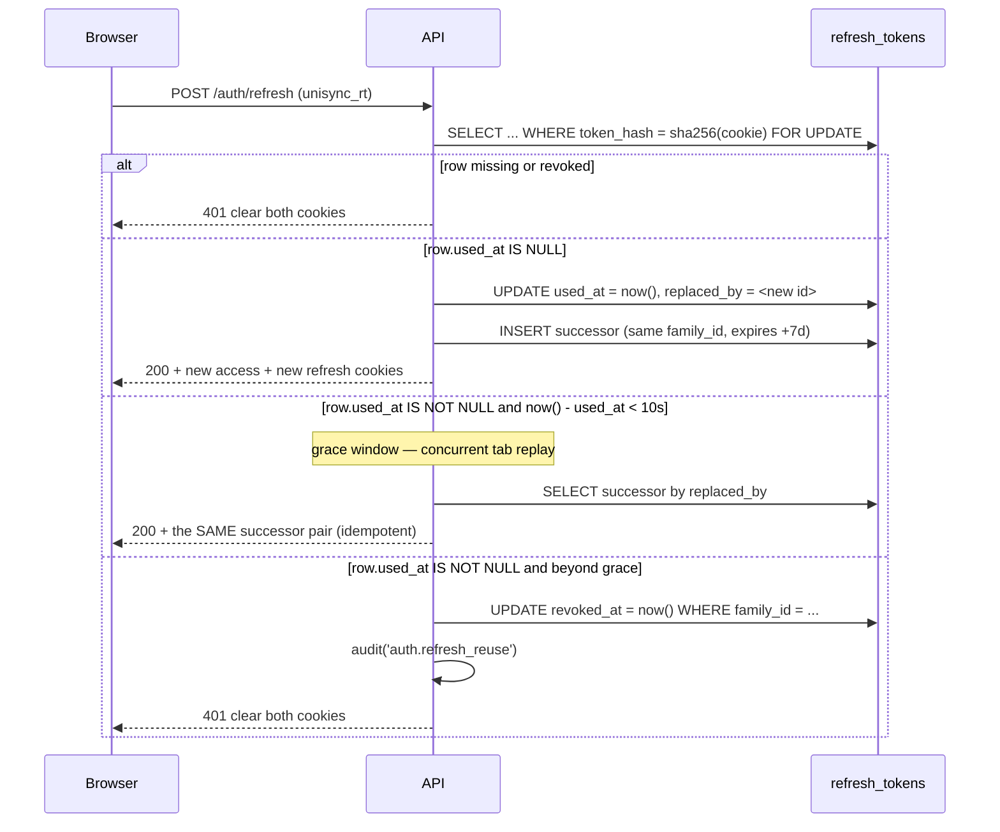
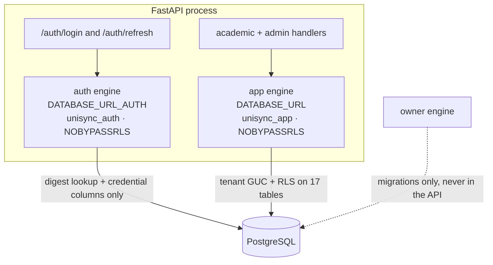
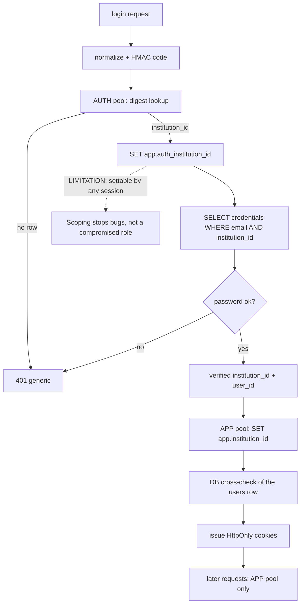
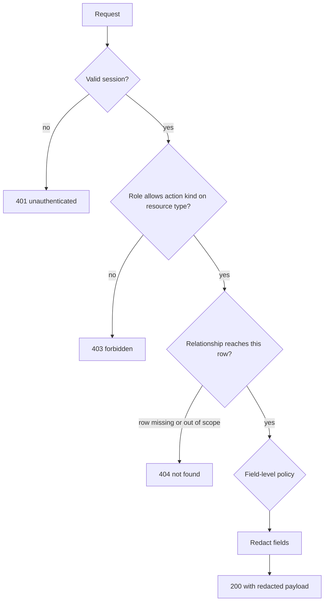
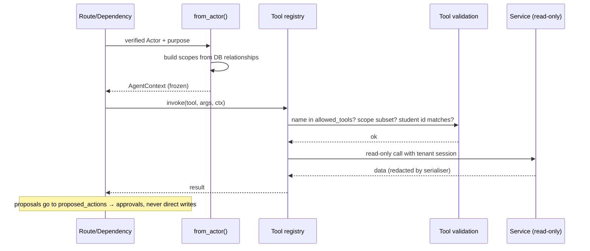
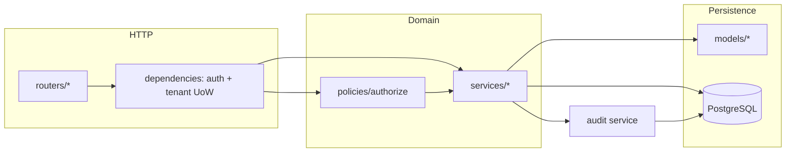

# Phase 1.5 — Authentication, Authorization & Service Layer (design)

Status: **DESIGN ONLY — awaiting approval.** No code, no schema change, no migration 0003.
Base commit: `b09e30c` · Live revision: `0002_academic_core` · Existing tests: 50 passing.

Authoritative source: [`architecture-v2.md`](./architecture-v2.md), especially §13.5-E1 (tenancy),
§13.5-E2 (sessions), §13.5-E3 (execution boundary), §6 (API plan).
Items marked **P** are proposals that revise or extend approved architecture and need sign-off.
Items marked **Q** are open questions.

---

## 1. Executive summary

This phase answers one question end to end: *given an HTTP request, what may it read and write,
and where is that decided?*

The design rests on six rules:

1. **Institution codes are secrets.** They are never stored in plaintext, never logged, and never
   compared as strings. Login resolves an institution through a keyed HMAC digest held in a table
   only the authentication role can read.
2. **The tenant comes from the database, never from the request.** A caller names an institution only
   at login, as a selector that is verified before anything else happens; the value that reaches the
   tenant GUC is read from the matched record.
3. **Authorization is decided in one place.** Routes authenticate and delegate. A single policy
   service evaluates role + scope + relationship; serialisers redact fields.
4. **The transaction boundary is the request boundary.** One unit of work per request owns the
   transaction and sets the tenant GUC before any query. Services never commit.
5. **Authentication and application traffic never share a role or a pool.** `unisync_auth` and
   `unisync_app` are separate roles, separate engines, separate grants. There is no fallback between
   them, and neither may use the owner.
6. **Agents are principals with less authority than users, not more.** `AgentContext` is built
   from a verified actor, carries an explicit tool allow-list, and cannot reach `SYSTEM_SWEEP`
   through HTTP.

What already exists: config, `app.current_institution()`, `tenant_session()`, the role guard, RLS on
17 tables, 39 tenant-pinned foreign keys, 3 integrity triggers, 50 tests.
What does not exist: any route, any middleware, any service, `refresh_tokens`,
`password_reset_tokens`, `audit_logs`, `record_access_log`, and `users.last_step_up_at`.

---

## 2. Existing architecture reconnaissance

| Area | Present today | Gap for this phase |
|---|---|---|
| Config | `app/core/config.py` — settings include `jwt_signing_key`, `audit_hmac_key`, TTLs, role names | No rate-limit, cookie-domain, idle-timeout or step-up settings |
| DB session | `app/db/session.py` — `tenant_session()` with `set_config(..., true)`, `assert_runtime_role()`, `assert_url_uses_runtime_role()` | No dependency wiring; nothing calls it from HTTP |
| RLS | 17 tables, `ENABLE`+`FORCE`, single `tenant_isolation` policy each | `institutions` is readable only with a tenant set — blocks login (§3.1) |
| Auth tables | `users` holds `password_hash`, `failed_login_count`, `locked_until` **today**; ADR-28 relocates all three to `auth_user_credentials` | **No `refresh_tokens`, `password_reset_tokens`, `auth_user_credentials`, `last_step_up_at`** |
| Audit | **None** | `audit_logs` / `record_access_log` absent |
| API | `app/main.py` — `/healthz` only | No routers, middleware, error envelope, or auth dependency |
| Tests | 50 passing: 4 unit, 21 tenancy, 25 academic | No auth, authorization, or service tests |
| ADRs | ADR-1…17 approved | ADR-18…23 proposed below |

Confirmed by inspection, not assumption: `apps/api/app` contains only `main.py`, `core/config.py`,
`db/base.py`, `db/session.py`. There is no `auth`, `services`, `policies`, `routers` package.

**Unrelated working-tree changes:** `.commandcode/taste/taste.md` modified and
`.commandcode/taste/taste/` untracked. These are the taste learning system's own files. Reported,
left untouched.

---

## 3. Authentication architecture

### 3.1 A1 is rejected; institution codes are secret

Institution codes are **secret**: knowledge of a code must be limited to the members of that
institution. A1 — an additive `SELECT` policy on `institutions` keyed on a request-supplied code —
is therefore **rejected**. It would have let `unisync_app` resolve any institution by guessing a
code, and the code itself is stored in plaintext in `institutions.code`, readable by that role
within its tenant.

**A2 is adopted: a dedicated `unisync_auth` role with its own connection pool.**

| Decision | Value |
|---|---|
| Role | `unisync_auth` — `LOGIN NOSUPERUSER **NOBYPASSRLS** NOCREATEDB NOCREATEROLE` |
| Pool | its own `AsyncEngine`, own credentials, own lifecycle, never shared |
| Read surface | one credential table + column-level grants on `users` |
| Never | academic tables, `institutions`, `refresh_tokens`, audit writes |
| Owner credentials | never used; startup guard refuses them |
| `SECURITY DEFINER` | **still forbidden** (D5/R8). A2 needs none. |

### 3.1.1 Credential storage — keyed digests, never plaintext

New table `institution_code_digests`, owned by `unisync_owner`:

| Column | Type | Null | Notes |
|---|---|---|---|
| `id` | uuid | no | PK, UUIDv7 app-generated |
| `institution_id` | uuid | no | FK → `institutions(id)` `ON DELETE RESTRICT` |
| `digest` | bytea | no | HMAC-SHA-256 of the normalized code, 32 bytes |
| `pepper_version` | integer | no | which pepper produced it |
| `normalization_version` | integer | no | which normalization rule produced it |
| `is_current` | boolean | no | one per institution |
| `retired_at` | timestamptz | yes | set when superseded |
| `expires_at` | timestamptz | yes | hard expiry; `NULL` = no expiry |
| `created_at` | timestamptz | no | `now()` |
| `created_by` | uuid | yes | the admin who rotated it |

Constraints: `UNIQUE (digest)` (a digest resolves to at most one institution, across current and
retired rows) · `UNIQUE (institution_id) WHERE is_current` · `CHECK (octet_length(digest) = 32)` ·
`CHECK (is_current OR retired_at IS NOT NULL)`.

**Why a keyed digest.** Institution codes are short and human-typed — low entropy. An **unkeyed**
hash of such a code is reversible by enumeration in seconds, so it is explicitly rejected. HMAC-SHA-256
with a pepper held **outside PostgreSQL** means a database dump alone does not yield codes.

**The pepper never touches the database.** `INSTITUTION_CODE_PEPPER` (≥32 random bytes) lives in the
API environment only; `INSTITUTION_CODE_PEPPER_PREVIOUS` may hold the prior value during rotation.
No column, table, function or view can produce a code from a digest.

**Normalization** (`normalization_version = 1`): `NFKC → strip → ASCII uppercase → collapse runs of
whitespace/underscore/hyphen to a single "-"`; reject empty or >64 characters. The same routine runs
at digest creation and at login; a version mismatch is a 500, never a silent fallback to raw bytes.

**Constant-time comparison.** The lookup is an indexed equality on a 256-bit keyed digest, which is
not enumerable. `hmac.compare_digest` is used wherever the application compares two digests directly
(rotation validation, tests).

### 3.1.4 Slug and code are different things (Q11 — accepted)

**Accepted:** `institutions.code` becomes `institutions.slug`. The slug is public and non-secret;
the login code is a secret that exists only as a digest.

| Property | `slug` | secret code |
|---|---|---|
| Purpose | display, URLs, admin UI, human reference | authentication only |
| Storage | plaintext `citext`, tenant-scoped by RLS | HMAC digest only |
| Uniqueness | global `UNIQUE (slug)` | global `UNIQUE (digest)` |
| Who may read | `unisync_app` for **its own** institution; admin UI; never `unisync_auth` | nobody — not even an admin, after the one-time display |
| Accepted at login | **never** | yes, and only via the digest path |

**Why conflating them was wrong.** Serving a display identifier from the same column that carries a
credential means every screen hinting at an institution (URLs, dropdowns, logs of admin actions)
leaks the credential. Splitting them makes the display identifier safe to show and the credential
safe to store one-way.

**Components that may read the slug:** the app pool inside a tenant transaction (`institutions` is
RLS-scoped), the admin UI, and URL routing. `unisync_auth` has **no grant** on `institutions` at all,
so it cannot read slugs either — it does not need them.

**Slug is rejected as a credential.** The login handler accepts only `institution_code`, runs it
through the normalizer and HMAC, and queries the digest table. A slug has no digest, so
`login(slug, …)` returns the generic 401. A test asserts this explicitly.

**Migration plan (for 0003, not executed now):**

```sql
ALTER TABLE institutions RENAME COLUMN code TO slug;
ALTER TABLE institutions RENAME CONSTRAINT uq_institutions_code TO uq_institutions_slug;
```

- **Constraints preserved:** the `UNIQUE (slug)` constraint survives the rename; naming it explicitly
  keeps the catalogue readable.
- **RLS untouched:** `tenant_isolation` on `institutions` is `id = app.current_institution()` and does
  not reference `code`. Nothing to change.
- **Foreign keys:** none reference `institutions.code` — every FK targets `institutions(id)`. Verified
  by catalogue query during implementation, not assumed here.
- **Fixtures and seeds:** existing values (`alpha`, `beta`) remain valid slugs, so the academic
  fixtures need no change beyond any test that reads `code` by name.
- **Existing institution codes:** the plaintext value that was in `code` must **not** become the new
  secret — it has already been visible in fixtures and developer logs. At migration time each
  institution receives a **freshly generated** code, stored only as a digest, distributed
  out-of-band. The old value survives only as the slug.

### 3.1.2 Institution-code lifecycle (Q12 — resolved)

| Stage | Specification |
|---|---|
| **Generation** | 20 characters from the Crockford base32 alphabet (`0-9A-HJKMNP-TV-Z`, which excludes I, L, O, U), from `secrets.choice` with rejection sampling to avoid modulo bias. ≈100 bits of entropy. Displayed grouped `XXXX-XXXX-XXXX-XXXX-XXXX`. |
| **Entropy floor** | Reject any generated code below 80 bits. Test asserts the generator's alphabet and length. |
| **Normalization** | `NFKC → strip → ASCII uppercase → collapse runs of `[\s_-]+` to a single `-``. Post-normalization charset `[0-9A-Z-]`, length 16–26. Applied identically at issuance and login. |
| **Issuance** | Server-generated only; an operator never chooses a code. Returned **once**, in the creation response, and never retrievable afterwards — the digest is one-way. |
| **Activation** | `is_current = true`, `retired_at IS NULL`, `expires_at IS NULL`. The partial unique index guarantees exactly one current code per institution. |
| **Rotation** | Insert the new row as current; the previous row becomes `is_current = false, retired_at = now(), expires_at = now() + 24 h`. During that window **two** digests resolve; the lookup orders `is_current DESC`, so the new code wins, and the old one still works so an institution can distribute the change. |
| **Overlap expiry** | After `expires_at` the lookup predicate excludes the row. A test pins the boundary at ±1 s. |
| **Permanent retirement** | Retired rows are retained for audit, then purged after 180 days past expiry. A purged digest resolves to nothing. |
| **Emergency revocation** | `UPDATE … SET expires_at = now()` for every row of that institution, then issue a replacement. Audit reason `compromise`. |
| **Multiple active codes** | Not permitted as a steady state — only the 24-hour rotation overlap yields two resolvable digests. Any other overlap is an error. |
| **Reactivation** | **Never.** A retired digest is immutable and `UNIQUE (digest)` spans current *and* retired rows, so a code that has ever existed can never be re-registered, accidentally or deliberately. |
| **Audit** | `institution.code_issued`, `.code_rotated`, `.code_revoked` — institution id, actor id, reason enum (`scheduled`, `compromise`, `offboarding`). **Never** the code, never the digest, never a prefix of either. |
| **Authorization** | Only an `admin` of that institution. Rotation and revocation require step-up re-authentication (v2 E2.4). |
| **Non-logging** | The raw code is never a cache key, telemetry label, span attribute, exception message or SQL parameter log entry. Rate limiting keys on the **digest hex prefix**, not the code. |

### 3.1.3 Pepper lifecycle (Q13 — resolved)

Peppers are configured as a **versioned map** in the API environment, never in PostgreSQL:

```
INSTITUTION_CODE_PEPPERS = {"1": "<32+ random bytes, hex>", "2": "..."}
INSTITUTION_CODE_PEPPER_ACTIVE = 2
```

| Concern | Specification |
|---|---|
| **Storage** | Environment/secret manager only. Never in the database, source control, logs, or `institution_code_digests`. |
| **Selection at issuance** | New digests are written with `pepper_version = INSTITUTION_CODE_PEPPER_ACTIVE`. |
| **Selection at login** | Compute the HMAC under **every configured version** and issue one lookup: `WHERE (digest, pepper_version) IN (($1,1), ($2,2)) AND …`. With ≤2 versions this is a two-row index probe, not a scan. |
| **Coexistence** | Old and new versions coexist indefinitely. A row's `pepper_version` records which one produced it, so verification is deterministic. |
| **Why existing codes cannot be migrated** | The plaintext code is never stored, so it cannot be re-digested. **Changing an environment variable does not migrate existing digests** — it only affects newly issued codes. This is stated explicitly because the opposite is the natural assumption. |
| **Retiring a pepper** | Only after every digest under it is expired: `SELECT count(*) FROM institution_code_digests WHERE pepper_version = $old AND (expires_at IS NULL OR expires_at > now())` must be `0`. The removal is blocked in code until that query returns zero. |
| **Consequence** | Fully retiring an old pepper requires **reissuing every institution code** that still depends on it — a deliberate, audited, out-of-band operation, not a config change. |
| **Lost pepper** | Any digest under the lost version can no longer be verified; those institutions cannot log in until their codes are reissued. |
| **Compromised pepper** | Every digest under that version becomes offline-brute-forceable. All affected codes must be revoked (`expires_at = now()`) and reissued. There is no cheaper remedy; the pepper's only purpose was to make that dump useless. |
| **Cadence** | Annual review (Q13), plus immediate rotation on suspicion. |

### 3.1.5 Credential privileges — what `unisync_auth` may actually write (ADR-28)

**Table `auth_user_credentials`** (owned by `unisync_owner`):

| Column | Type | Null | Notes |
|---|---|---|---|
| `user_id` | uuid | no | PK; FK `(user_id, institution_id)` → `users(id, institution_id)` |
| `institution_id` | uuid | no | tenant pinning |
| `password_hash` | text | no | Argon2id PHC string |
| `password_changed_at` | timestamptz | no | |
| `credential_version` | integer | no | increments on every hash change; optimistic-concurrency token |
| `failed_login_count` | integer | no | default 0 |
| `locked_until` | timestamptz | yes | |
| `created_at` / `updated_at` | timestamptz | no | |

**Grants — deliberately not `UPDATE` on every credential column:**

| Role | Grants on `auth_user_credentials` |
|---|---|
| `unisync_owner` | owner (migrations) |
| `unisync_auth` | `SELECT (user_id, institution_id, password_hash, failed_login_count, locked_until, credential_version)` · `UPDATE (failed_login_count, locked_until)` |
| `unisync_credential_writer` *(ADR-29 — approved)* | `UPDATE (password_hash, password_changed_at, credential_version)` — **no `SELECT`** |
| `unisync_app` | **none** |

The auth role therefore **cannot replace a password hash**. It can read hashes (it must, to verify)
and can reset its own lockout counters (see residual risk). Password *changes* are applied by a
write-only role that never reads a hash.

**Password change / reset flow (two-phase, no hash write by the verifier):**

1. `POST /auth/password/change` or `/auth/password/reset` → the auth pool verifies the current
   password (or the single-use reset token) and, on success, the API mints a **signed change grant**:
   5-minute expiry, `purpose=password_change`, bound to `user_id`, `institution_id`,
   `credential_version`.
2. The password service verifies the grant's signature and purpose (no database read), computes the
   Argon2id hash, and issues a targeted write through the writer pool:
   `UPDATE auth_user_credentials SET password_hash = $1, password_changed_at = now(),
   credential_version = credential_version + 1, updated_at = now()
   WHERE user_id = $2 AND institution_id = $3 AND credential_version = $4`.
3. Zero rows updated means the credential changed mid-flight → 409, re-authenticate.
4. The same transaction revokes all refresh-token families and bumps `users.perm_version`.

**Database-enforced vs service-enforced**

| Control | Enforced by | Strength |
|---|---|---|
| Which columns may be written by which role | column-level `GRANT` | **database** |
| That the writer role cannot read hashes | no `SELECT` grant | **database** |
| One credential row per user | PK | **database** |
| Tenant consistency of the credential row | composite FK | **database** |
| No lost update between two password changes | `AND credential_version = $4` | **database** (optimistic) |
| Current password verified before a change | signed change grant | service + token signature — **not** database |
| Grant bound to one user/institution/version | token claims | service — cryptographic if signing key holds |
| No generic "update credential" endpoint exists | code review + import/AST test | service |
| Lockout cannot be reset by the service | **not enforced** | — see residual |

**Abuse cases**

| Abuse | Prevented? |
|---|---|
| Arbitrary password-hash replacement by the auth role | **Yes** — no `UPDATE (password_hash)` grant |
| Arbitrary replacement by the writer role | Only by possessing a valid change grant; a compromised writer process *can* write any hash it is given. Bounded to one column and no reads. |
| Reset its own lockout counters | **No** — the auth role needs `UPDATE (failed_login_count, locked_until)` to function. Lockout protects against remote guessing through the service, **not** against a compromised service. Residual, documented. |
| Cross-institution credential update | RLS scopes rows to `app.auth_institution_id` — **accident protection only**; the GUC is settable (§4.3.1). Real bound is the `WHERE user_id = … AND institution_id = …` predicate. |
| Unintended modification via a generic update path | No generic repository method exists; every credential write names its columns and carries `credential_version`. Enforced by test, not by the database. |

**Accepted residual:** a compromised `unisync_auth` can read hashes (offline cracking is then bounded
by Argon2id cost) and can reset lockout counters. A compromised `unisync_credential_writer` can set
any password hash. Neither can read academic data.

**ADR-29 is proposed**, not approved. If a fourth role is rejected, the fallback is
`UPDATE (password_hash)` on `unisync_auth` itself, which makes password replacement reachable by a
compromised auth process — a strictly larger blast radius, and the reason the separate role is
recommended.

### 3.2 Login lifecycle (two pools, one request)

```mermaid
sequenceDiagram
    participant C as Client
    participant A as API
    participant AP as AUTH pool (unisync_auth)
    participant PP as APP pool (unisync_app)
    participant DB as PostgreSQL

    C->>A: POST /auth/login {institution_code, email, password}
    A->>A: normalize + HMAC(code, pepper)   [never logged]
    A->>AP: BEGIN
    AP->>DB: SELECT institution_id FROM institution_code_digests
             WHERE digest=$1 AND not expired
    alt no digest
        A->>A: dummy Argon2 verify (timing parity)
        A-->>C: 401 invalid credentials
    else digest found
        AP->>DB: set_config('app.auth_institution_id', id, true)
        AP->>DB: SELECT u.id, u.institution_id, u.is_active, u.perm_version,
                 c.password_hash, c.failed_login_count, c.locked_until
                 FROM users u JOIN auth_user_credentials c ON c.user_id=u.id
                 WHERE u.email=$2 AND u.institution_id=id
        AP->>AP: Argon2id verify / lockout counters
        AP->>DB: COMMIT
        A->>PP: BEGIN  (verified institution_id)
        PP->>DB: set_config('app.institution_id', id, true)
        PP->>DB: SELECT name FROM institutions WHERE id=id   [RLS]
        PP->>DB: INSERT refresh_tokens + audit auth.login
        PP->>DB: COMMIT
        A-->>C: 200 {user, institution:{name}} + HttpOnly cookies
    end
```

```
POST /api/v1/auth/login  { institution_code, email, password }
 1. Rate limit (Redis): per-IP, and a per-digest counter keyed on the HMAC hex prefix —
    the raw code never becomes a cache key.
 2. Normalize + HMAC the supplied code in-process (pepper from the environment).
 3. AUTH POOL, short transaction:
    a. SELECT institution_id, pepper_version FROM institution_code_digests
         WHERE digest = $1 AND (expires_at IS NULL OR expires_at > now())
         ORDER BY is_current DESC LIMIT 1
       └ none → dummy Argon2 → 401 (identical body and comparable timing)
    b. set_config('app.auth_institution_id', <id>, true)
    c. SELECT u.id, u.institution_id, u.is_active, u.perm_version,
              c.password_hash, c.failed_login_count, c.locked_until
         FROM users u JOIN auth_user_credentials c ON c.user_id = u.id
        WHERE u.email = $2 AND u.institution_id = <id>
       └ absent → dummy Argon2 → 401
    d. locked_until > now() → 429 + Retry-After (no password check)
    e. Argon2id verify. On failure: failed_login_count += 1 (atomic UPDATE … RETURNING),
       locked_until per backoff → 401
    f. is_active = false → 401 (identical body; suspension is not disclosed)
    g. success: c.failed_login_count = 0 on auth_user_credentials; u.last_login_at = now() on users
    h. COMMIT — the auth connection returns to the AUTH pool
 4. APP POOL, tenant transaction — institution_id is now *verified*, not claimed:
    set_config('app.institution_id', <id>, true)
    a. SELECT name FROM institutions WHERE id = <id>        -- RLS scoped to itself
    b. INSERT refresh_tokens (hash only) + audit auth.login
    c. COMMIT
 5. 200 { user: {id, role, full_name}, institution: {name} }
    Set-Cookie: unisync_at, unisync_rt  — no token in the body, no code echoed
```

The institution code is **never** returned to the client: the user supplied it. Login responses
contain no credential material of any kind.

**Backoff:** 5 failures → 30 s, 6 → 60 s, 7 → 120 s, 8 → 300 s, 9 → 600 s, 10 → 900 s; ≥10 keeps
the account locked until an administrator clears it. Counters are reset on success or password
change. `locked_until` is authoritative over the Redis limiter (survives a Redis flush).

**P2 — dummy-hash verification** costs ~50 ms per unknown-user login. Accepted: it removes the
timing oracle. Requires one fixed pre-computed Argon2id hash in config, not a per-request hash.

### 3.3 Session issuance

| Artifact | Form | Storage | Lifetime | Cookie |
|---|---|---|---|---|
| Access | JWT (HS256, single key, `alg` pinned) | stateless | 15 min | `unisync_at` — `HttpOnly; Secure; SameSite=Lax; Path=/; Domain` unset |
| Refresh | 256-bit opaque random, base64url | **hash** (SHA-256) in `refresh_tokens` | 7 days, sliding | `unisync_rt` — `HttpOnly; Secure; SameSite=Strict; Path=/api/v1/auth` |

Access JWT claims: `sub`, `sid` (session/family id), `role`, `inst`, `pv` (perm_version), `iat`,
`exp`, `iss`, `aud`, `jti`. It deliberately carries `role` for cheap routing but **the role used for
every decision is re-read from the database** (§4.1).

`SameSite=Strict` on the refresh cookie is safe because it is only ever sent to `/api/v1/auth/*`
from same-site XHR.

**No token is ever returned in a JSON body.** A response-body token would land in logs, APM traces
and any XSS-accessible scope — the exact defect C-03 corrected.

### 3.3.1 `refresh_tokens` schema (G4 — previously undefined)

Owned by `unisync_owner`; tenant-scoped; written and read only by the app pool.

| Column | Type | Null | Notes |
|---|---|---|---|
| `id` | uuid | no | PK, UUIDv7 |
| `user_id` | uuid | no | FK `(user_id, institution_id)` → `users(id, institution_id)` |
| `institution_id` | uuid | no | tenant pinning |
| `family_id` | uuid | no | one family per login; all rotations share it |
| `family_created_at` | timestamptz | no | copied from the first row; anchors the **30-day absolute** lifetime |
| `token_hash` | bytea | no | SHA-256 of the opaque cookie value — the plaintext token is never stored |
| `issued_at` | timestamptz | no | `now()` |
| `expires_at` | timestamptz | no | `issued_at + 7 d` for normal rotation |
| `used_at` | timestamptz | yes | set when the token is redeemed |
| `replaced_by` | uuid | yes | FK → `refresh_tokens(id)`; the successor issued on redemption |
| `revoked_at` | timestamptz | yes | family revocation (logout, reuse, password change, suspension) |
| `last_seen_at` | timestamptz | no | `now()`; drives the **8-hour sliding idle** timeout |
| `ip` | inet | yes | |
| `user_agent` | text | yes | |

Constraints: `UNIQUE (token_hash)` · `CHECK (expires_at > issued_at)` ·
`CHECK (used_at IS NULL OR used_at >= issued_at)`.

Indexes: `(family_id)` · `(user_id, family_id)` · partial `(expires_at) WHERE revoked_at IS NULL`
for the cleanup job.

**Semantics — the four rules that were previously prose only**

| Rule | Definition |
|---|---|
| **Family** | Created at login (`family_id`, `family_created_at`). Every rotation inserts a successor with the same `family_id` and the same `family_created_at`. Revoking a family sets `revoked_at` on all its rows |
| **Rotation** | `UPDATE … SET used_at = now() WHERE token_hash = $1 AND used_at IS NULL RETURNING id` — compare-and-set. The winner inserts the successor and sets `replaced_by`; a loser that loses the race falls into the grace path |
| **Successor recovery (10 s grace)** | If `used_at IS NOT NULL` and `now() - used_at < 10 s`, follow `replaced_by` and return the **same** successor pair. Beyond 10 s, treat as replay |
| **Replay detection** | `used_at IS NOT NULL` beyond the grace window, or a revoked/expired row → revoke the entire family, write `auth.refresh_reuse`, return 401 |
| **Idle timeout** | Refuse when `now() - last_seen_at > 8 h`; a successful refresh sets `last_seen_at = now()` |
| **Absolute lifetime** | Refuse when `now() - family_created_at > 30 d`, regardless of activity; reauthentication required |

**Concurrency.** `SELECT … FOR UPDATE` on the token row serialises two refreshes of the *same* token.
The compare-and-set on `used_at` is the authoritative gate; `FOR UPDATE` only prevents two waiters
from both observing `used_at IS NULL`.

**Cleanup.** A scheduled job deletes rows where `expires_at < now() - 30 d` or
`revoked_at < now() - 30 d`. Deletion is safe: a deleted token is indistinguishable from an unknown
one (401), and family revocation is recorded in the audit ledger.

**Q15 — open.** `refresh_tokens` is RLS-protected, but the refresh endpoint arrives with no JWT and
therefore no tenant. A lookup path must be chosen before implementation: (a) a token-hash-scoped
policy (`USING (token_hash = current_setting('app.refresh_token_hash', true))`), which follows the
existing accident-protection pattern; (b) service the lookup on the auth pool, which requires new
grants; or (c) move session records out of the tenant-scoped model. **Not decided here.**

### 3.4 Refresh rotation and reuse detection



**P3 — 10-second grace window.** Without it, two tabs refreshing simultaneously trip reuse
detection and log the user out — a denial of service an attacker can trigger by racing the browser.
With it, the second request is idempotently served from the recorded successor. The window is short
enough that a genuinely stolen token replayed later still revokes the family. **Q2 resolved
2026-11-16: 10 seconds, approved.** It exceeds worst-case client retry latency and stays well below
human-perceptible reuse.

`SELECT ... FOR UPDATE` on the token row serialises concurrent refreshes of the *same* token.

### 3.5 Logout, revocation, suspension

| Trigger | Effect |
|---|---|
| `POST /auth/logout` | `revoked_at = now()` on the whole family; both cookies cleared (`Max-Age=0`) |
| Password change | All families revoked except the current one; `perm_version += 1` |
| Password reset | All families revoked; `perm_version += 1` |
| `is_active = false` | All families revoked; `perm_version += 1`; refresh returns 401 |
| Reactivation | `perm_version += 1`; user logs in again |
| Idle timeout | **8 h sliding** (approved). Refresh refused when `last_seen_at < now() - 8 hours`; a successful refresh updates `last_seen_at` |
| Absolute lifetime | **30 d non-sliding** (approved). Refresh refused when `now() - family.created_at > 30 days`, regardless of activity. The user must reauthenticate |

**Access tokens are not revocable individually** (15-minute lifetime). Revocation therefore relies on
`perm_version`: every request compares the token's `pv` to `users.perm_version`. A stale token is
rejected within one request, not within 15 minutes. This is why the JWT is cheap but not trusted.

### 3.6 CSRF

- `SameSite=Lax` on the access cookie blocks most cross-site POSTs; it does not cover same-site
  subdomains.
- Every state-changing request must additionally present `X-CSRF-Token` matching a value in a
  non-HttpOnly `unisync_csrf` cookie (double submit), **and** pass an `Origin`/`Sec-Fetch-Site`
  allow-list check.
- The BFF proxy (v2 C-04) forwards the CSRF header; it does not mint it.
- `GET`, `HEAD`, `OPTIONS` are exempt.

### 3.7 Password reset and recovery

`POST /auth/password/reset-request { institution_code, email }` → always **202**, no user
enumeration. If the user exists and is active: insert a `password_reset_tokens` row with a hashed
token, 30-minute expiry, single use, and deliver it through the `Notifier` interface.

**Q4 resolved 2026-11-16.** The console/file notifier is **development-only**. In production the
service must refuse to start with a console notifier configured (startup guard: `ENV=production` with
the console notifier is a fatal configuration error), so a reset token can never be written to a
production log. The UI labels the feature unavailable when no production notifier is configured.

**Q10 — production provider undecided.** Delivery in production requires a provider decision at
deployment time. The code commits only to a **provider-independent `Notifier` interface** —
`send_password_reset(to, token, expires_at)` — with the implementation chosen behind it. This design
selects no provider, and password reset must not be advertised as available in production until one
exists.

`POST /auth/password/reset { token, new_password }` → validates hash, single-use, expiry; the new hash
is written through the credential-writer path (§3.1.5), not by the auth role; all families revoked;
`perm_version += 1`; audited.

**Argon2id parameters:** `m=65536` (64 MiB), `t=3`, `p=4`, 16-byte salt, 32-byte output, PHC string
in `password_hash`. On successful login, if the stored parameters are below current policy, rehash
transparently.

---

### 3.8 Authentication audit pathway (ADR-23 — resolves a real conflict)

Three approved statements collide:

1. `unisync_auth` must not write the audit ledger.
2. Authentication events must land in the tamper-evident ledger.
3. A successful login must not be issued if its mandatory audit event failed to persist.

**Options assessed**

| Option | Least privilege | Atomicity with auth state | Failure behaviour | Forgery risk | Verdict |
|---|---|---|---|---|---|
| **A — app-pool writer** | auth keeps zero audit grants | **No** (separate transactions) | clean: no token without an audit row | app can write arbitrary events; auth cannot | **Selected** |
| B — dedicated `unisync_audit_writer` role | good, but a fourth credential to protect | No | same as A | a third writer role can forge | Rejected: adds a secret without fixing atomicity |
| C — transactional outbox | auth writes only a narrow insert-only outbox | **Yes** for the *intent* | event durable at commit; ledger delayed | auth can inject outbox rows only, with a constrained schema | Viable escalation path, not MVP |
| D — grant `INSERT` on `audit_logs` to auth | poor: auth could fabricate approvals or logins | Yes | — | **high** | Rejected outright |

**Selected: Option A, with an explicit ordering guarantee.**

```
AUTH pool tx                         APP pool tx
─────────────                        ───────────
verify credential                    INSERT audit_logs (auth.login | auth.login_failed)
UPDATE counters / lockout   ──commit──▶  on success only: INSERT refresh_tokens
                                     COMMIT
                                     ──▶ only now mint the JWT and set cookies
```

**What is guaranteed:** no session token is minted, and no cookie is set, unless an audit row
committed in the *same transaction* as that token. The credential-state write and the audit row are
**not atomic with each other** — this design does not claim otherwise.

**Failure semantics**

| Scenario | Response | Notes |
|---|---|---|
| Auth pool fails before verification | 503 `auth_unavailable` | Nothing happened; no audit row required |
| Credential wrong, audit insert fails | **503 `audit_unavailable`** | Not 401. If the ledger is unavailable we stop authenticating rather than silently drop events. Client retry re-attempts both |
| Credential correct, audit insert fails | **503**, transaction rolled back, **no refresh token, no cookies** | The fail-closed rule |
| Credential correct, refresh-token insert fails | 503, transaction rolled back, no cookies | Single transaction with the audit row |
| Audit committed, response lost in transit | Client retries → a second audit row (`auth.login`, new request id) | Duplicate events are correct: two attempts occurred |

**Replay and idempotency.** Each row carries `request_id`. Retries of the *same* request (same
`Idempotency-Key`) dedupe on `(request_id, action)`; a genuinely repeated login attempt is a new
event and is recorded separately. Audit inserts are append-only, so the dedupe is a lookup before
insert, not an upsert.

**Tamper evidence.** Rows are written through the single appended-ledger path (v2 §13.5-E1.4):
`seq`, canonical bytes, advisory-lock writer, hash chain, checkpoints. Authentication events inherit
that integrity because they are ordinary ledger rows.

**Forgery scope, stated honestly.** `unisync_auth` cannot write audit rows at all. `unisync_app` can
insert any audit event through the audit service — the database cannot distinguish an authentication
event from an academic one, because there is one writer. The mitigation is that the audit service is
the only code path with the insert, and Phase 5's `*_canonical` hashing and checkpoints detect
after-the-fact tampering, not fabrication by a compromised app process.

**Separation from read auditing.** This covers **authentication events only**. `record_access_log`
(FR-B2: "every read logged") remains unimplemented and must not be claimed until it exists.

## 4. Tenant identity and RLS flow

### 4.1 Request lifecycle

The tenant GUC must be set **before** the actor row is read, or RLS returns zero rows. (The earlier
draft of this diagram showed the read first — that ordering was wrong and is corrected here.)

```mermaid
sequenceDiagram
    participant C as Client
    participant MW as Middleware
    participant DP as Dependency
    participant S as Service
    participant PG as PostgreSQL (app pool)

    C->>MW: HTTP request (cookies)
    MW->>MW: request_id, security headers, origin + CSRF check
    MW->>DP: authenticate()
    DP->>DP: verify JWT: alg pinned, signature, iss, aud, exp
    alt signature or claims invalid
        DP-->>C: 401 — no database access at all
    end
    DP->>PG: BEGIN; set_config('app.institution_id', token.inst, true) [PROVISIONAL]
    DP->>PG: SELECT id, institution_id, role, is_active, perm_version FROM users WHERE id = $sub [RLS]
    PG-->>DP: row, or zero rows
    DP->>DP: cross-check row.institution_id == token.inst, perm_version == pv, is_active
    Note over DP: tenant is AUTHORITATIVE only after this check, from row.institution_id
    alt mismatch or suspended
        DP->>PG: ROLLBACK
        DP-->>C: 401
    end
    DP-->>S: Actor(row.institution_id, user_id, role, scopes)
    S->>PG: queries in the same transaction (RLS applies)
    S->>PG: COMMIT (or ROLLBACK on error)
    Note over PG: SET LOCAL reverts on both paths; the connection returns to the pool with no tenant attached
```

### 4.5 Pool isolation

Two engines live in the same process and are never interchangeable.



| Property | Auth pool | App pool |
|---|---|---|
| Role | `unisync_auth` | `unisync_app` |
| DSN setting | `DATABASE_URL_AUTH` | `DATABASE_URL` |
| Pool size | 2–5, `max_overflow=0` | 5–20 |
| `pool_timeout` | 2 s (fail fast) | 10 s |
| Statement timeout | 5 s | 30 s |
| Idle-in-transaction timeout | 10 s | 10 s |
| Transaction scope | one login/refresh attempt | one HTTP request |
| GUC it may set | `app.auth_institution_id` **only** | `app.institution_id` **only** |
| Writes | `auth_user_credentials.failed_login_count`, `locked_until` (ADR-28); `users.last_login_at` | all academic tables via services |
| Must never | read academic tables, write audit, issue tokens | read credential digests, set `auth_institution_id` |

**Startup guards** (both run before the first request, as `assert_runtime_role()` already does):

- `assert_auth_role(engine)` — `current_user = 'unisync_auth'`, `rolsuper = false`,
  `rolbypassrls = false`. Fails closed.
- `assert_runtime_role(engine, forbidden_role='unisync_owner')` — unchanged, plus a new check that
  `current_user != 'unisync_auth'`.
- `assert_url_uses_runtime_role()` extended to reject the **owner** URL for both pools, and a new
  check that the two DSNs are distinct and resolve to different roles.

**No fallback, ever.** If the auth pool is exhausted, the request returns 503 with `Retry-After`. It
does not borrow an app connection, does not fall back to the owner role, and does not retry against
a different DSN. A fallback would silently convert a capacity incident into an authorization
bypass.

**Tenant-context cleanliness.** The auth pool never sets `app.institution_id`, so an auth connection
returned to its pool cannot carry a tenant. The app pool never sets `app.auth_institution_id`. Both
use `set_config(..., true)` exclusively; both are covered by pool-size-1 leak tests (§11.3).

**Exhaustion and timeouts.** Auth: 2 s checkout timeout, 5 s statement timeout — a login that cannot
get a connection within 2 s under load fails fast rather than queueing behind academic traffic.
App: 10 s checkout, 30 s statement.

### 4.6 Non-goals preserved

No `SECURITY DEFINER`, no `BYPASSRLS` for either runtime role, no policy on `institutions` for
`unisync_app`, no session-level `SET` (only `set_config(..., true)`), and no shared connection pool
between authentication and application traffic.

### 4.2 Where the tenant value comes from

| Source | Trusted? |
|---|---|
| `users.institution_id` for the authenticated `sub` | **yes — the only source** |
| JWT `inst` claim | no — compared to the row; a mismatch is a 401 and an audit event |
| Request body / query / path / header | **never** |
| Institution code at login | selector only; resolved to a row, never used as an id |

A request that supplies `institution_id` anywhere is ignored. If a caller supplies one that
disagrees with the actor, it is a client error (400) and an audit event, not a silent override.

### 4.3 Two different identity lookups, two different mechanisms

**Case 1 — login.** No session exists. The tenant comes from the digest lookup on the **auth pool**
(§3.2). The auth role sees only the credential table and a narrow projection of `users`. Its `users`
policy is scoped by `app.auth_institution_id`, set from the *digest result* — but see §4.3.1: that
scoping prevents **accidental** cross-tenant queries, it is not a boundary against a compromised
process.

Authentication-only policy (the deliberate, narrow exception permitted by the brief):

```sql
CREATE POLICY auth_credential_lookup ON users
  TO unisync_auth
  USING      (institution_id = app.current_auth_institution())
  WITH CHECK (institution_id = app.current_auth_institution());
```

Column-level grants keep it minimal: `SELECT (id, institution_id, email, is_active, perm_version)`
and `UPDATE (last_login_at)`. Lockout counters are **not** on `users` — they live in
`auth_user_credentials` (ADR-28), and the password hash is read from that table, never from
`users`. No `full_name`, no role list, and no academic table.

#### 4.3.1 What `app.auth_institution_id` does and does not protect

A custom GUC is settable by any database session: `SET app.auth_institution_id = '<any uuid>'` is
permitted for a role that can connect. A process with arbitrary SQL as `unisync_auth` can therefore
change it at will. **The policy is not a boundary against a compromised authentication process, and
this design does not claim that it is.**

| Adversary | Does the GUC policy help? | The control that actually applies |
|---|---|---|
| Application bug — the auth service passes the wrong institution id | **Yes.** The query returns zero rows instead of another tenant's credentials | GUC + `auth_credential_lookup` policy |
| Compromised authentication process with SQL execution | **No.** It can `SET` the GUC and read any institution's credential rows | Privilege minimisation: the role has no academic grants, no `full_name`, no audit writes. ADR-28 removes `password_hash` from `users` so the **app** role cannot read hashes either |
| Leaked `unisync_auth` credentials | **No**, for the same reason | Separate secret scope, rotation, connection-source restriction, query monitoring and rate limits |
| Malicious or compromised operator with owner access | **No.** The owner has `BYPASSRLS` by design | Audit ledger, least-privilege operations, out-of-band review |



**Alternatives evaluated and rejected**

1. A `SECURITY DEFINER` lookup function — forbidden by D5/R8.
2. `BYPASSRLS` for the auth role — strictly worse; it removes even the accidental-query protection.
3. A parameterised view — a view cannot take a runtime parameter without a GUC or a function, so it
   collapses into (1).
4. **ADR-28 (approved):** move `password_hash` out of `users` into `auth_user_credentials`. This
   does not stop a compromised auth role from reading hashes — a verifier must read them — but it
   removes hash access from `unisync_app`, which today can `SELECT *` on `users` inside its tenant.

**Accepted residual risk.** A compromised `unisync_auth` can read credential rows for any
institution. The compensating controls are privilege minimisation (no academic data, no `full_name`,
no audit writes), a secret that is not shared with either other role, and monitoring. This is
recorded as residual risk, not presented as solved.

**Case 2 — every subsequent request (Q14, resolved as O1).**

The invariant, stated exactly:

1. An **unverified** JWT claim never establishes tenant context.
2. `alg` (pinned), signature, `iss`, `aud`, `exp` and `nbf` are verified **before any claim is read**;
   a failure is a 401 with **zero database access**.
3. The **verified** `inst` claim may select a **provisional** tenant context for the initial identity
   lookup only.
4. The application then verifies that the database user identified by `sub` belongs to that
   institution.
5. The **database user record is authoritative** for tenant membership.
6. A failed cross-check aborts the request **inside the same transaction**, before any academic
   service is reachable.
7. No academic service may run under an unverified or merely provisional tenant identity.
8. Tenant-GUC setup and transaction ownership remain one unit of work per request (ADR-19).

**Sequence**

5. App pool: `BEGIN`, then `set_config('app.institution_id', token.inst, true)` — this value is
   **provisional**.
6. `SELECT id, institution_id, role, is_active, perm_version FROM users WHERE id = $sub` under RLS.
   Zero rows → 401: the user does not exist in that institution.
7. Require `row.institution_id == token.inst`, `row.perm_version == token.pv` and `row.is_active`.
8. Only now is the `Actor` returned, carrying `institution_id = row.institution_id`. Services never
   see the claim value.

**What actually protects the boundary, in order of load-bearing weight**

| Control | Role |
|---|---|
| Signature + claim verification | **Primary.** The only way an incorrect `inst` enters the system is a forged or stolen token |
| RLS scoping the lookup by the provisional GUC | **Structural.** An incorrect claim yields zero rows, never another tenant's row |
| Explicit `row.institution_id == token.inst` | **Defence in depth.** Under current RLS this is structurally guaranteed and cannot fail; it exists to catch a future RLS or policy regression |
| `perm_version` + `is_active` in the same row read | **Revocation.** A token stays usable only while the user is active and the permission version is unchanged |
| Single transaction, abort before services | **Containment.** A failed check rolls back, so no academic query runs under a provisional tenant |

**Honest note.** Because the `users` policy filters on the same GUC, step 7's institution comparison is
tautological *today* — it is a regression guard, not the load-bearing control. The load-bearing
controls are signature verification and the row read with `perm_version`.

**What signature verification does *not* prove:** current membership or revocation status. Those come
from the row read in the same transaction, plus the hard rule that institution reassignment is not a
supported operation and, if ever added, must bump `perm_version` and revoke every token family.

**Q5 resolved:** the auth-only `users` policy exists, but only the `unisync_auth` role can use it, and
only when `app.auth_institution_id` is set inside a login transaction. `unisync_app` never gets this
policy and never reads another tenant's `users` rows.

### 4.4 Pool and failure scenarios

| Scenario | Behaviour |
|---|---|
| Concurrent requests, same pooled connection | Impossible — a connection is checked out exclusively; each has its own transaction |
| Transaction commits/rolls back | `SET LOCAL` reverts; verified in Phase 1.2 with pool size 1 |
| Exception before `set_config` | No tenant queries can run (session is only handed out by `tenant_session`) |
| Exception mid-transaction | Rollback; RLS denies nothing because the GUC dies with the transaction |
| Missing GUC | `app.current_institution()` → NULL → zero rows, writes rejected (42501) |
| Malformed GUC | Same: function returns NULL for unparseable input |
| Connection killed mid-transaction | Server-side rollback clears the local setting |
| Worker task | Must call `tenant_session` too; a bare session sees nothing |

### 4.5 Non-goals preserved

No `SECURITY DEFINER`, no `BYPASSRLS` for the runtime role, no policy relaxation beyond P1, no
session-level `SET` (only `set_config(..., true)`).

---

## 5. Roles, scopes and the permission matrix

### 5.1 Four independent layers

1. **Authentication** — is there a valid session? (401)
2. **Role authorization** — may this role perform this *action kind* on this *resource type*? (403)
3. **Resource authorization** — does this actor's *relationship* reach this *row*? (404 if not)
4. **Field redaction** — which fields of an authorised row may this actor see? (omitted)

Conflating these is how "faculty can see their students" becomes "faculty can see every student".

### 5.2 Scopes (derived, not stored in the JWT)

| Scope | Derivation |
|---|---|
| `SELF` | actor is the student |
| `INSTRUCTOR` | actor is the `faculty` row that owns the offering |
| `ADVISOR` | **active** `advisor_assignments` row (`ended_at IS NULL`) for the student |
| `DEPT_ADMIN` | **Deferred** (Q6) — ADR-20 remains proposed and is not in MVP |
| `ADMIN` | `users.role = 'admin'` |

**Q6 resolved 2026-11-16: department administrators are deferred.** The role enum stays
`(admin, faculty, student)` for MVP; ADR-20 (`department_admins`) remains **Proposed** and is not
implemented. The `DEPT_ADMIN` column in the matrix below is future-facing only.

**Q7 resolved 2026-11-16: counselling/student-support staff are in MVP.** They are a first-class
scope, not an add-on. The approved requirement is: a dedicated authorization scope, assignment-based
access, counselling records separated from the academic record, field-level redaction, and a
sensitive-access audit event.

**The detailed counselling architecture is deliberately not specified here.** It is pending
**Phase 1.5B**, which must define the scope name, the assignment model, the record separation
mechanism, the redaction matrix column, and the audit event. This document does not invent
counsellor permissions, a counselling schema, assignment constraints, consent models, retention rules
or sharing policy. Until 1.5B lands, **no `COUNSELLOR` column is added to the permission matrix** and
no counselling endpoint is designed.

### 5.3 Permission matrix

Legend: `R` read · `W` write · `R*` read with field redaction · `—` denied (404) ·
`403` role-forbidden on a visible resource.

| Resource | SELF (student) | INSTRUCTOR (own offerings) | ADVISOR (assigned) | DEPT_ADMIN (own dept) | ADMIN |
|---|---|---|---|---|---|
| Student profile | R (own) | R* (identity + own-offering academics) | R + W (notes) | R* (dept students) | R + W |
| Attendance | R (own) | R + W (own offerings only) | R | R | R + W |
| Marks | R (own) | R + W (own offerings only) | R | R | R + W |
| Assessments | R (published, own) | R + W (own offerings) | R | R | R + W |
| Assignments | R (own offerings) | R + W (own offerings) | R | R | R + W |
| Submissions | R + W (own) | R* + W (grade, own offerings) | R* | R | R |
| Enrollments | R (own) | R (own offerings) | R + W (request only) | R | R + W |
| Academic alerts | R* (band + plain drivers) | R* (band only) | R + W | R* (aggregate) | R + W |
| Intervention cases | — | — | R + W (assigned) | — | R + W |
| Follow-up tasks | — | R* (own assigned) | R + W (own) | — | R + W |
| Institution configuration | — | — | — | — | R + W |
| User administration | — | — | — | R + W (dept) | R + W |

Rules that follow from this table:

- `INSTRUCTOR` never sees interventions, rationale, advisor notes, or risk **weights** — band only.
  This is C-05's correction, now applied per cell.
- `ADVISOR` requires an **active** assignment; an ended assignment confers nothing.
- Agents may never write marks or enrolment (v2 §5.7); no scope in this table implies otherwise.
- Bulk export of a ranked risk list is `ADMIN` + mandatory reason + audited (v2 §13.5-E4.5).

### 5.4 Authorization decision flow



**404 vs 403 rule:** a resource the actor cannot see returns **404**, so status codes cannot be used
to enumerate existence. A resource the actor *can* see but may not act on returns **403** (for
example, a student `PATCH`ing their own mark).

---

## 6. AgentContext

### 6.1 Shape

```python
@dataclass(frozen=True)
class AgentContext:
    institution_id: UUID          # from the verified actor or scheduler, never the request
    principal: Principal          # USER | SYSTEM_SWEEP | WORKER | ANONYMOUS
    actor_user_id: UUID | None    # None only for SYSTEM_SWEEP / ANONYMOUS
    actor_role: str | None
    scopes: frozenset[Scope]      # resolved relationships, not raw ids
    subject_student_id: UUID | None   # the single student this run may touch
    purpose: str                  # 'early_alert_sweep' | 'chat_answer' | ...
    correlation_id: str
    policy_version: int
    allowed_tools: frozenset[str]
```

### 6.2 Construction and validation

| Path | Who may construct | Authority |
|---|---|---|
| `from_actor(actor, purpose)` | request dependency only | inherits the actor's scopes |
| `for_sweep(institution_id, purpose)` | **`app.workers` only** (import-linter) | read-only, no user, no write tools |
| anything else | nobody | raises |

Validation at every tool call:

1. `tool.name ∈ ctx.allowed_tools` else `ToolNotPermitted` → run fails.
2. Any student id argument must equal `ctx.subject_student_id` else `ScopeViolation` → run fails.
3. The tool's resolved scope set must be a subset of `ctx.scopes`.
4. Tools never receive a raw id from model output; ids come from the context.

### 6.3 Lifecycle



### 6.4 Boundaries

- Agents receive a **read-only** service surface. The `import-linter` contract (v2 E3.5) forbids ORM
  writes outside `app.services`, `app.governance.executors`, `app.workers`; agents are not on that
  list.
- `SYSTEM_SWEEP` has no HTTP constructor. It is created in the worker process and is not
  serialisable; a test asserts no route can produce a `Principal.SYSTEM_SWEEP`.
- Proposals are `proposed_actions` rows; the approval and audit path is v2 E3.3 and is Phase 3/5
  work, not this phase.
- Nothing in this phase implements an agent or calls a model.

---

## 7. Service layer

### 7.1 Layering



Route handlers do exactly four things: validate input shape, call `authorize()`, call a service,
serialise with redaction. Any branch beyond that belongs in a service.

### 7.2 Responsibilities

| Service | Owns | Does not |
|---|---|---|
| `auth` | credential verification, session issuance/rotation, lockout counters, password change/reset | authorization decisions |
| `policy` | `authorize(actor, action, resource)`, scope resolution, redaction selection | querying academic data |
| `student` | profile assembly, search within scope | risk computation |
| `enrollment` | enrolment lifecycle, capacity enforcement, duplicate checks | attendance |
| `attendance` | recording, bulk upsert, active-enrolment validation | roster assembly |
| `assessment` | assessment CRUD, weight aggregate pre-check | marks |
| `marks` | grade entry, max-score pre-check, bulk grading | transcript finalisation |
| `assignment` / `submission` | coursework lifecycle, lateness freeze | grading |
| `term` | term lifecycle, closed-term guards, `is_current` transitions | enrolment |
| `institution` | departments, users, advisor assignments, config | academic records |
| `audit` | append-only event writes, `record_access` | decisions |

### 7.3 Transaction and tenant ownership

**P7 — the request dependency owns the unit of work.**

```python
async def get_session(actor: Actor) -> AsyncIterator[AsyncSession]:
    async with tenant_session(session_factory, actor.institution_id) as session:
        yield session          # commits on clean exit, rolls back on exception
```

Services receive `session` and **never** call `commit()`/`rollback()`. Rationale: a multi-service
operation (e.g. enrol + audit) is atomic, and there is exactly one place that sets the tenant GUC.

### 7.4 Cross-cutting rules

| Concern | Rule |
|---|---|
| Input validation | Pydantic v2 at the route; services receive typed values |
| Domain validation | services raise domain errors (`CapacityExceeded`, `TermClosed`, `PrerequisiteCycle`) |
| Constraint handling | `IntegrityError` is caught at the service boundary, mapped by `constraint_name` to a domain error; never surfaced raw |
| Error translation | one exception handler → v2 §6.1 envelope with `code`, `message`, `details`, `request_id` |
| Idempotency | `Idempotency-Key` on POST for bulk writes, approvals and imports; stored per (actor, key) with the response hash |
| Bulk operations | single transaction, all-or-nothing by default; per-row results only where the endpoint says so |
| Audit | every mutation emits an audit event in the **same** transaction |
| Concurrency | explicit locking (§8), never "retry on conflict" as a substitute |

---

## 8. Academic invariant ownership

The database enforces I5–I7 (score bounds, weight aggregate). Everything else needs an owner.

| # | Invariant | Layer | Strategy | Error | Test |
|---|---|---|---|---|---|
| I1 | Prerequisite graph is acyclic | service | recursive CTE over `subject_prerequisites` inside the write transaction; reject if the new edge closes a cycle | 422 `prerequisite_cycle` | add A→B→A, expect rejection; add A→B, B→C, expect success |
| I2 | Session falls inside its term | service | join offering→term, compare `meets_on` to `[starts_on, ends_on]` | 422 `session_outside_term` | boundary dates ±1 day |
| I3 | `meets_on` = local date of `starts_at` | service | **derive** `meets_on` server-side from `starts_at` + `institutions.timezone`; never accept it from the client | n/a (not client-supplied) | send a contradictory `meets_on`, expect it ignored |
| I4 | Attendance only for active enrolments | service | lock the enrolment row (`FOR SHARE`), check `status='enrolled'` and session date within the enrolment window | 409 `enrollment_inactive` | attendance before `enrolled_on`, after `dropped_on` |
| I5 | `score <= max_score` | **database** | trigger | 23514 → 422 | A9, A14 |
| I6 | `Σ weight <= 100` | **database** | deferred constraint trigger | 23514 → 422 | A10, A10b |
| I7 | submission score bound | **database** | trigger | 23514 → 422 | A14 |
| I8 | Lateness frozen | service | compute `is_late`/`late_days` from `assignments.due_at` at write; never recompute | n/a | change `due_at` after submission, assert unchanged |
| I9 | Closed-term writes rejected | service | `terms.ends_on < today(institution tz)` → reject enrolment/mark/attendance writes | 409 `term_closed` | write after `ends_on` |
| I10 | Capacity not exceeded | service | `SELECT capacity FROM subject_offerings WHERE id=$1 FOR UPDATE`, then `COUNT(*)` of active enrolments, then insert | 409 `capacity_exceeded` | concurrent enrolments (§8.1) |

### 8.1 The capacity race, explicitly

Two concurrent enrolments can both read `count = 29` with `capacity = 30` and both insert. A
`CHECK` cannot see the aggregate and a unique index cannot express "≤ capacity".

**Chosen strategy:** `SELECT … FOR UPDATE` on the `subject_offerings` row at the start of the
enrolment transaction. Both transactions target the same parent row, so the second blocks until the
first commits, then re-reads the count and sees 30. This serialises per offering — the contention is
bounded and acceptable at MVP volume.

Rejected alternatives: a counter column (drifts from truth), `SERIALIZABLE` isolation across the
whole request (retry storms on unrelated writes), an advisory lock keyed by offering (equivalent
here, more moving parts).

**Residual risk:** a bulk importer that bypasses the service layer can still overfill. The importer
is a service caller too, and a test asserts it takes the same lock.

### 8.2 Honesty about application invariants

Application validation is **not** equivalent to a database constraint: it protects requests that go
through the service, not a future script, a migration backfill, or a second code path. Each of I1–I4
and I8–I10 is therefore accompanied by a nightly report query (Phase 6) that detects violations
rather than pretending they cannot happen. Where a trigger can enforce a rule (I5–I7) it does.

---

## 9. API contract (initial surface)

Conventions: `/api/v1`, `snake_case`, opaque cursor pagination (`limit`, `cursor`), error envelope
per v2 §6.1, `X-Request-Id` on every response, `Idempotency-Key` where marked.

### 9.1 Authentication

| Method | Path | Access | Request | Response | Notes |
|---|---|---|---|---|---|
| POST | `/auth/login` | public | `{institution_code, email, password}` | 200 `{user, institution}` + cookies | 401 generic; 429 locked; audit `auth.login` |
| POST | `/auth/refresh` | refresh cookie | — | 200 `{user}` + rotated cookies | 401 on reuse/expiry; audit `auth.refresh_reuse` on detection |
| POST | `/auth/logout` | any session | — | 204 + cleared cookies | revokes family; audit `auth.logout` |
| GET | `/auth/me` | any session | — | `{user, institution, scopes}` | 401 if `pv` stale |
| POST | `/auth/password/change` | any session | `{current_password, new_password}` | 204 | revokes other families; audit |
| POST | `/auth/password/reset-request` | public | `{institution_code, email}` | 202 always | no enumeration |
| POST | `/auth/password/reset` | public | `{token, new_password}` | 204 | single use; revokes all |

### 9.2 Students

| Method | Path | Access | Notes |
|---|---|---|---|
| GET | `/students` | ADMIN, DEPT_ADMIN, ADVISOR(scoped) | filter `term_id`, `department_id`, `q`; cursor pagination |
| GET | `/students/{id}` | SELF, ADVISOR, INSTRUCTOR(own), ADMIN | **redacted by scope** per §5.3 |
| GET | `/students/{id}/enrollments` | SELF, ADVISOR, INSTRUCTOR(own offerings), ADMIN | 404 if out of scope |
| PATCH | `/students/{id}` | ADMIN only | identity fields; audit |

### 9.3 Terms, subjects, offerings

| Method | Path | Access | Notes |
|---|---|---|---|
| GET | `/terms` | any authenticated | list |
| POST / PATCH | `/terms`, `/terms/{id}` | ADMIN | `is_current` transition is exclusive (partial unique) |
| GET | `/subjects` | any authenticated | catalogue |
| POST / PATCH | `/subjects`, `/subjects/{id}` | ADMIN | |
| POST | `/subjects/{id}/prerequisites` | ADMIN | I1 cycle check |
| GET / POST | `/offerings` | INSTRUCTOR(own, read), ADMIN | create validates term/subject tenant |
| PATCH | `/offerings/{id}` | ADMIN | capacity change audited |

### 9.4 Enrolment

| Method | Path | Access | Notes |
|---|---|---|---|
| POST | `/enrollments` | ADMIN, ADVISOR(request only) | I9, I10, duplicates; `Idempotency-Key` |
| PATCH | `/enrollments/{id}` | ADMIN | status/grade; audit |
| GET | `/offerings/{id}/roster` | INSTRUCTOR(own), ADMIN | redacted |

### 9.5 Attendance

| Method | Path | Access | Notes |
|---|---|---|---|
| POST | `/attendance` | INSTRUCTOR(own offering), ADMIN | I4; unique per (enrolment, session) |
| POST | `/attendance/bulk` | same | all-or-nothing; `Idempotency-Key`; returns per-row outcome only on explicit `mode=report` |
| GET | `/attendances` | SELF, INSTRUCTOR(own), ADVISOR, ADMIN | cursor |

### 9.6 Assessments, marks, coursework

| Method | Path | Access | Notes |
|---|---|---|---|
| POST / PATCH | `/assessments`, `/assessments/{id}` | INSTRUCTOR(own), ADMIN | weight pre-check before the deferred trigger |
| POST | `/marks` | INSTRUCTOR(own), ADMIN | max-score pre-check; **agents can never** propose this |
| POST | `/marks/bulk` | same | atomic; `Idempotency-Key` |
| GET | `/marks` | SELF, INSTRUCTOR(own), ADVISOR, ADMIN | |
| POST / PATCH | `/assignments`, `/assignments/{id}` | INSTRUCTOR(own), ADMIN | |
| POST | `/submissions` | SELF only | I8 lateness freeze |
| POST | `/submissions/{id}/grade` | INSTRUCTOR(own), ADMIN | |

### 9.7 Response shapes

- Errors: `{ "error": { "code", "message", "details", "request_id" } }`.
- Lists: `{ items: [...], next_cursor: string|null }`.
- No internal table or column names in payloads; schemas are explicit DTOs, never ORM dumps.

---

## 10. Threat model

| # | Threat | Scenario | Impact | Mitigation | Test | Residual |
|---|---|---|---|---|---|---|
| T1 | Cross-tenant IDOR | Authenticated A user requests B's student id | Data disclosure | RLS + composite FKs + scope check returning **404** | A1–A3, A15, plus auth-level IDOR test | Low |
| T2 | Forged tenant identity | Client sends `institution_id` in body/query | Cross-tenant access | Ignored entirely; tenant from `users` row; mismatch → 400 + audit | send conflicting id, expect 400 | Low |
| T3 | JWT `inst` tampering | Attacker edits claim | Read another tenant's user row | Claim is a lookup **hint**; row must match, else 401 | forged `inst` → 401 | Low |
| T4 | Session fixation | Attacker plants a token before login | Session hijack | Login always mints a new family; no pre-login session id is reused | fix-up test | Low |
| T5 | Refresh replay | Stolen refresh token used later | Long-lived access | Rotation + family revocation on reuse beyond grace | replay after grace → family revoked | Medium (grace window) |
| T6 | Concurrent refresh race | Two tabs refresh at once | Spurious logout (DoS) | `FOR UPDATE` + 10 s idempotent grace | parallel refresh test | Low |
| T7 | CSRF | Cross-site form POST | State change as victim | `SameSite` + `X-CSRF-Token` + Origin allow-list | request without header → 403 | Low |
| T8 | XSS reading tokens | Injected script | Token theft | Tokens are `HttpOnly`; **never** in body/localStorage | static check + header assertions | Low (XSS still allows actions) |
| T9 | Brute force | Credential stuffing | Account takeover | Per-IP + per-account limits, exponential `locked_until` in DB | 11 failed logins → 429 | Medium |
| T10 | Privilege escalation | Student calls faculty endpoints | Unauthorised writes | Policy service checks role **and** relationship; tests per route | role matrix tests | Low |
| T11 | Faculty over-reach | Instructor reads a student in another offering | Privacy breach | `INSTRUCTOR` scope = own offerings only; redaction omits interventions/risk weights | cross-offering test | Low |
| T12 | Advisor over-reach | Ended assignment still grants access | Privacy breach | `ended_at IS NULL` required in every check | ended-advisor → 404 | Low |
| T13 | Sensitive-field disclosure | 360 payload includes referrals | Privacy breach | Serialiser-per-section; one test per matrix cell | redaction matrix tests | Low |
| T14 | Pool tenant leakage | GUC left on a pooled connection | Cross-tenant read | `set_config(..., true)` only; pool-size-1 commit/rollback tests | T7a/T7b (existing) | Very low |
| T15 | Agent scope escalation | Tool called with an arbitrary student id | Cross-student data | `AgentContext` student pinning; tool allow-list; import boundary | forged-context tests | Low |
| T16 | Audit tampering | Attacker edits audit rows | No accountability | Insert-only role, hash chain, checkpoints (v2 E1.4) | `audit-verify` (Phase 5) | Medium until Phase 5 |
| T17 | Bulk export abuse | Admin exports full risk ranking | Mass disclosure | Admin-only, mandatory reason, audited, rate-limited, no CSV of raw PII by default | export requires reason | Medium (insider) |
| T18 | Institution enumeration | Login probing reveals valid codes | Reconnaissance | Generic 401 body, per-IP limiting, constant-ish timing | probe response equality | Low–Medium |
| T19 | Offline code recovery from a database dump | Attacker reads `institution_code_digests` | Every institution's secret code | **Keyed** HMAC-SHA-256; pepper lives only in the API environment; unkeyed hashes explicitly rejected | attempt to derive a code from a digest with the pepper absent | Low |
| T20 | Auth-role privilege abuse | `unisync_auth` credential leaks | Read/write beyond credentials | No grants on academic tables or `institutions`; RLS on the credential table is policy-scoped `TO unisync_auth`; `NOBYPASSRLS`; startup guard | connect as auth, attempt `SELECT` on `marks` → 42501 | Low |
| T21 | Cross-institution login | Use institution A's code with a B user's email | Authenticate into the wrong tenant | The digest scopes the user query (`WHERE institution_id = <resolved>`); a B user simply returns zero rows | login with (A-code, B-email) → 401 | Low |
| T22 | Auth pool fallback | Auth pool exhausted; code silently borrows the app pool or owner | Authorization bypass | No fallback path exists; exhaustion → 503; startup guards reject wrong roles; DSNs must differ | force pool exhaustion, assert 503 and no app-pool use | Low |
| T23 | Credential material in logs | Code or password written to a log or audit event | Full compromise of a tenant code | Structural: the raw code never leaves the normalizer; digests are bytes; audit events carry ids only; a test scans log output for the fixture code and password | log-scan test | Low |
| T24 | Credential table read by app | `unisync_app` queries `institution_code_digests` | Code oracle | Zero grants to `unisync_app`; RLS policy granted only `TO unisync_auth` | app `SELECT` → 42501 | Very low |

---

## 11. Test matrix

### 11.1 Authentication (≈26)

Valid login · wrong password · unknown email · unknown institution code · suspended account ·
locked account · lockout after N failures · successful login resets counter · cookie flags
(`HttpOnly`, `Secure`, `SameSite`, `Path`) · no token in body · access TTL · refresh rotation issues a
new pair · old refresh rejected after grace · reuse beyond grace revokes family · reuse within grace
is idempotent · logout revokes family · logout clears cookies · refresh after logout → 401 ·
concurrent refresh (two parallel) → one pair, no logout · expired access → 401 · expired refresh →
401 · `perm_version` bump invalidates access · password change revokes other families · password
reset single-use · reset token expiry · reset revokes all.

### 11.1b Authentication role and credential storage (≈16)

Digest resolves a valid code to the right institution · unknown code → generic 401 (identical body
and comparable timing) · expired digest rejected · retired digest still valid until `expires_at`
then rejected · during rotation the current digest is preferred and the retired one still resolves
inside the grace window · `UNIQUE (digest)` blocks two institutions sharing a code · normalization
treats `" ALPHA-2026 "`, `"alpha 2026"` and `"ALPHA_2026"` as the same code · empty and >64-character
codes rejected at validation · `unisync_app` cannot `SELECT` from `institution_code_digests` (42501)
· `unisync_auth` cannot `SELECT` from `marks`, `attendance_records` or `submissions` (42501) ·
`unisync_auth` cannot `SELECT` from `institutions` (no grant) · `unisync_auth` is `NOSUPERUSER` and
`NOBYPASSRLS` at runtime · auth-only `users` policy returns zero rows when `app.auth_institution_id`
is unset · (A-code, B-email) login → 401 · no response body ever contains `password_hash` or an
institution code · a log scan over a full login asserts the raw code and password never appear.

### 11.2 Authorization (≈30)

Per role × resource matrix cell: student self-read allowed · student reads another student → 404 ·
student writes marks → 403 · instructor reads own offering's roster · instructor reads other
offering → 404 · instructor sees no interventions in profile · advisor reads assigned student ·
advisor reads unassigned → 404 · advisor with ended assignment → 404 · dept admin reads own
department only · admin full access · admin cannot approve own proposal (Phase 3) · sensitive fields
absent from serialised payloads per matrix cell.

### 11.3 Tenant isolation (≈10)

Missing GUC · malformed GUC · pool reuse after commit · pool reuse after rollback · concurrent
requests from two tenants (no bleed) · failed transaction cleanup · RLS enforced with `row_security`
off → error · cross-tenant FK rejection at auth layer · institution claim mismatch → 401 · login
GUC cannot leak into a tenant transaction.

### 11.4 Service invariants (≈18)

I1 cycle rejected / non-cycle accepted · I2 session outside term rejected, boundary accepted ·
I3 client-supplied `meets_on` ignored, server-derived · I4 attendance before enrolment / after drop ·
I5/I6/I7 database-enforced (already passing) · I8 due date edited after submission does not change
`is_late` · I9 closed-term enrolment/mark rejected · I10 capacity: sequential overfill rejected ·
I10 capacity: **two concurrent transactions** produce exactly one success · duplicate submission
rejected · concurrent attendance upsert yields one row.

### 11.5 AgentContext (≈8)

Forged context rejected · missing scope rejected · scope escalation rejected · tool not in
allow-list → run fails · `SYSTEM_SWEEP` not constructible from HTTP · sensitive field not present in
tool output · student id outside `subject_student_id` → `ScopeViolation` · agents cannot write
(import-linter contract).

### 11.6 Authentication security tests (A2) — what each one actually proves

**Group A — controls the design genuinely provides.**

| Test | Proves |
|---|---|
| app `SELECT institution_code_digests` → 42501 | grant boundary |
| app `SELECT auth_user_credentials` → 42501 (ADR-28) | grant boundary (hash exposure removed from the app role) |
| auth `SELECT marks` / `attendance_records` / `submissions` / `assessments` / `interventions` → 42501 | grant boundary: no academic access |
| auth `SELECT institutions` → 42501 | no slug or metadata access |
| auth role reports `rolsuper=false`, `rolbypassrls=false` at runtime | role attributes match the intent |
| auth with `app.auth_institution_id` unset → zero rows | GUC scoping against bugs |
| auth with a malformed GUC → zero rows, no error | `current_auth_institution()` fails closed |
| (A-code, B-email) → 401 | digest scoping prevents cross-institution login |
| retired code fails after `expires_at`; still works inside the 24 h overlap | lifecycle timing |
| duplicate digest insert → 23505 | ambiguity impossible, including across retired rows |
| `login(slug, email, password)` → 401 | the slug is not a credential |
| digest with `pepper_version = 1` verifies while pepper 1 is configured | versioned pepper lookup |
| removing a pepper while live digests reference it is refused | retirement guard |
| the auth dependency cannot be wired to the app factory (unit test on DI) | pool separation |
| pool-size-1 checkout after login leaves no `app.institution_id` or `app.auth_institution_id` | `SET LOCAL` cleanup |
| no response body contains `password_hash` or an institution code | serialisation |
| a full login's log lines contain neither the code nor the password | logging |
| unknown code, unknown email and wrong password produce byte-identical failures | no enumeration |

**Group B — NOT protected by this design, pinned as characterisation tests.**

| Test | Expected result | What it means |
|---|---|---|
| as `unisync_auth`: `SET app.auth_institution_id = <another>` then read credentials | **succeeds** | The GUC is settable. The test records the limitation so nobody mistakes it for a boundary |
| as `unisync_auth`: read every `auth_user_credentials` row | **succeeds** within its grants | A verifier must read hashes |
| recover a code from a digest **without** the pepper | fails | The pepper is the real protection |
| recover a short code from a digest **with** the pepper, offline | succeeds | Why codes are 100-bit machine-generated, never human-chosen |

Group B exists so the limitation is tested rather than described once and forgotten.

### 11.7 Regression

**All 50 existing tests must continue to pass unchanged.** No existing security assertion may be
relaxed; if a schema change makes one stale (as happened with the 6-table count), it is updated to
the exact new expectation, never removed.

---

## 12. Proposed implementation sequence

| Step | Scope | Gate |
|---|---|---|
| 2.0a | Bootstrap: create **two** roles — `unisync_auth` (`LOGIN NOSUPERUSER NOBYPASSRLS NOCREATEDB NOCREATEROLE`) and `unisync_credential_writer` (`LOGIN NOSUPERUSER NOBYPASSRLS NOCREATEDB NOCREATEROLE`, ADR-29); add `DATABASE_URL_AUTH`, the credential-writer DSN and the pepper to the environment template | role attributes verified; app role unchanged |
| 2.0b | Migration 0003: `institution_code_digests`, `auth_user_credentials`, `refresh_tokens`, `password_reset_tokens`, **`audit_logs`**, **`audit_chain_checkpoints`**, `users.last_step_up_at`; drop `users.password_hash`, `failed_login_count`, `locked_until`; the auth-only `users` policy; all grants/revokes; `institutions.code` → `slug` | catalogue + grant matrix verified; RLS tests still pass |
| 2.1 | Config + error envelope + middleware (request id, security headers, CORS) | header tests |
| 2.2 | `policies/` — Actor, scopes, `authorize()`, 404/403 rule | unit tests, no DB |
| 2.3 | Auth service + `/auth/*` routes | §11.1 suite |
| 2.4 | Session dependency + actor loading (**ADR-21 / O1**: verified claim selects provisional scope, `users` row is authoritative) | §11.3 suite |
| 2.5 | Term / subject / offering services + routes | invariant tests I1–I3, I9 |
| 2.6 | Enrolment + attendance services + routes (I4, I10) | concurrency test |
| 2.7 | Assessment / marks / assignment / submission services + routes (I8) | invariant tests |
| 2.8 | Student profile + redaction serialisers | §11.2 suite |
| 2.9 | `AgentContext` (no agents, no LLM) + import-linter contract | §11.5 suite |
| 2.10 | Audit service (ADR-23 approved; ledger tables arrive in 0003) | audit tests |

Nothing in steps 2.0–2.10 implements an agent or calls a model.

---

## 13. ADR register

Status vocabulary: **Approved** · **Approved with conditions** · **Proposed** · **Rejected** · **Superseded**.
Status is recorded from the reviewer's explicit language, never inferred from the fact that an ADR is
documented. Reviewer language mapping: *"accepted in principle"* → Approved with conditions;
*"accept the proposed rename"* → Approved; *"do not reopen"* → **not** an approval, so those remain
Proposed.

| # | Decision | Status | Conditions | Dependencies | Must happen before implementation |
|---|---|---|---|---|---|
| **ADR-18** | ~~Institution-code lookup via an additive `SELECT` policy on `institutions` keyed on `app.login_institution_code`~~ | **Rejected** → superseded by ADR-24 | — | — | Nothing; A1 stays removed from the design. Kept for history. |
| **ADR-19** | Request-scoped unit of work owns the transaction; services never commit | **Approved 2026-11-16** | Services never call `commit()`; the request dependency owns the GUC and the transaction | — | Unit-of-work dependency used by every service route |
| **ADR-20** | Department authority as a `department_admins` table, not a new enum value | **Proposed** | — | migration 0003 | Approval; table + scope resolution |
| **ADR-21** | **Provisional-selector vs authoritative-membership.** The verified `inst` claim selects a *provisional* tenant scope for the initial identity lookup only; the `users` row is authoritative for membership and revocation, and a failed cross-check aborts before any service runs | **Approved 2026-11-16** (Q14 resolved as O1) | (1) Signature and claims verified before any claim is read; (2) cross-check mandatory in the same transaction; (3) no service reachable on a provisional tenant; (4) reassignment must bump `perm_version` | ADR-19 (unit of work) | Signature verification, in-transaction cross-check, and a regression test for the tautology are implemented |
| **ADR-22** | Refresh rotation with a 10 s idempotent grace window | **Approved 2026-11-16** (Q2 resolved) | 10 s grace; 8 h sliding idle; 30 d absolute lifetime; family schema in §3.3.1 | `refresh_tokens` in 0003 | Schema implemented; concurrent-refresh and replay tests |
| **ADR-23** | Authentication audit pathway: app-pool writer, ordered after credential verification, with a fail-closed gate | **Approved 2026-11-16** (Q8 resolved) | No audit grants to `unisync_auth`; 503 `audit_unavailable` on audit failure; **no atomicity claim** across pools; failed-login audit failure also 503 | `audit_logs` + `audit_chain_checkpoints` in 0003 | Ledger tables exist; audit gate implemented |
| **ADR-24** | Dedicated `unisync_auth` role with its own pool for institution resolution and credential verification | **Approved with conditions** | (1) `NOSUPERUSER NOBYPASSRLS`; (2) no fallback to app or owner, ever; (3) startup guards assert the role on each pool; (4) §4.3.1 limitation documented and tested | bootstrap role + migration 0003 | Role provisioned, guards implemented, Group B characterisation tests present |
| **ADR-25** | Institution codes stored only as keyed HMAC-SHA-256 digests | **Approved 2026-11-16** | Pepper outside PostgreSQL and versioned; unkeyed hashes rejected; `pepper_version` per digest; 20-char Crockford Base32; 24 h overlap; permanent retirement | migration 0003 | Digest table + pepper config implemented |
| **ADR-26** | One auth-only RLS policy on `users`, `TO unisync_auth`, scoped by `app.auth_institution_id` | **Approved with conditions** | Condition: it is documented and tested as **accident protection only**, never as a boundary; Group B tests must exist | migration 0003 | Policy created with 0003; characterisation tests |
| **ADR-27** | Rename `institutions.code` → `slug`; slug is public and non-secret | **Approved** | (1) Slug is never accepted as a credential; (2) existing plaintext values become slugs, new secret codes are issued; (3) fixtures updated | migration 0003 | Signed-off migration; fixtures migrated |
| **ADR-28** | Move `password_hash`, `failed_login_count`, `locked_until` out of `users` into `auth_user_credentials` | **Approved 2026-11-16** | Auth role gets **no** `UPDATE (password_hash)`; app role gets nothing; exact grants in §3.1.5 | migration 0003 | Table created; `users` columns dropped; grants as written |
| **ADR-29** | Separate write-only `unisync_credential_writer` role for password changes | **Approved 2026-11-16** | No `SELECT` on hashes; authorised by a short-lived signed change grant; `credential_version` optimistic concurrency; role provisioned in 2.0a | bootstrap role + migration 0003 | Role created; grants as written; change-grant flow implemented |

**Status after the 2026-11-16 reconciliation:** ADR-19, ADR-22, ADR-23, ADR-25, ADR-28 and ADR-29
are **Approved** per the review baseline, joining ADR-21, ADR-24, ADR-26 and ADR-27. **ADR-20 remains
Proposed** because department administrators are deferred (Q6). ADR-18 remains **Rejected**, preserved
with its supersession by ADR-24.

**Q8 — audit scope.** If ADR-23 is rejected, auth events have nowhere to go and Phase 2 ships
without an audit trail, which contradicts FR-B2. Decision needed before step 2.0.

---

## 14. Open questions and unresolved risks

| # | Question | Default if unanswered |
|---|---|---|
| Q1 | ~~Is the institution code a public identifier?~~ | **Resolved 2026-11-16: codes are secret.** A1 rejected; ADR-24 (dedicated role) + ADR-25 (keyed digests) adopted |
| Q2 | ~~Refresh grace window duration~~ | **Resolved 2026-11-16: 10 s approved** |
| Q3 | ~~Idle timeout~~ | **Resolved 2026-11-16: 8 h sliding**, plus **30 d non-sliding absolute** lifetime; reauthentication required after expiry. Schema in §3.3.1 |
| Q4 | ~~No email infrastructure for reset tokens~~ | **Resolved:** console/file notifier is **development-only**; the service must refuse it in production. See §3.7 |
| Q5 | ~~`users` lookup at auth time~~ | **Resolved:** auth-only RLS policy for `unisync_auth` (ADR-26); per-request lookup uses the signature-verified claim (ADR-21) |
| Q6 | ~~Department administrator modelling~~ | **Resolved 2026-11-16: deferred.** ADR-20 stays Proposed; no `department_admins` table in MVP |
| Q7 | ~~Counselling/support staff~~ | **Resolved 2026-11-16: in MVP.** Dedicated scope, assignment-based access, separated records, field redaction, sensitive-access audit. **Detailed architecture pending Phase 1.5B** (see §5.2) |
| Q8 | ~~Audit ledger pulled forward (ADR-23)?~~ | **Resolved: yes.** ADR-23 approved; `audit_logs` and `audit_chain_checkpoints` are in the 0003 scope |
| Q9 | MFA / TOTP | **Deferred to Phase 3**, extensibility retained (`last_step_up_at` reserved) |
| Q10 | Password-reset delivery in production | **Provider undecided.** A provider-independent `Notifier` interface is required (§3.7) |
| Q11 | ~~Rename `institutions.code` → `slug` and drop the plaintext secret?~~ | **Resolved 2026-11-16: accepted** (ADR-27; see §3.1.4). Not implemented |
| Q12 | ~~Dual-validity window when rotating an institution code~~ | **Resolved:** 24 h overlap, with the full lifecycle in §3.1.2 |
| Q13 | ~~Pepper rotation cadence~~ | **Resolved:** annual review, versioned peppers, full lifecycle in §3.1.3. Existing digests **cannot** be re-keyed — affected codes must be reissued |
| **Q14** | ~~How does tenant context get established per request?~~ | **Resolved 2026-11-16: O1 adopted** (ADR-21). The verified claim is a *provisional selector*; the `users` row is *authoritative membership*; a failed cross-check aborts before any service. See §4.3 Case 2 and §16.2 |
| **Q15** | **Open.** How does `/auth/refresh` establish tenant context before it can read `refresh_tokens`? The endpoint carries no JWT, so the tenant GUC is unset | **Unresolved.** Three options documented in §3.3.1: (a) a token-hash-scoped policy, (b) auth-pool lookup with new grants, (c) move session records out of the tenant-scoped model |

**Unresolved risks**

1. **T5/T16 residual:** refresh reuse detection is best-effort (the 10 s grace window), and the audit
   ledger has a single writer, so `unisync_app` can fabricate events. Both are documented rather than
   closed; ADR-23 is approved, which removes the earlier "if it is accepted" caveat.
2. **Application invariants I1–I4, I8–I10** are service-level. A future importer or migration that
   bypasses the service can violate them; nightly detection (Phase 6) is the compensating control.
3. **`record_access_log` (FR-B2: "every read logged")** is not implemented and is not in this phase.
   Until it is, the product must not claim read-access auditing.
4. **Capacity locking** serialises enrolment per offering; at very high concurrency this is a hot
   row. Acceptable at MVP scale, revisit with a counter + trigger if measured.
5. **Step-up auth (`users.last_step_up_at`) is designed but unused** until Phase 3 approvals exist.
6. **A third role is a third thing to get wrong.** `unisync_auth` must be provisioned by the
   bootstrap (the owner has `NOCREATEROLE`, so migration 0003 cannot create it), and its password
   must never be reused for `unisync_app` or `unisync_owner`. Startup guards catch misconfiguration,
   but a human still has to provision it correctly once.
7. **The auth role can read password hashes.** That is inherent to password authentication — the
   verifier must see the hash. **The `app.auth_institution_id` policy does *not* bound this against a
   compromised role:** a custom GUC is settable by any session, so a process holding SQL as
   `unisync_auth` can point the policy at another institution and read its credential rows (§4.3.1).
   The real bound is what the role is **granted**: credential columns only, no academic data, no
   `full_name`, no audit writes. Removing the grant entirely is not possible — a verifier that cannot
   read a hash cannot verify a password.
8. **Code secrecy depends on out-of-band distribution.** The digest protects against a database
   dump, not against a member sharing the code. If a code leaks, the detection mechanism is
   anomaly-based at best; rotation is the remedy, and it is manual.

---

## 15. Mandatory security review (A2)

### 15.1 Role and privilege matrix

| Object | `unisync_owner` | `unisync_auth` | `unisync_app` |
|---|---|---|---|
| `institutions` | owner (BYPASSRLS) | **no grant** | `SELECT/INSERT/UPDATE/DELETE` via RLS — own tenant only |
| `institution_code_digests` | owner | `SELECT (institution_id, digest, pepper_version, normalization_version, is_current, expires_at)` | **no grant** |
| `auth_user_credentials` (ADR-28) | owner | `SELECT (user_id, institution_id, password_hash, failed_login_count, locked_until, credential_version)` + `UPDATE (failed_login_count, locked_until)` — **no `UPDATE (password_hash)`** | **no grant** |
| `users` — identity columns | owner | `SELECT (id, institution_id, email, is_active, perm_version)` + `UPDATE (last_login_at)` — **lockout counters live in `auth_user_credentials`** after ADR-28 | `SELECT` all columns (RLS-scoped); **no `password_hash`** after ADR-28 |
| `users` — RLS policy | bypasses | `auth_credential_lookup`, `TO unisync_auth`, `institution_id = app.current_auth_institution()` | `tenant_isolation` only |
| 11 academic tables | owner | **no grant** | DML per default privileges, RLS-scoped |
| `refresh_tokens`, `password_reset_tokens` | owner | **no grant** | DML |
| `audit_logs` | owner | **no grant** | `INSERT, SELECT` only (no UPDATE/DELETE) |
| `alembic_version` | owner | no grant | no grant |
| `BYPASSRLS` | yes (by design) | **no** | **no** |
| `SUPERUSER` | no | **no** | **no** |
| Used by | migrations only | auth pool | app pool |

`unisync_credential_writer` (ADR-29, **proposed**, not in the matrix above because it is a fourth
role): `UPDATE (password_hash, password_changed_at, credential_version)` on `auth_user_credentials`
and **nothing else** — no `SELECT`, no other table. If ADR-29 is rejected, that grant moves to
`unisync_auth` and a compromised auth process can replace passwords (ADR-28 fallback).

### 15.2 The ten questions

| # | Question | Control | Residual risk |
|---|---|---|---|
| 1 | Can `unisync_app` read institution code digests? | Zero grants on `institution_code_digests`; the table's only RLS policy is granted `TO unisync_auth`. Both barriers must fail for a read to succeed. Test asserts `42501`. | None identified |
| 2 | Can `unisync_app` enumerate secret codes? | It has no access to digests, no `institutions` policy keyed on code (A1 removed), and — with ADR-27 — no plaintext code anywhere. | If ADR-27 is **rejected**, `app` can still read its **own** tenant's plaintext code. Cross-tenant enumeration remains impossible because the `institutions` policy is `id = current_institution()`. |
| 3 | Can `unisync_auth` access marks, attendance, submissions or counselling data? | Column-level grants only on `users`, `auth_user_credentials` and `institution_code_digests`; **no grants at all** on academic tables. RLS would deny a read even if a grant were added, since the auth role has no `app.institution_id`. Test asserts `42501` on `marks`, `attendance_records`, `submissions`. | None identified |
| 4 | Can `unisync_auth` bypass RLS? | Created `NOBYPASSRLS`, `NOSUPERUSER`; `assert_auth_role()` refuses to start otherwise. The policy scopes queries to one institution **for accidental-error protection only** — a session can `SET` the GUC, so it is **not** a boundary against a compromised auth role (§4.3.1). | A compromised auth role reads credential rows for any institution. Bounded by *grants*, not by RLS. |
| 5 | Can institution A's code authenticate a B user? | The digest resolves to exactly one `institution_id` and the user query is `WHERE email = $2 AND institution_id = <resolved>`. A B user yields zero rows → 401. The unique digest constraint also prevents two institutions sharing a code. | None identified |
| 6 | Can an unverified JWT claim establish tenant context? | No. `alg` is pinned, signature/`iss`/`aud`/`exp`/`nbf` are checked **before** any claim is read; a failure is a 401 with **zero database access**. After verification the claim is still cross-checked against the `users` row (`institution_id`, `perm_version`), and the row's value is what the request continues with. | A stolen signing key would defeat this — that is key management, not the claim design. |
| 7 | Can the auth pool become an academic query pool? | Separate engine, separate DSN, separate role, separate pool with its own limits and timeouts. No fallback path exists: exhaustion returns 503. Startup guards assert the role on each pool and that the two DSNs differ. | A future refactor could pass the wrong factory; the startup guard and a unit test on the dependency wiring are the controls. |
| 8 | Does the design expose password hashes more broadly than necessary? | **Today it does:** `unisync_app` can `SELECT` every column of `users` within its tenant, **including `password_hash`**. This design fixes that — **ADR-28** moves the hash to `auth_user_credentials`, granted only to `unisync_auth`; the app role then has no hash access at all. Hashes are never returned in a response, never logged, and audit events carry ids only. | A compromised `unisync_auth` can read hashes for any institution — the GUC does not stop it (§4.3.1). Inherent to password verification. |
| 9 | Does any part rely on an unrestricted `SECURITY DEFINER` function? | **None.** No `SECURITY DEFINER` anywhere in this design. The only narrow exceptions are a role-targeted policy (ADR-26) and a digest table, both ordinary, auditable DDL. | None |
| 10 | Can raw institution codes or passwords appear in logs or audit events? | Structurally prevented: the raw code exists only as a local variable inside the normalizer then as an HMAC digest (bytes); passwords go only into `argon2.verify`; audit events record `institution_id`/`user_id`/outcome; request logging excludes the auth body. A log-scan test asserts the fixture code and password never appear. | Framework-level debug logging could reintroduce it; the log-scan test is the guard. |

### 15.3 RLS implications

- **Unchanged for `unisync_app`:** all 17 existing policies stand; no policy is loosened, and A1's
  proposed policy is not added.
- **One new policy exists** (`auth_credential_lookup` on `users`), granted `TO unisync_auth` only. It
  cannot be used by `unisync_app`, and it returns zero rows unless `app.auth_institution_id` is set.
- **One new table** (`institution_code_digests`) with RLS enabled and a single role-targeted policy.
- The existing `tenant_isolation` policy on `institutions` remains untouched, so institution metadata
  stays tenant-scoped for the application role.

---

## 16. Consistency audit (2026-11-16)

### 16.1 The ten required statements

| # | Statement | Verdict | Evidence / note |
|---|---|---|---|
| 1 | Auth role cannot write directly to the audit ledger | **Consistent** | No `INSERT` on `audit_logs`; ADR-23 selects the app-pool writer precisely to keep it that way |
| 2 | Authentication events must be tamper-evident | **Consistent** | They are ordinary rows in the appended ledger (seq, hash chain, checkpoints) |
| 3 | Login fails closed if mandatory success auditing fails | **Was under-specified → fixed** | No failure rule existed. §3.8 now defines: audit row and refresh token commit together; no cookie is ever set otherwise; audit failure → 503 |
| 4 | Auth role has no academic-data privileges | **Consistent** | No grants on the 11 academic tables; asserted by tests in §11.6 Group A |
| 5 | App role cannot read password hashes | **Agreed, not yet true** | ADR-28 is approved but not implemented: `users.password_hash` still exists and `unisync_app` holds table-level `SELECT` on `users`. True only after migration 0003. Until then the design must not claim it |
| 6 | Auth GUC is not a boundary against compromised auth credentials | **Consistent** | §4.3.1; ADR-26 annotated; Group B characterisation tests |
| 7 | Institution code digests are never exposed to the app role | **Consistent** | No grants on `institution_code_digests`; role-targeted policy |
| 8 | The verified database user determines tenant identity | **Consistent** for the authoritative value | After cross-check, `row.institution_id` is what the request continues with |
| 9 | JWT claims never establish tenant context | **Consistent under the O1 invariant** | A claim never establishes *authoritative* context. It selects a provisional scope for one lookup; the `users` row is authoritative; a failed cross-check aborts before any service. Resolution in §16.2 |
| 10 | The separate auth pool never becomes the academic pool | **Consistent** | Separate engine/DSN/role; no fallback; DI test |

### 16.2 Statement 9 — resolved by O1

**Decision (2026-11-16): O1 adopted.** The invariant is restated as a distinction between *provenance*
and *authority*, which is what it was trying to express:

> A verified claim may **select** a provisional tenant scope for one lookup. It never **establishes**
> authoritative tenant context. The database user record is authoritative for membership, and the
> request aborts before any service runs if the two disagree.

| Option | How | Cost | Outcome |
|---|---|---|---|
| **O1 — provisional selector** | Verified `inst` scopes one lookup; the `users` row is authoritative; mismatch aborts in-transaction | none | **Adopted** |
| O2 — per-request auth-pool validation | Auth-only policy keyed on `app.auth_user_id`; app GUC set only from the DB value | extra PK lookup per request; the auth pool becomes a per-request dependency, contradicting its login-only role | Not adopted — O1 is sufficient |
| O3 — app-role policy keyed on `app.auth_user_id` | App pool reads the actor row before any tenant GUC | widens `unisync_app` visibility of `users` to any UUID | Rejected: loosens tenant isolation on `users` |

**Why O1 is coherent with the existing SQL and RLS.** The control is not the comparison — it is the
combination of *signature verification* and *RLS scoping*. A token whose `inst` is wrong cannot be
produced without the signing key, and if one existed, the RLS-scoped `SELECT … WHERE id = $sub`
returns zero rows because the user does not belong to that institution. The request dies before
`Actor` construction. The explicit `row.institution_id == token.inst` comparison is retained as a
regression guard, and §4.3 states plainly that under current RLS it is tautological.

**What O1 does not prove, and is not claimed to.** Signature verification alone says nothing about
current membership or revocation. Those come from `is_active` and `perm_version` read in the same
transaction. Institution reassignment is unsupported; if added, it must bump `perm_version` and
revoke every token family.

**No new security gap introduced.** O2 would buy one thing O1 lacks — a tenant value that never passes
through a claim — at the cost of a per-request auth-pool dependency. Since the claim cannot be
forged and the lookup is RLS-scoped, that extra step closes no practical gap.

**Q14 is closed.**

### 16.3 Statement 5 — current-state contradiction

`unisync_app` can read password hashes **today**. ADR-28 is **approved** but not yet implemented.
Two consequences:

- Until migration 0003 lands, the design must say "the app role can read hashes" rather than implying
  isolation.
- ADR-28 is therefore not merely hardening: it closes an existing exposure, and it is gate **G1**.

### 16.4 Other inconsistencies found and corrected

| Finding | Correction |
|---|---|
| ADR-25/26/28 had no consistent status across the register, the open questions and §15 | Single vocabulary applied in §13; each ADR now states decision, status, conditions, dependencies |
| ADR-27 was "Accepted" while Q11 said "Assume yes" | Q11 marked **Resolved**, ADR-27 **Approved** |
| ADR-28 had no privilege detail, and granting `UPDATE (password_hash)` to the auth role would permit account takeover | §3.1.5 specifies exact grants and introduces **ADR-29** (write-only role) with a documented fallback |
| §15.1 matrix omitted the password-write path | Writer-role grants added as an explicit note |
| ADR-23 named no failure behaviour | §3.8 defines success and failed-login audit failure semantics, including 503 |
| Nothing described whether auth-pool and audit commits are atomic | §3.8 states plainly that they are **not**, and what is guaranteed instead |

---

## 17. Pre-production security gates

These must be satisfied before authentication handles real users. They are recorded here so that
"Phase 2 shipped" cannot be mistaken for "Phase 2 is safe to expose".

| # | Gate | Why it blocks | Blocks |
|---|---|---|---|
| **G1** | **ADR-28 — required pre-production remediation.** `password_hash` must move to `auth_user_credentials` and be dropped from `users` | Today `unisync_app` — the role serving every academic request — can `SELECT password_hash` for its tenant. Adding authentication does not create this exposure, but shipping authentication without fixing it means the highest-traffic role also holds the credential store | Any production deployment |
| **G2** | **ADR-23 audit gate implemented**: audit row and refresh token commit together; audit failure returns 503 | Otherwise a login can succeed with no tamper-evident record, defeating FR-B2 and the governance claim | Production |
| **G3** | **Audit-forgery residual accepted in writing**: `unisync_app` can insert arbitrary audit events, and the database cannot distinguish an auth event from an academic one | One writer means one forgery surface. Phase 5 checkpoints detect tampering, **not** fabrication by a compromised app process | Risk acceptance sign-off |
| **G4** | **Pool separation verified**: `assert_auth_role`, extended `assert_runtime_role`, distinct DSNs, no fallback | A silent fallback converts a capacity incident into an authorization bypass | Production |
| **G5** | **GUC limitation tested**: Group B characterisation tests exist and pass | Prevents a future reader from mistaking `app.auth_institution_id` for a boundary | Production |
| **G6** | **Code and pepper runbooks exist**: issuance, 24 h rotation, emergency revocation, pepper retirement guard | Retirement requires reissuing codes; without a runbook the first rotation becomes an outage | First institution onboarding |
| **G7** | **No `SECURITY DEFINER`, no `BYPASSRLS` for either runtime role**, verified by a catalogue query in CI | The design forbids both; a catalogue assertion makes that enforceable rather than aspirational | Production |
| **G8** | **Log-hygiene test passes**: raw codes and passwords never appear in logs or audit rows | A single logged code compromises a tenant | Production |
| **G9** | **Step-up auth for code rotation and `risk_class=high` approvals** | Rotating a tenant credential or approving a consequential action needs recent re-authentication (E2.4) | Phase 3 |
| **G10** | **`record_access_log` still absent — do not claim read auditing** | FR-B2 requires every read to be logged; it is unimplemented. The product must not describe itself as having read-access auditing | Public claims |

**Explicit statement of the current exposure.** Until G1 lands, `unisync_app` can read password
hashes for its own institution. This is a property of the schema as it exists today (migration 0001),
verified by catalogue inspection, not a consequence of the A2 design. ADR-28 is the remediation, and
it is listed as **required**, not optional.
